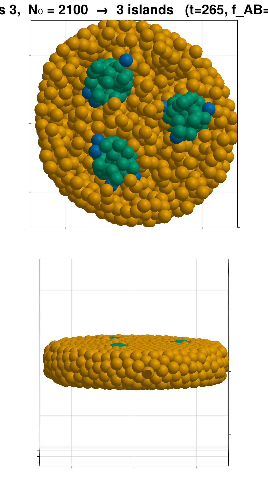
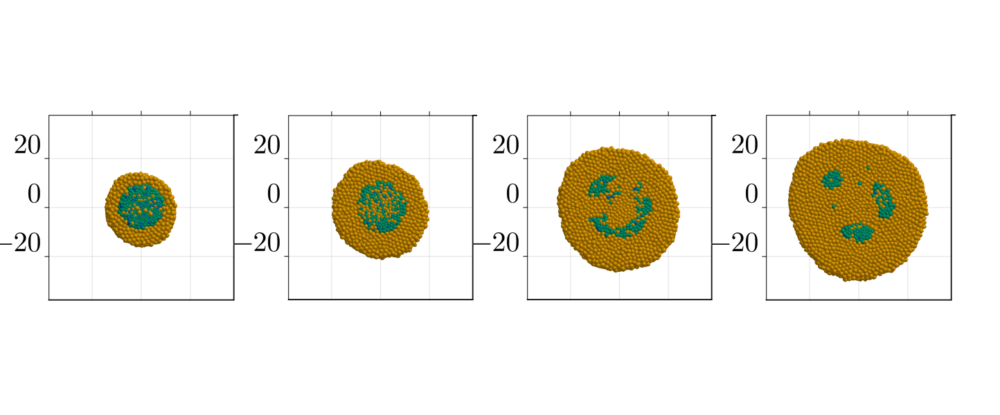
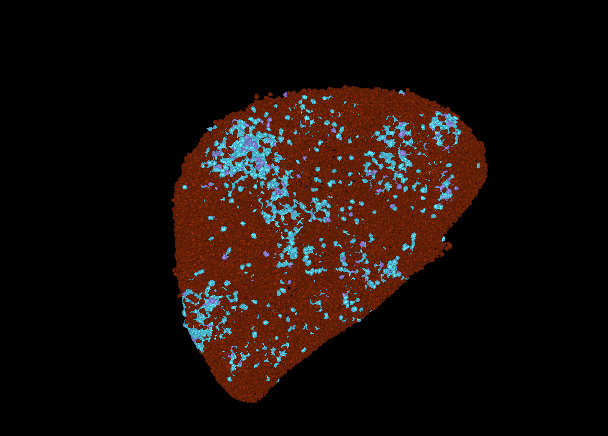
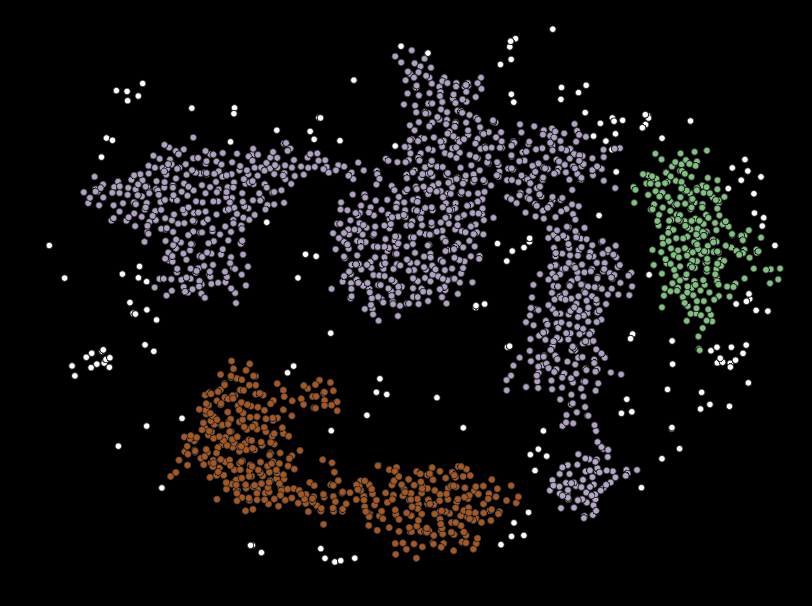

# 01: Repository reorganised (checkpoint 1)

*2026-10-06*

> **Later the same day you renamed the folders:** `original-code/` → `code-original/`,
> `claude-code/` → `code-claude/`, and `pattern-examples/` + `presentations/` → `experiments/`.
> At your request, all reports moved to `reports/`; the living report is now
> **[reports/REPORT.md](../reports/REPORT.md)**. The tree below shows the layout as first proposed.

## What changed

```
squeezing-gastruloids/
├── README.md                  rewritten for the new layout
├── Project.toml, Manifest.toml    moved up from code/: one environment for everything
├── original-code/             YOUR code, untouched
│   ├── squeezing-gastruloids.ipynb    identical to commit f7fd270 (git: R100 rename)
│   ├── plots/                 your figures + movies (pancake_video.mp4, ...)
│   ├── preamble/              your earlier function notebooks
│   ├── images2gif.py
│   └── sotiris/               Sotiris' notebook + sotiris_fusion.png (kept, not used)
├── claude-code/               MY code
│   ├── squeezing-gastruloids-claude.ipynb   July notebook; adapted to B/C in stage 2
│   ├── scripts/               July scripts, repointed; revised in the next stages
│   ├── REPORT.md              the LIVING report (constraints, decisions, results)
│   └── july-2026/             everything superseded from July (own README)
├── claude-answers/            these answers (+ img/)
├── pattern-examples/          untouched
└── presentations/             untouched; now gitignored (1.7 GB)
```

* **Nothing was deleted.** Tracked files were moved with `git mv`, so `git status` shows renames. The changes are staged but **not committed**.
* `.gitignore` now excludes `presentations/` and the July runs (`results/`, `coms/`, 285 MB). The runs are
  still on disk.
* The living report is **[reports/REPORT.md](../reports/REPORT.md)** (originally `claude-code/REPORT.md`). It already records your
  constraints verbatim: BC entries frozen, `q` fixed, no active forces, constant thickness, BC "glue". It also
  holds the decisions log and the piece-by-piece table of the July work.

## Two things to check on your side

1. **An empty `code/` folder is left behind.** Windows refused to delete it because something has it open,
   most likely VS Code or a Jupyter kernel started there. Delete it once that is closed.
2. **If VS Code still has `code/squeezing-gastruloids.ipynb` open in a tab, close it without saving.** A save
   would recreate the file at the old path. In July, an autosave did exactly this kind of overwrite.

## The target, in pictures

What we have and what we want:

| July set (compact, round) | Your first simulations (sparse) |
|---|---|
|  |  |

What the experiments look like:

| 3D rendering (cyan = T/Bra+) | Segmented clusters (white = isolated) |
|---|---|
|  |  |

The experiments differ from the July result in three ways:
- There are **many** domains, not 2–5.
- They are **irregular and loosely packed**, not round.
- There are **isolated T/Bra+ cells** between them, the white points in the segmentation.

My July classifier labelled exactly this kind of texture "dispersed" and treated it as a failure. That changes
in stage 3.

## Next: stage 2 (model and initial condition)

- **Model:** B → C at the constant rate `q`, with no A cells and no feedback. The 3×3 matrices and the colours
  stay.
- **`initialize_diff!`:** B = 60 % of all cells, with a sharp core or a diluted edge.
- **Walls:** a short comparison at 1, 2 and 4 layers of four options:
  - your constant force
  - the July Hookean wall
  - a stiffer Hookean wall per layer
  - a rigid constraint

  Criteria: thickness equal to the nominal number of layers, stability, cost.

At **checkpoint 2** I will show:
- 3D views of the initial condition
- the wall comparison
- one test run with each starting parameter set: your CONFINED PATTERNS set, the July set and the FUSION set,
  all with the BC entries frozen

You then choose the wall and whether to use the diluted edge.

## Questions for you

1. Is the layout right? In particular, is it OK that your `report/` folder now lives in
   `claude-code/july-2026/report/`?
2. Should I commit the reorganisation now as a separate commit, before any code changes? I would not include
   `pattern-examples/` (21 MB) or the July `figures/` (18 MB) unless you want them in git.
