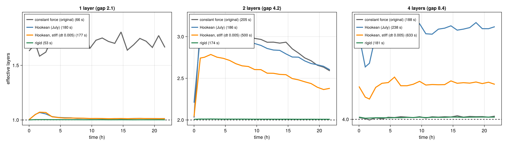
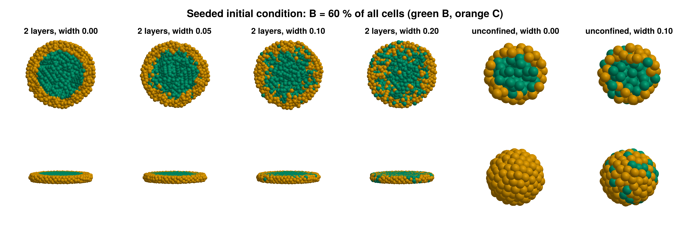
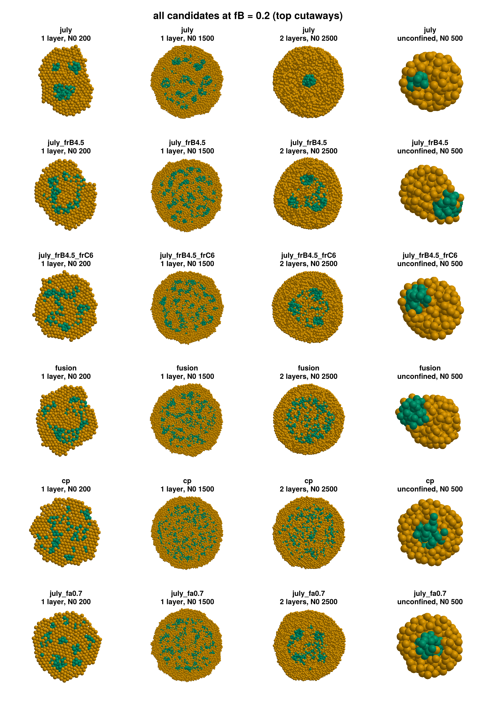
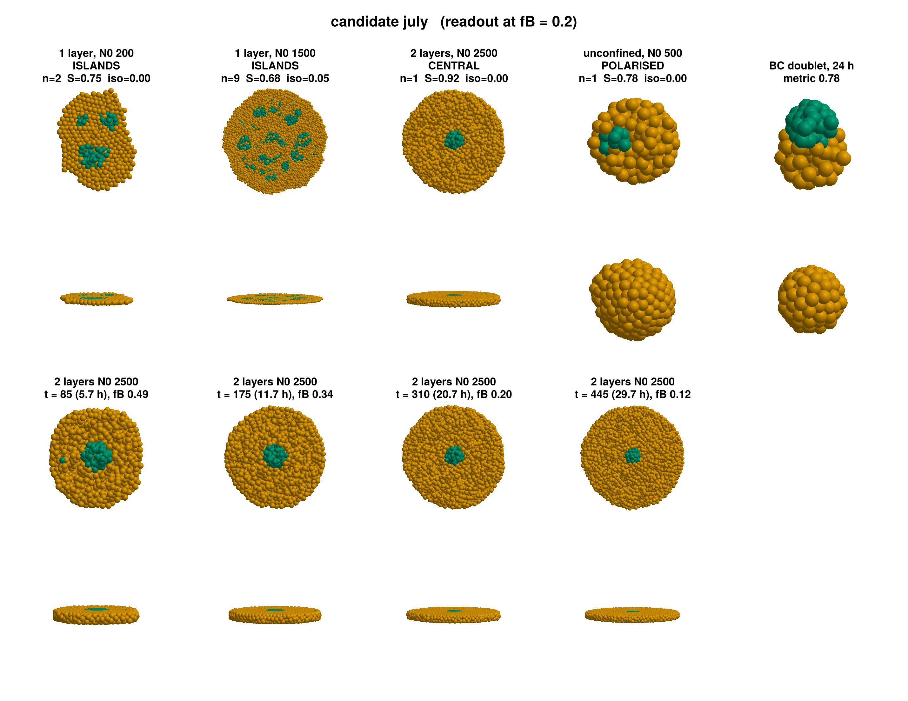
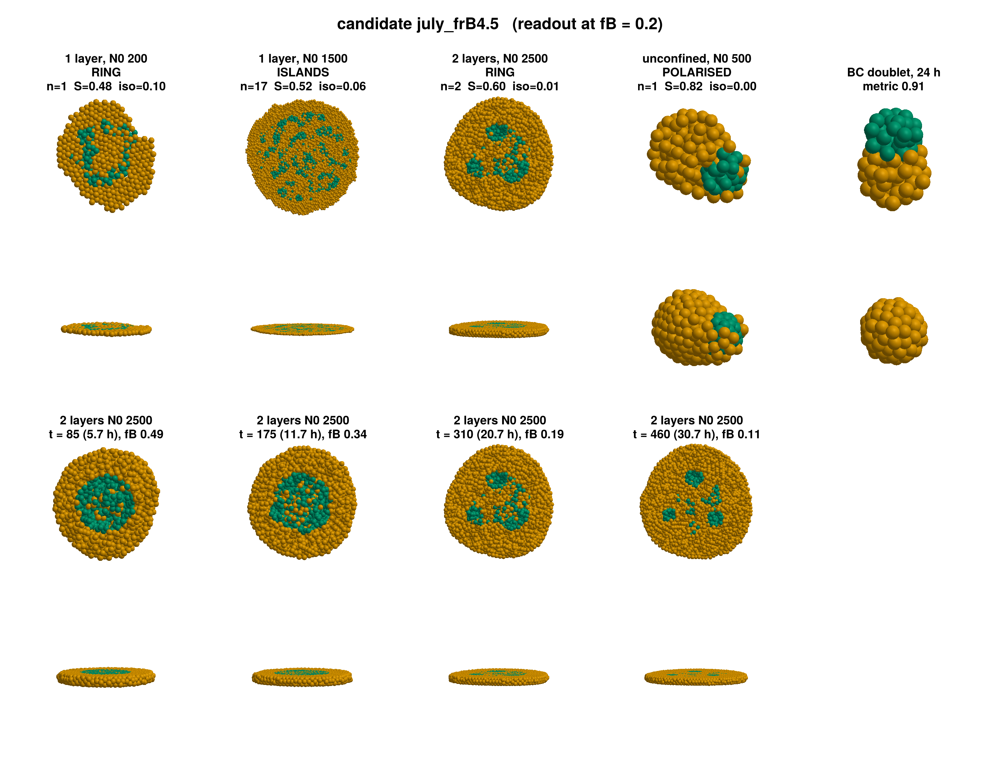
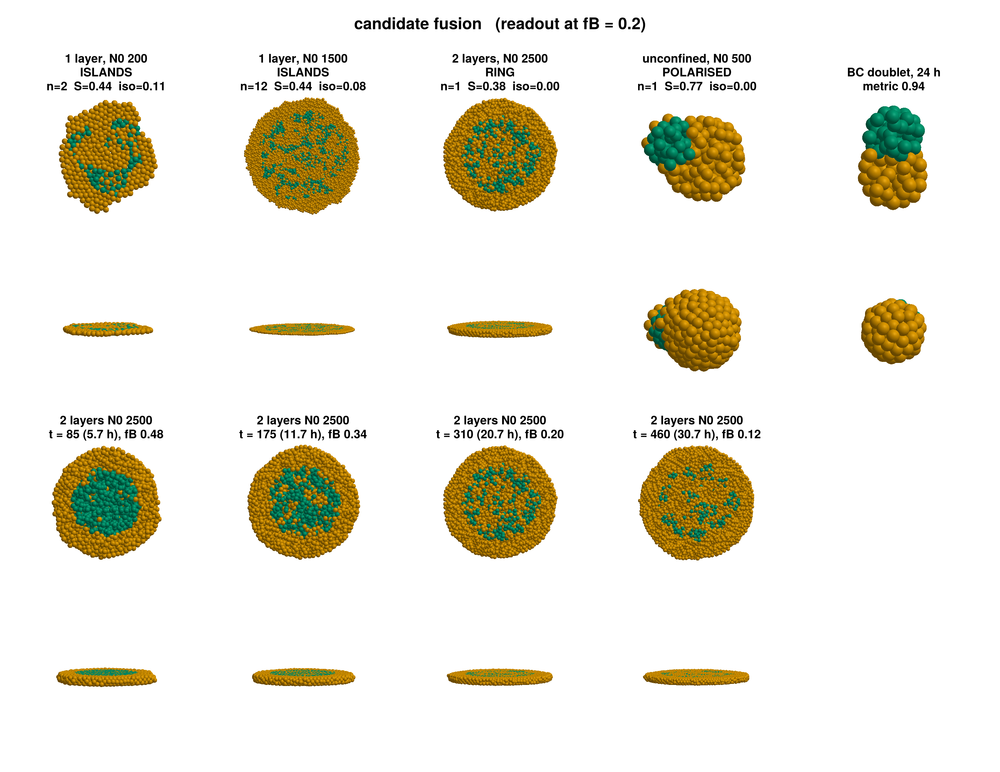
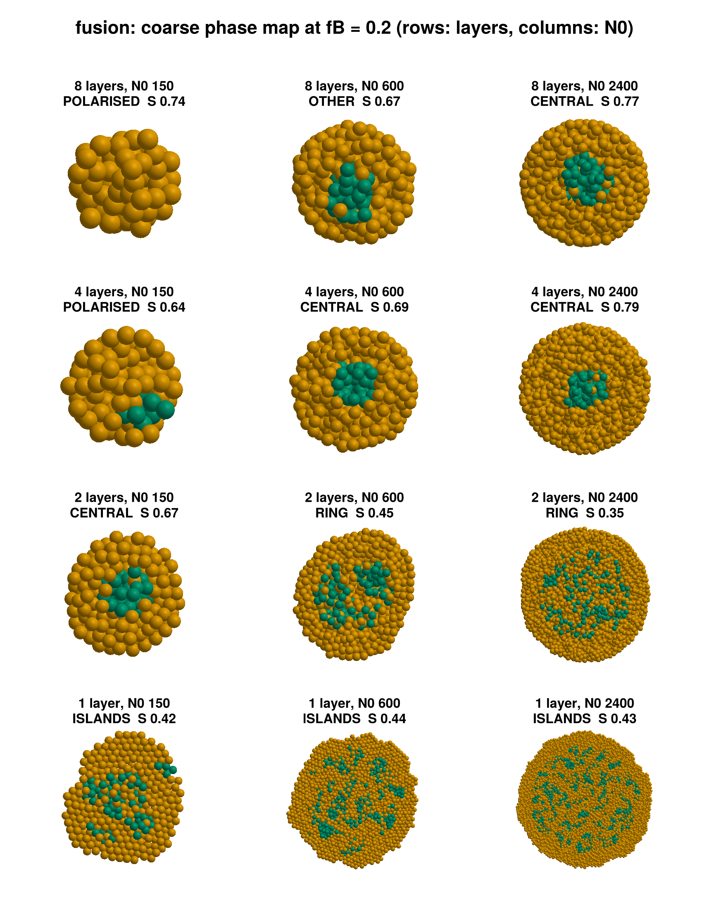
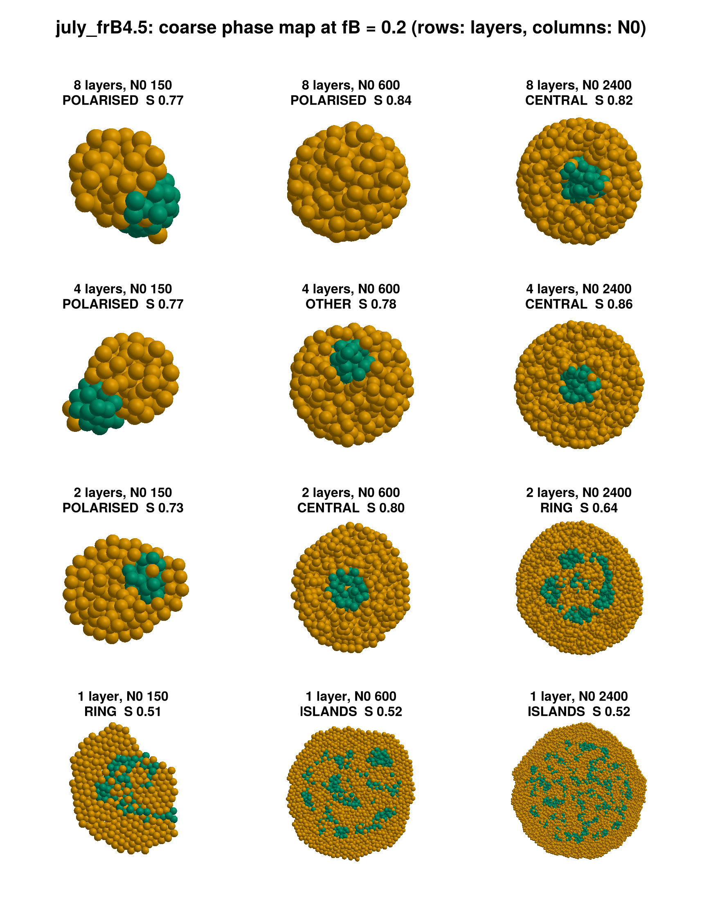
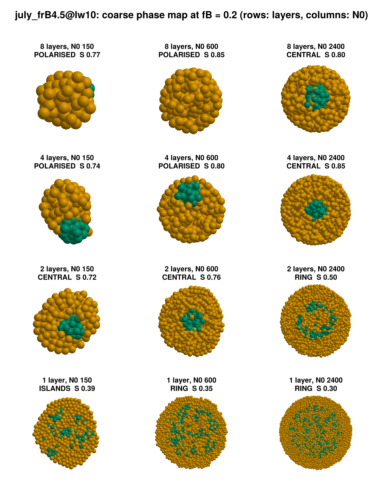

# 02: B/C model, plates, and candidate parameter sets (stages 2–4)

*2026-10-06. The details, numbers and every decision are in [reports/REPORT.md](../reports/REPORT.md).
Physics write-up (draft): [reports/MODEL.md](../reports/MODEL.md).*

## In short

1. **The model is now B/C only.** B makes up exactly 60 % of all cells at the start (sharp core, or a diluted
   edge as in your slides). B → C runs at the constant rate `q`, with no feedback. The constraints from July
   are respected: BC entries frozen, `q`, `lambda`, `alpha_ecm` and `tau_div` untouched, no active forces.
2. **Plates: rigid**, because they are the only ones that keep the thickness at the nominal number of layers
   (§1). Reversible with one keyword.
3. **The sparseness knob is cell stiffness** (`f_rep` BB/CC). Weakening adhesion (`f_att`) instead breaks
   polarisation and turns BC fusion into a sphere.
4. **Sotiris' FUSION set, unchanged, now does everything qualitatively:** sparse patterns, polarisation, and
   BC glue at 0.94.
5. **The coarse phase map of FUSION already shows your three regions** (§4):
   - thin slabs with many cells give patterns, and the threshold grows with the number of layers
   - slabs thick relative to the aggregate polarise
   - central clusters in between

   With a stiffer-B variant, small, thin aggregates polarise instead. **Friction with the plates** fixes
   that but makes everything more salt-and-pepper. It is in the model as an option (off), and I don't
   recommend it.

*How these were made:*
- Scripts in `code-claude/scripts/`:
  - `stage2_walls.jl`, `stage2_ic.jl`
  - `stage4_screen.jl`, `stage4_minimap.jl`, `stage4_gallery.jl`
- Candidates: `stage4_candidates.jl`
- All runs: rigid plates, seed 2345, sharp core unless noted.
- Raw runs and CSVs are in `code-claude/results/` (gitignored).

---

## 1. Plates: why rigid

Effective number of layers over time, for the same aggregate under four plate models:

- **Springs swell the slab.** Any spring settles where in-plane crowding balances it: about 2.6 layers for a
  nominal 2, and still 2.4 with a stiff spring at 2.5× the cost.
- **Rigid plates hold 1.00 / 2.01 / 4.00 layers** at the normal time step.
- **The pattern outcome was the same** whenever the thickness was right.

## 2. Initial condition

B = 60 % of all cells, sharp (left) or with a diluted edge (`width`). Exactly 60 % in every case:

## 3. The parameter screen

All panels are at the experimental readout reference, **fB = 0.2** (≈ 96 h). Rows are candidates; columns are
1 layer N0 200, 1 layer N0 1500, 2 layers N0 2500, and unconfined. Green is B, orange is C, and the top views
are cutaways through the mid-plane.

| row | what changes (BB / CC only) | look | polarises | BC glue (24 h) |
|---|---|---|---|---|
| July | — | compact islands; one compact blob at 2 layers | yes | 0.78 |
| **july_frB4.5** | `f_rep` BB 3 → 4.5 | **loose islands**; ring → islands at 2 layers | yes | **0.91** |
| july_frB4.5_frC6 | `f_rep` BB 4.5, CC 6 | loose islands; ring → islands | yes | 0.86 |
| **FUSION** (unchanged) | `f_rep` BB 6, CC 6 | **very loose**, network-like | yes | **0.94** |
| CONFINED PATTERNS + FUSION BC | weaker `f_att`, `mu` | salt-and-pepper | **no** | 0.55 = sphere |
| july_fa0.7 | `f_att` BB, CC × 0.7 | salt-and-pepper | **no** | 0.53 = sphere |

Each candidate's detail, with the five screens and the 2-layer run through time:

| July (compact) | july_frB4.5 (loose) | FUSION (very loose) |
|---|---|---|
|  |  |  |

**Why stiffness and not adhesion?**
- Every B cell that turns into C inside the B domain has to leave it.
  - In a soft tissue it can, so the B domain stays compact and shrinks (July).
  - In a stiff tissue it cannot, so the domain is perforated and breaks into loose islands.
- Stiffness does not change the tensions, so the equilibrium shapes survive: BC glue and the polarised end
  state.
- Weakening adhesion with BC frozen lowers the B–C interfacial tension. B and C then simply mix: no
  polarisation, and BC rounds up.

## 4. Coarse phase maps

A coarse version of the phase space for the two best candidates: layers {1, 2, 4, 8} × N0 {150, 600, 2400},
one seed each, at fB = 0.2. Rows are layers (thick on top); top cutaways. *(At 8 layers, "polarised" can mean
B went towards a plate, below the cutaway; that is why some of those panels look all orange.)*

| **FUSION** (unchanged) | **july_frB4.5** |
|---|---|
|  |  |

Summary at fB = 0.2 (P polarised, C central cluster, R ring, I islands):

| | FUSION 150 | 600 | 2400 | july_frB4.5 150 | 600 | 2400 |
|---|---|---|---|---|---|---|
| 8 layers | P | C (→P later) | C | P | P | C (→P later) |
| 4 layers | P | C | C | P | (→P) | C |
| 2 layers | **C** | R (→I later) | R | P | C | R (→I later) |
| 1 layer | I | I | I | R | I | I |

**Against your three regions:**
- ✓ **Thin slabs with many cells give patterns** (islands, or a ring that breaks into islands), and the
  threshold N0 grows with the number of layers:
  - FUSION: below 150 at 1 layer, 150–600 at 2 layers, above 2400 at 4 layers.
- ✓ **Thick slabs relative to the aggregate polarise** (small N0 at 4–8 layers). A large aggregate at the
  same thickness stays central, as you said: *"this enough will of course depend on the number of initial
  cells"*.
- ✓ **Central clusters** sit in between: the cluster stays in the middle and differentiates away.
- ✗ **Two things differ from your sketch:**
  1. At 1 layer even N0 = 150 forms a pattern. The threshold there may be below 150; I can check N0 = 50–100.
  2. At 4 layers the smallest aggregate polarises. But 150 cells between plates 4 cells apart are hardly
     squeezed: their free diameter is only about 6 cells.

**Plate friction (optional, §5).** With extra drag on cells touching the plates, small, thin aggregates stay
central for longer. The cost is that the monolayer becomes almost salt-and-pepper, since sorting slows down
too. FUSION already keeps the small 2-layer aggregate central without it, so I would **not** add it unless you
want even sparser monolayers:

## 5. What I need from you to fine-tune

1. **Which look matches the experiments?**
   - (a) July: compact islands
   - (b) **july_frB4.5**: loose islands with some isolated cells. My pick for "sparse but still islands".
   - (c) **FUSION**: very loose, network-like islands. It is Sotiris' set untouched and has the best BC glue
     (0.94).

   Anything between (b) and (c) is one number (`f_rep` BB from 4.5 to 6), so we can tune it.
2. **Rings.** At 2 layers both sets first form a ring of B, which then breaks into islands (by fB ≈ 0.12).
   Count a ring as a pattern? (The continuum model has the same ring stage.)
3. **Readout time.** fB = 0.2 (≈ 96 h) catches the 2-layer patterns while they are still rings; fB ≈ 0.12
   shows islands. Keep 0.2, or use a later one?
4. **Plates.** OK with rigid plates (§1)? And no plate friction?
5. **Initial condition.** The diluted core (`width` 0.1) changed little, so I have kept the sharp core.
   Prefer the diluted one?

Once you choose, the next step is the real phase space:
- a finer N0 grid and more layers (1–12)
- 3 seeds per point
- 3D figures, with their data saved (positions + cell types) and documented in `FIGURES.md`
