# 03: The chosen parameter set and the phase space

*2026-10-07. Built on your answers to 02:*
- *loose islands like july_frB4.5, or a little looser*
- *rings count as patterns*
- *readout at fB = 0.2*
- *plates and core: "whatever works best"*

*Every number and decision is in [reports/REPORT.md](../reports/REPORT.md), the physics in
[reports/MODEL.md](../reports/MODEL.md), and how each final figure was made (initial condition, procedure,
data) in [reports/FIGURES.md](../reports/FIGURES.md).*

## In short

**The chosen set is july_frB4.5_frC6 with plate friction 1.5, sharp core, rigid plates** (`PSETS["final"]`,
`LAMBDA_WALL` in the notebook). Starting from the July/FUSION mechanics, only three numbers change:

| entry | July | FUSION | **final** | what it does |
|---|---|---|---|---|
| `f_rep` BB | 3 | 6 | **4.5** | B stiffness: sets how loose the patterns are (your july_frB4.5) |
| `f_rep` CC | 5.1 | 6 | **6** | C stiffness: keeps a small squeezed B core from sliding to the rim |
| `lambda_wall` | 0 | 0 | **1.5** | friction with the plates: makes that reliable (optional, see §1) |
| everything else | | | unchanged | BC frozen; `q`, `lambda`, `alpha_ecm`, `tau_div` untouched |

**What it gives:**

- ✓ **Your three regions**, in a phase space of about 210 runs (§1):
  - **patterns** in thin slabs with enough cells
  - **polarisation** when the gap is wide compared with the aggregate
  - **a central cluster** in between
- ✓ **Sparse, irregular islands**, a little looser than july_frB4.5. At 2 layers, B first forms a ring that
  breaks into islands.
- ✓ **Polarisation unconfined** for N0 ≤ 600.
- ✓ **BC fusion as glue** (two lobes), while BB and CC round into one sphere.
- ✓ **Every final figure in 3D**, with the cells of every panel saved and a one-call replot (§3,
  `reports/FIGURES.md`).
- ✗ **Three differences from your sketch:**
  - Patterns only at 1–2 layers. At 3+ layers B stays one compact blob.
  - Big aggregates (N0 ≥ 1200) do not polarise within the B phase, not even unconfined, so thick slabs with
    many cells come out "central".
  - The smallest monolayers (75–150 cells) already pattern in most runs.

Three things came out of the tuning that differ from what we had assumed:

1. **The diluted core is worse.** With 25 % of the B cells outside the core, small squeezed aggregates
   polarise (20 of 21 runs), so I kept the sharp core: your rule was "if equal, dilution".
2. **Small thin aggregates slide.** Without friction a small B core between close plates slides to the rim in
   about 1 run in 3, before it can break up. Stiff C plus gentle friction with the plates keeps it
   central.
   - Friction 1.5 is enough.
   - Friction 3 (or 10, as in stage 4) makes the big monolayers nearly salt-and-pepper.
3. **One classifier fix.** At fB = 0.2 a compact central disc sits exactly on the old CENTRAL threshold, so
   slightly loose central clusters were called rings. A "centre fill" test fixes it; all runs are re-scored.

---

## 1. The phase space

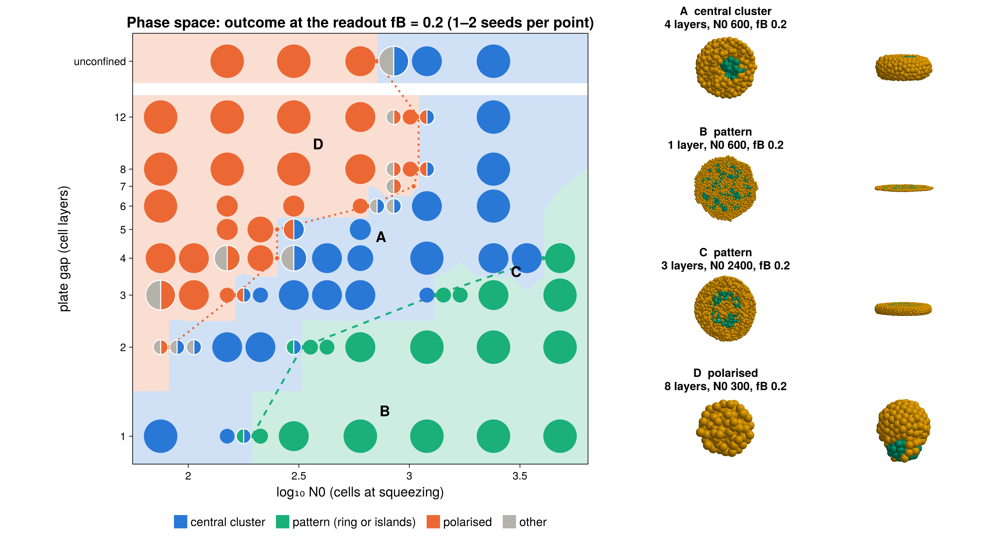

**How to read the chart:**
- **Each point is a pie** of its seeds' outcomes at the readout fB = 0.2 (3 seeds, 5 at the noisy smallest
  points).
- **The background** is the majority outcome of the nearest point.
- **Lines:** where patterns start (dashed) and up to where the aggregate polarises (dotted).
- **The top row "free"** is the same mechanics with no plates.
- **The 3D insets** A, B and C are the example of each region at the readout: top view (mid-plane cutaway)
  and side.

**The grid:**
- layers 1, 2, 3, 4, 6, 8, 12 × N0 75 … 4800, 3 seeds per point
- three rounds of refinement where neighbouring points disagree (N0 106 … 1697, layers 5 and 7)

| | what the model does |
|---|---|
| **patterns** | 1 layer: at every N0 down to 75 (islands; mixed with central at 75–150). 2 layers: from N0 ≈ 1300 (a ring that breaks into islands). 3+ layers: none up to 4800. |
| **polarised** | when the gap is wide compared with the aggregate. The boundary N0 is ≈ 75–106 at 2 layers, ≈ 180–210 at 3, ≈ 250–300 at 4, ≈ 500–700 at 6–12, and ≈ 600–1200 unconfined. |
| **central cluster** | everything in between: small aggregates at 2 layers, and every aggregate of N0 ≥ 1200 that is not a thin slab |

**Against your sketch** (`notes/3d-simulations presentation idea.jpg`, panel C):

| your sketch | the model |
|---|---|
| polarisation top-left, its boundary rising from ≈ 3 layers at small N0 to the unconfined row at log N0 ≈ 2.8 | ✓ the same: polarised from 2–3 layers at N0 ≤ 180, from 6 layers at N0 ≤ 500; unconfined up to N0 600 (log 2.8) |
| a "no polarisation" band in between | ✓ the central-cluster region |
| patterns at large N0, from log N0 ≈ 2.2 at 1 layer to ≈ 3 at 6 layers, and even unconfined beyond ≈ 3.1 | ✗ at every N0 at 1 layer, and from N0 ≈ 1300 at 2 layers; thicker slabs and big free aggregates keep one compact B blob |

So the polarisation side matches. The pattern side is the main open problem (§4).

**What it means:**
- **The pattern threshold rises steeply with thickness.** In a monolayer every newly made C cell is trapped
  inside the B domain and splits it. From 3 layers on, C cells can leave the domain upwards and downwards,
  to the plates, so B stays one compact blob: spread 0.12–0.15 and S ≈ 0.9, the July picture.
- **Big aggregates do not polarise in time.** Unconfined:

  | N0 | 150, 300, 600 | 1200 | 2400 |
  |---|---|---|---|
  | at fB 0.2 | polarised | central (polarises later in 1 seed of 2) | central |
  | largest offset in the whole run | — | — | 0.08 |

  So "many layers → behaves as unconfined" holds, but unconfined means central for N0 ≥ 1200.
- **Timing matters at the boundaries.** Read later, at fB = 0.12, rings have become islands and some
  drifting aggregates have polarised:

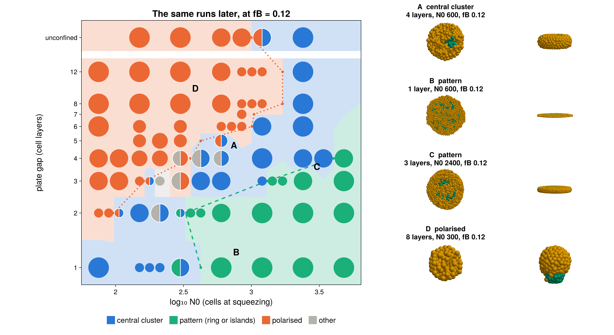

**Without friction** (`phase_A0`, the same grid, seed 1):

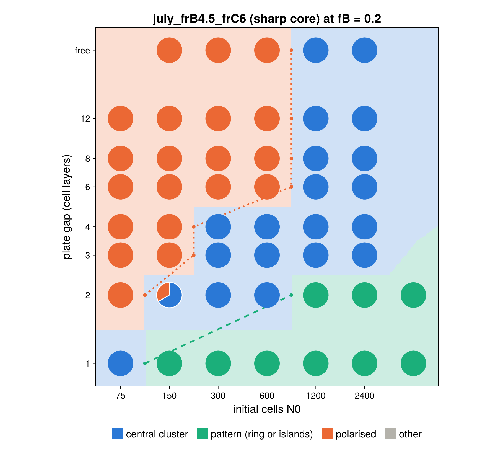

**Nearly the same map.** The same three regions, with the boundaries within one grid step. Plate friction
only changes the edges:

| point | with friction 1.5 | without |
|---|---|---|
| 2 layers, N0 150 | central in 3 of 3 seeds | central in 2 of 3 (1 polarises) |
| 1 layer, N0 75 | mixed pattern / central | central in 3 of 3, closer to your sketch |
| monolayer islands | S ≈ 0.44 | S ≈ 0.49, closer to july_frB4.5 |

So friction is a fine-tuning choice, not essential. It makes the small 2-layer central cluster reliable, at
the price of slightly looser monolayers. Dropping it is one number (`LAMBDA_WALL = 0`), and the friction-free
runs are all saved.

**Later readout.** At fB = 0.12 (`phase_space_late`, above) the map moves towards your sketch:
- At 1 layer, the smallest aggregates (N0 ≤ 212) count as central: only one small cluster near the centre
  is left.
- The polarised region reaches N0 ≈ 850 at 8–12 layers.

---

## 2. How the set was chosen (3 seeds per test point)

### 2.1 Sharp vs diluted core, and why friction

2 layers, N0 150, a "few layers, few cells" point that should stay central. Set july_frB4.5_frC6. Each row
is one start; the columns are three seeds at the readout:

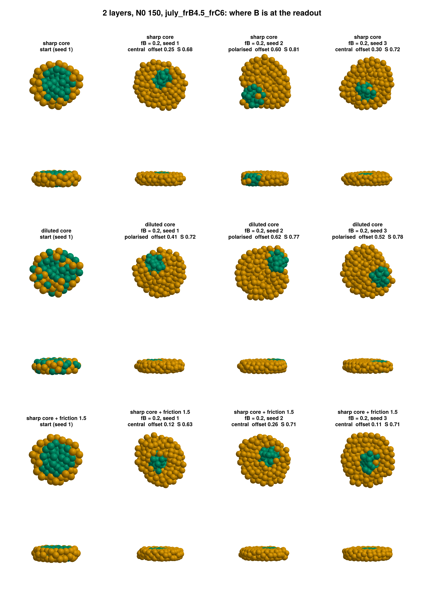

| start | B offset at the readout (0 = centre, 1 = rim), 3 seeds | central |
|---|---|---|
| sharp core | 0.25, **0.60**, 0.30 | 2 / 3 |
| diluted core (75 % of B inside) | **0.41, 0.62, 0.52** | 0 / 3 |
| **sharp core + friction 1.5** | 0.12, 0.26, 0.11 | **3 / 3** |
| sharp core + friction 3 | 0.17, 0.29, 0.01 | 3 / 3 |

**Diluted core.**
- The B cells outside the core make B patches near the rim, and the core moves to join them.
- It is the same for all seven sets tried: 20 of 21 diluted runs had polarised by fB 0.15.
- So, by your rule, the sharp core. The diluted start is still available with `f_in = 0.75`.

**Why friction.**
- **Frictionless plates let the core slide.** A B core in a thin slab glides sideways as easily as a free
  aggregate polarises.
- **Plate friction targets exactly that.** `lambda_wall`, already in the model since stage 4, mostly slows
  *collective* sliding: neighbours drag each other, so a whole domain feels the plate drag of all its
  cells. Sorting is hardly slowed: one cell rearranging is about 1.25× slower at 1.5.
- **Thick slabs barely feel it**, since few of their cells touch a plate. 4 layers, N0 150 still polarises.
- **Stiff C matters too.** Friction alone did not hold july_frB4.5's softer C (CC 5.1): offsets 0.29, 0.59,
  0.58 even at friction 3.

### 2.2 How much friction: the monolayers decide

Friction slows sorting most where every cell touches a plate, so the monolayers show its cost:

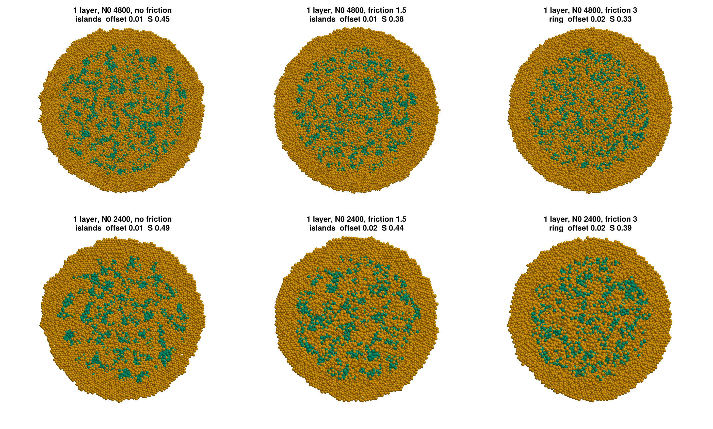

| 1 layer | no friction | **friction 1.5** | friction 3 |
|---|---|---|---|
| N0 2400, S | 0.49 | **0.44** | 0.39 |
| N0 4800, S | 0.45 | **0.38** | 0.33 |

`S` is the B fraction around a B cell: 1 = compact, ≈ 0.2 = random mixing at this fB.

### 2.3 How loose the patterns are

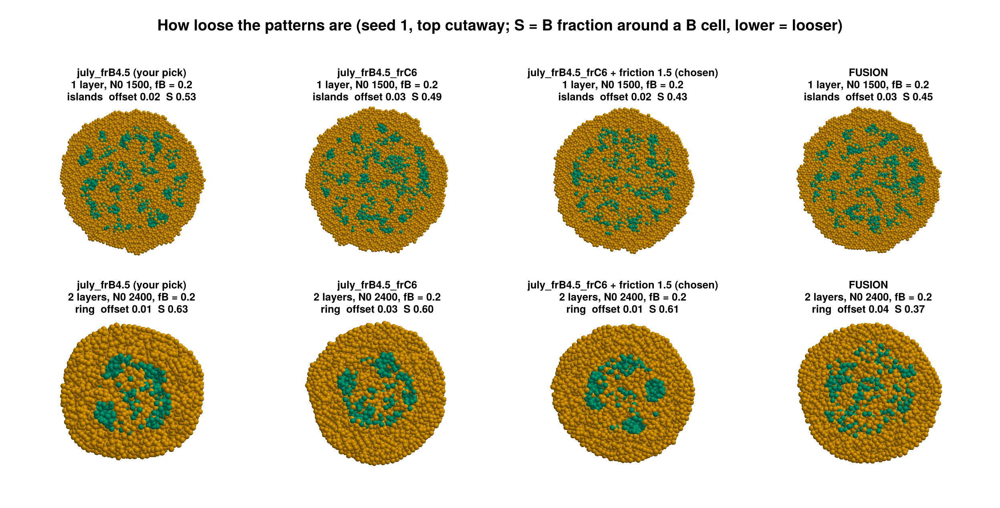

| set | 1 layer, N0 1500 | 2 layers, N0 2400 |
|---|---|---|
| july_frB4.5 (your pick) | islands, S 0.53 | ring → islands, S 0.63 |
| july_frB4.5_frC6, no friction | islands, S 0.48–0.50 | ring → islands, S 0.60–0.62 |
| **final (friction 1.5)** | islands, S 0.42–0.46 | ring → islands, S 0.54–0.61 |
| FUSION | islands, S 0.41–0.45 | network-like ring, S 0.29–0.37 |

So the final set is "a little more loose" than your pick, as you allowed: noticeably in monolayers, barely at 2
layers.

### 2.4 Polarisation and BC glue

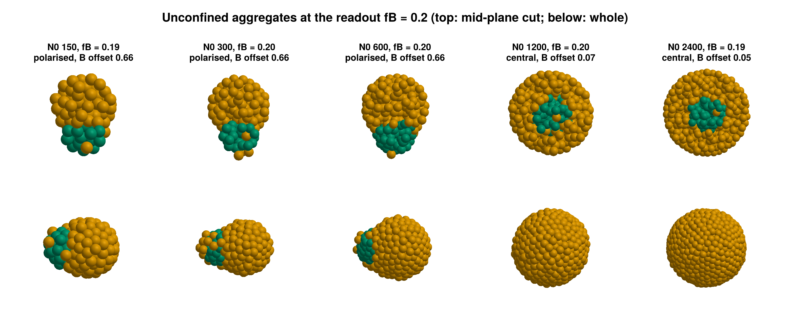

- **Unconfined** (no plates, so no friction): B polarises at N0 150–600 in every seed (offsets 0.41–0.68 at
  the readout). At N0 1200 and 2400 B is still central when it runs out.
- **BC glue**, 24 h doublet: BC 0.86 against BB 0.53 and CC 0.56.
  - BB and CC round into one sphere (≈ 0.5); BC stays two lobes stuck together (1.6 = just touching).
  - Stiffer C costs a little glue: july_frB4.5 gave 0.92.

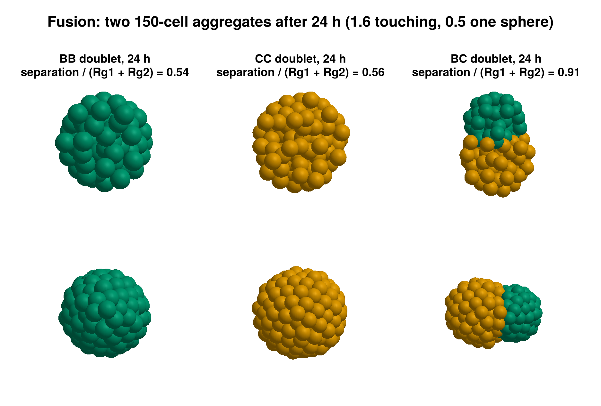

### 2.5 The classifier fix

At the readout a compact central B disc has spread (2/3)√0.2 ≈ 0.30, exactly the old CENTRAL threshold, so
small, slightly loose central clusters came out as RING or OTHER. These were labelled by the **old**
classifier:

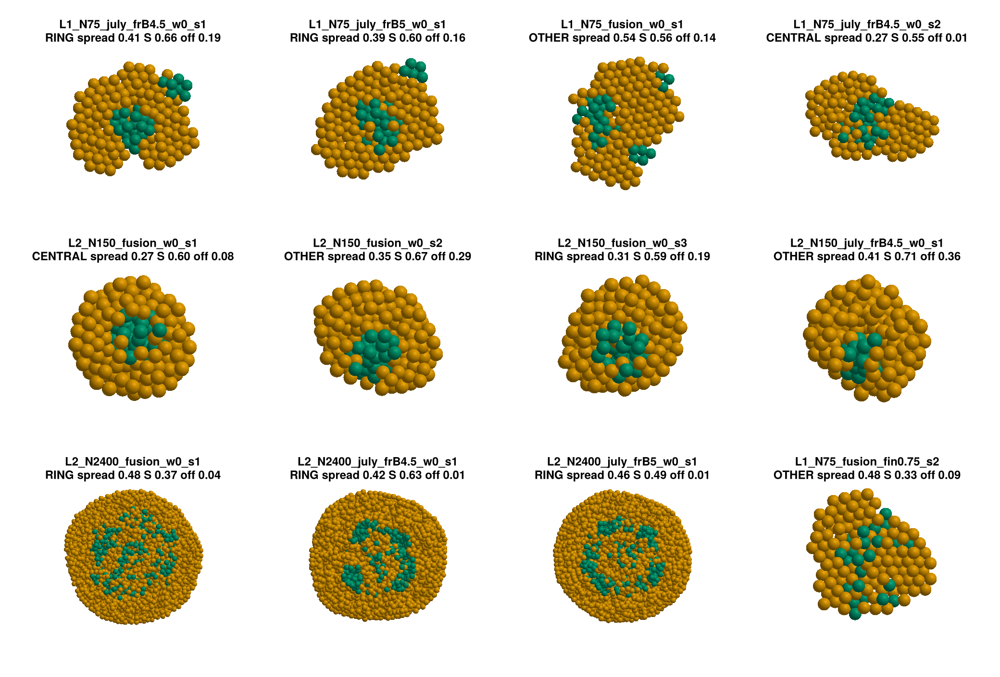

- **New statistic, `fill`:** the B fraction of the cells in the middle, within 0.7 × the radius a compact
  disc of the current B would have.
  - By eye, central clusters have 0.65–0.85; rings and islands have 0.24–0.41.
- **New rule:** CENTRAL if spread < 0.30, or if the largest cluster holds half of B **and** fill ≥ 0.55.
- **Re-scoring:** every run is re-scored from its trajectory (`scripts/stage5_common.jl`).

---

## 3. The final figures

All 3D, all redrawn from `code-claude/figures/data/` alone (`replot_figures`, last notebook cell).
`reports/FIGURES.md` gives, for each, the runs, frames and procedure.

**fig1, the initial condition.** B is 60 % of the cells. Sharp core (used) vs diluted (75 % inside),
squeezed and free:

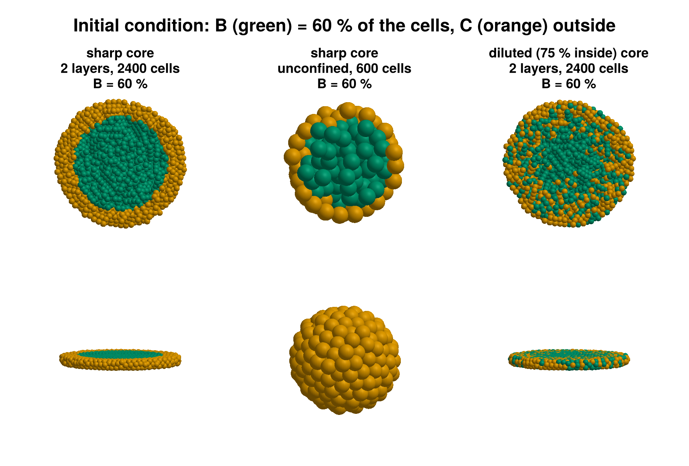

**fig2, your panel B.** The same aggregate (N0 600) under no confinement (polarises), medium confinement (4
layers: a central cluster that shrinks) and strong confinement (1 layer: islands). Columns: fB 0.6 → 0.45 →
0.3 → **0.2 (readout)** → 0.12. Top: mid-plane cutaway; below: side.

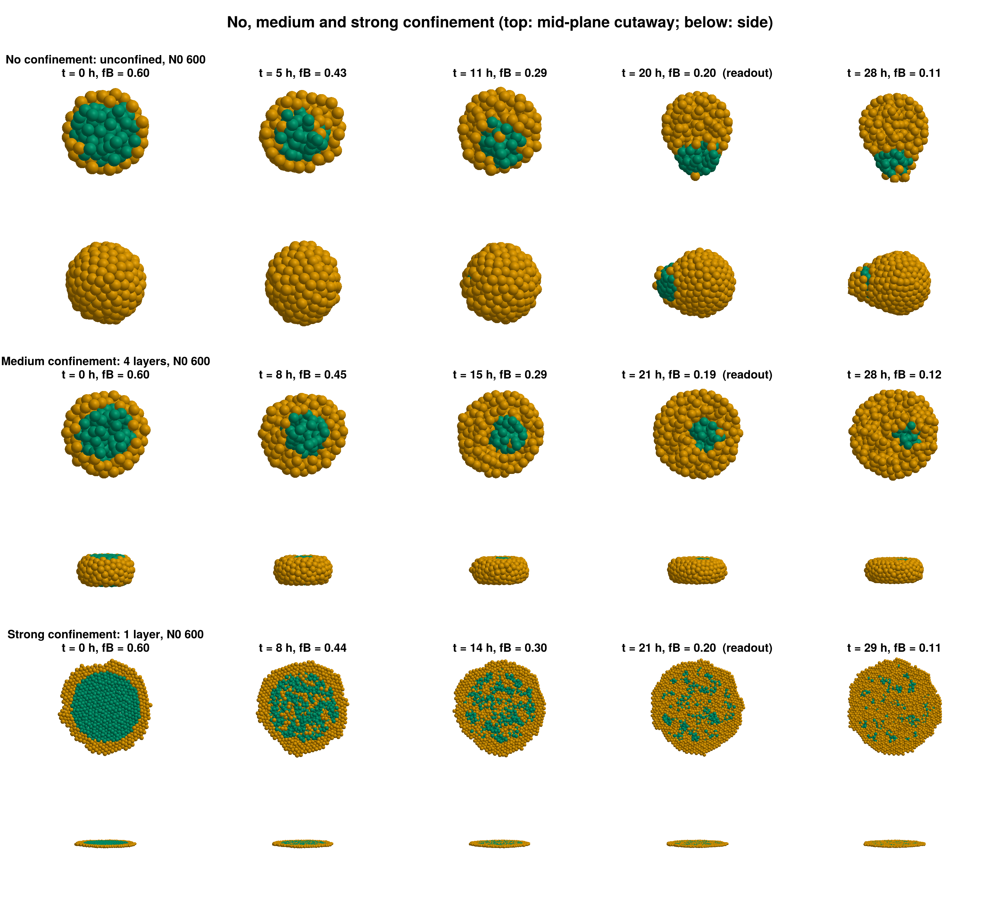

**fig3, the patterns at the readout**, at every pattern point (seed 1):

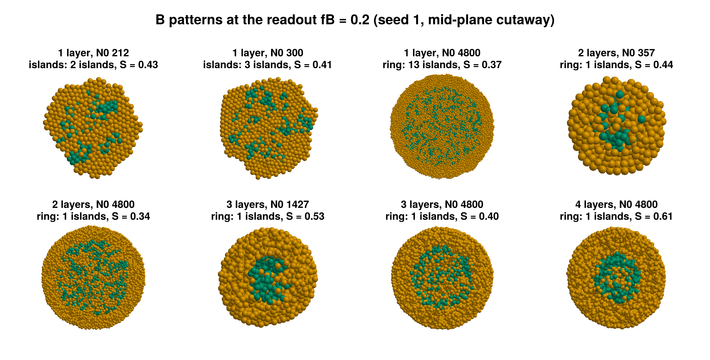

**fig4 (unconfined polarisation) and fig5 (fusion)** are shown in §2.4.

**Movies** (one frame per hour, seeding → fB 0.1; top cutaway and side), in `code-claude/figures/movies/`:
- [central.mp4](../code-claude/figures/movies/central.mp4)
- [pattern.mp4](../code-claude/figures/movies/pattern.mp4)
- [polarised.mp4](../code-claude/figures/movies/polarised.mp4)
- [unconfined.mp4](../code-claude/figures/movies/unconfined.mp4)

**Data.** `code-claude/figures/data/<figure>/` holds every panel's cells (`x, y, z, r, cell_state`) as CSV
and JLD2, with the source run in `meta`. The phase spaces also have `phase_space.csv` (one row per run, all
classes and readout statistics) and `free.csv`. The movie trajectories are in `data/movies/`. In all,
≈ 9 MB of data, ≈ 4 MB of movies and ≈ 8 MB of PNGs.

---

## 4. What you might want to check or change

1. **Plate friction (`LAMBDA_WALL` = 1.5) is a modelling choice.** It stands for adhesion to, or rubbing on,
   the confining surfaces. Is that plausible for the experimental setup?
   - Without it the phase space looks the same except at small, thin aggregates, which slide to the rim
     about 1 time in 3 (the friction-free map above).
   - Setting it to 0 is one number.
2. **Patterns in thick slabs, and in big free aggregates, as in your sketch.** This is the main mismatch.
   - **Why the model doesn't do it:** B breaks into islands only when the C cells made inside the B domain
     cannot get out. In a thin slab they are trapped; from 3 layers on they slip out vertically, and in a
     free aggregate they slip out to the surface. So B stays one compact blob and just shrinks.
   - **What the allowed knobs do:** stiffer cells slow this escape, but even FUSION (BB 6) stays central at
     4 layers, N0 2400 (stage 4), and the patterns get much looser.
   - **What would shift it:** sorting slower relative to conversion. That means a higher tissue friction
     (`lambda`, `alpha_ecm`) or a faster B → C (`q`), both of which we kept fixed.

   Do you want me to try one of them, or is the 1–2-layer pattern region acceptable?
3. **Looseness.** The monolayers (S ≈ 0.44) are looser than july_frB4.5 (0.53). Less friction or a softer
   B tightens them, at the cost of the central region. Tell me if they should be more compact.
4. **Readout.** fB = 0.2 catches the 2-layer patterns as rings. At fB 0.12 they are islands
   (`phase_space_late`).
5. **What is not committed yet:** everything since commit 5316b35 (code, reports, answers, `figures/` ≈ 21
   MB). The raw runs in `code-claude/results/` (2 GB) stay out of git. Say if you want it committed.
