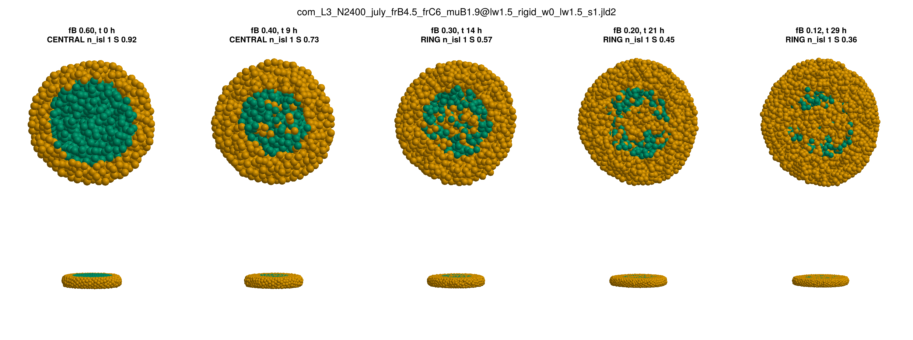
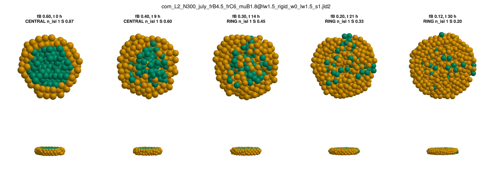
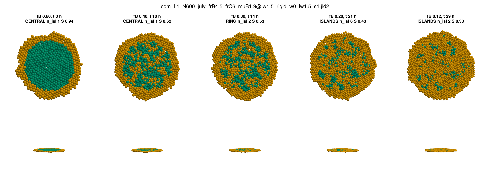
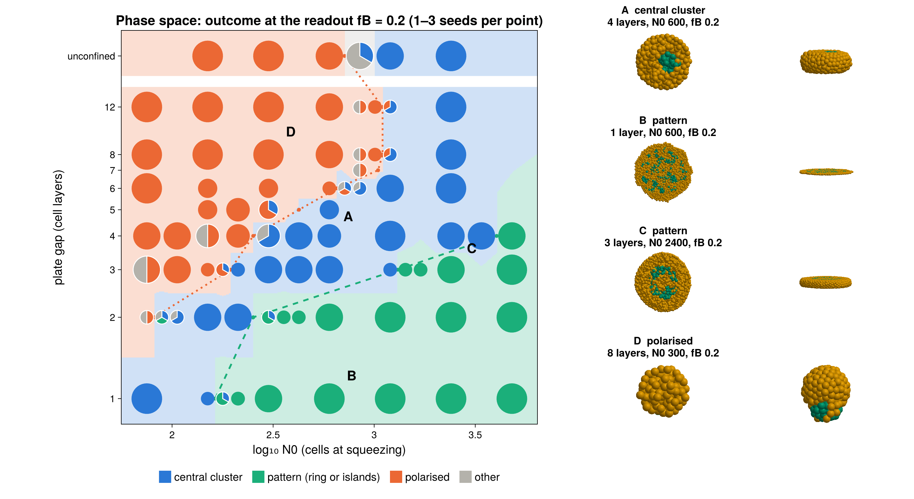
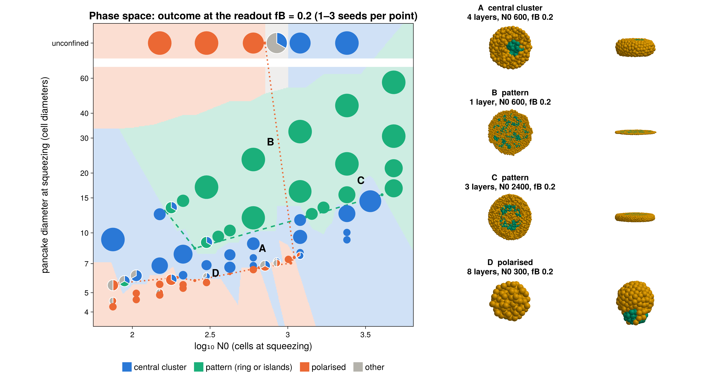
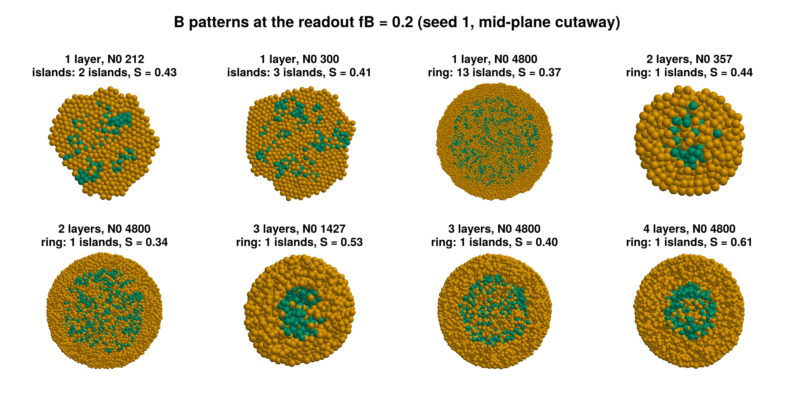
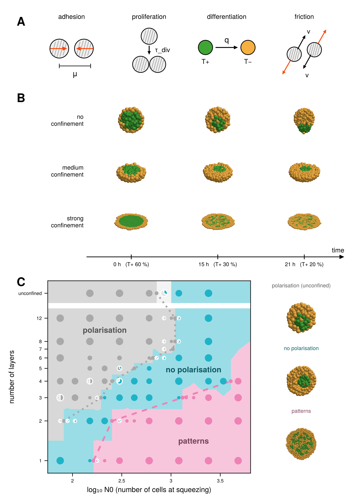
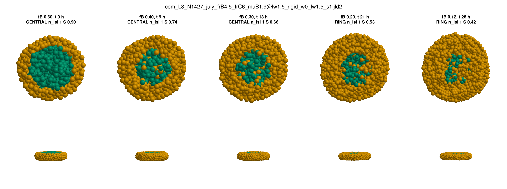

# 04: Your July commit, patterns in thick slabs, the phase-space plots, the presentation PDF

*2026-10-08, overnight. Your four tasks, in order. The details are in [reports/REPORT.md](../reports/REPORT.md)
(decisions log, 10-08, and "Stage 7"), the physics in [reports/MODEL.md](../reports/MODEL.md), and how every
figure is made in [reports/FIGURES.md](../reports/FIGURES.md).*

## In short

1. **Your July commit** is merged into `dev` and sorted into the repo layout, with a README in each folder.
2. **Patterns in slabs of 3+ layers: yes.** None of your three ideas did it on their own: B 65 %, a
   salt-and-pepper start, or other plates. What did it is **one more BB entry, `mu` BB 2 → 1.9**, a shorter
   B–B attraction range, so B is a little less cohesive.
   - **Thick slabs:** a big B core hollows into a ring, then islands.
   - **Unchanged:** small cores stay central, monolayers pattern, the free aggregate polarises, BC glues.
   - **Constants:** BC entries, `q`, λ and α_ecm are untouched.

   This is the new final set. The phase space was rerun with it, and the Oct 7 set and its figures are kept.
3. **The phase space comes in four versions:** y = number of layers or pancake diameter at squeezing, against
   x = N0 or log₁₀ N0.
4. **The presentation PDF** follows your sketch (A model, B no / medium / strong confinement over time,
   C phase space), in your colours: `code-claude/figures/presentation.pdf`.

**The new phase space** (177 runs, 2–3 seeds per point) has your three regions, now with patterns at 1–4
layers:

| layers | polarised up to N0 | central cluster | patterns from N0 |
|---|---|---|---|
| 1 | — | 75–150 | ≈ 160 |
| 2 | 75 | 89–212 | ≈ 250 |
| 3 | 150–178 | 212–1200 | ≈ 1300 |
| 4 | 212 | 300–3394 | between 3394 and 4800 |
| 6–12 | 600–1000 | above that, up to 2400 | none up to 2400 |
| unconfined | 600 | 849–2400 | none up to 2400 |

**The diameter plots (task 3) show why the threshold rises so steeply.** Over 1–4 layers the pattern
threshold spans N0 ≈ 170–4000, a factor of 25, but only about 8–17 cell diameters in pancake width
(≈ 80–170 µm if a cell is 10 µm across):
- 2 layers: patterns from D ≈ 8.5
- 3 layers: from D ≈ 12
- 4 layers: from D ≈ 15.5
- 1 layer: from D ≈ 13

So most of the effect is that thicker slabs need many more cells to reach the same width. The width needed
still rises a little with thickness.

---

## 1. The July commit from your laptop

`git pull` gave a merge commit (`aede782`, merging your 2772c15 into my local reorganisation commit). Nothing
is pushed. Your commit added two folders that predated the reorganisation; this is where their files went:

| your file | now | what it is |
|---|---|---|
| `report-july-tex/main.tex`, `refs.bib`, `confined-gastruloids-report.pdf`, `main.synctex.gz` | `reports/july-2026/report/` | your LaTeX report on the July work |
| `report-july-tex/*.png, *.jpg` (14 images) | already in `reports/july-2026/report/` | byte-identical copies; the duplicates were dropped |
| `report-july-tex/3layers-islands.png`, `example-aggregate.png`, `sotiris_fusion-edit.jpeg` | `reports/july-2026/report/` | the images only the LaTeX report uses (`3layers-island.png` there was the same image under another name and is now `3layers-islands.png`, the name `main.tex` uses) |
| `report-july-tex/REPORT.md` | `reports/july-2026/report/REPORT.md` | my July markdown report with your title. The old copy is still `reports/july-2026/REPORT.md`. |
| `code/code-old-july-anothermachine/squeezing-gastruloids.ipynb` | `code-original/july-laptop/` | **your** notebook, a variant of `code-original/squeezing-gastruloids.ipynb` (README there) |
| `code/code-old-july-anothermachine/squeezing-gastruloids-2.ipynb` | `code-claude/july-2026/squeezing-gastruloids_claude-july_laptop.ipynb` | **my July notebook as you edited it**: shorter introduction, and a four-verdict phase plot |

**What the "code you don't remember" is.** Your laptop notebook is your original notebook with three named
parameter sets you can switch between (`params_tuned = params_pol`):

| set | what it is |
|---|---|
| `params_pol` (UNCONFINED POLARISATION) | `mu` 2, `f_rep` 3 (CC 5.1), `f_att` [6 6 2.4; 6 6 1.6; 2.4 1.6 4.8] |
| `params_pat` (CONFINED PATTERNS) | the same with `f_att` halved |
| `params_fus` (FUSION) | Sotiris' set |

Its seeding is the interesting part: `initialize_diff!(com; g_on = false, cluster = true, center = 0.8,
a0 = 0.15, b0 = 0.75)`. It shuffles a core of radius 0.8 R into 75 % B, 15 % A and 10 % C. That is the
salt-and-pepper start you were thinking of in task 2.

---

## 2. Patterns in slabs of 3+ layers

### What July did that we were not doing

| | July | Oct 7 set |
|---|---|---|
| cell types | A → B → C, both rates slowed by the A fraction | B → C at `q` |
| core | radius 0.8 R, **shuffled: 75 % B, 15 % A, 10 % C** | the innermost 60 %, pure B |
| `f_rep` BB / CC | 3 / 5.1 | 4.5 / 6 |
| plates | springs: "3 layers" was really ≈ 3.5, "4" ≈ 4.5 | rigid, exact thickness, friction 1.5 |
| what counted as a pattern | ≥ 2 islands still there at the end of the run (2–3 islands at 3–4 layers, the largest 40–53 %) | the class at fB 0.2 |

### What I tried (3 layers, N0 2400, the run that has to pattern)

All runs use seed 1. "Central" means one compact blob. S is the looseness: about 0.9 for a compact blob,
0.4–0.6 for the loose patterns of thin slabs.

| change | class at the readout | S |
|---|---|---|
| **your ideas** | | |
| B 65 % instead of 60 % | central | 0.88 |
| salt-and-pepper, B scattered outside the core (90 % / 80 % / 70 % of B inside) | central | 0.88 / 0.86 / 0.89 |
| salt-and-pepper, **C mixed into the core as in July** (10 / 20 / 30 % of the core) | central | 0.89 / 0.91 / 0.89 |
| B 65 % and either of the above | central (also at 4 layers) | 0.88–0.89 |
| spring plates (July) instead of rigid | central | 0.91 |
| plate friction 5 instead of 1.5 | central | 0.89 |
| **the July mechanics** (`f_rep` BB 3, CC 5.1), with each of the above | central | 0.90–0.93 |
| **other BB / CC entries** | | |
| `f_att` CC 3 → 3.6 (stickier C) | central | 0.88 |
| `f_att` BB 6.4 → 5.6 (less sticky B) | central, looser | 0.72 |
| **`mu` BB 2 → 1.9 (shorter B–B range)** | **ring, islands by fB 0.12** | **0.45** |
| `mu` BB 1.85 / 1.8 | ring | 0.35 / 0.30, but B dissolves (below) |
| **slower mechanics** (λ × 2, 3, 4; you said only if nothing else works) | central (λ × 4: a ring only by fB 0.15) | 0.84 / 0.66 / 0.52 |

**Why the July runs could do it and the B/C model could not**:
- **The A cells and their feedback are gone.** The July mechanics without A, with the July seeding and the
  July plates, still make one blob.
- **The July plates were softer than they looked.** "3 layers" was ≈ 3.5 effective layers, but in our tests
  the spring plates do not change the outcome either.

**Why a thick slab keeps one blob.**
- **Thin slabs:** in a slab of 1–2 layers, the C cells that appear inside the B core cannot get out, because
  cells cannot pass each other there. The core is cut into a ring and islands.
- **Thick slabs:** from 3 layers on, cells pass over and under each other. With the Oct 7 cohesion, B
  squeezes the new C cells out and stays one blob.
- **Seeding doesn't help:** even a core started with 30 % C re-sorts into one blob within a few hours.

**What changes it is B–B cohesion.**
- **The B–B adhesion energy:** `mu` BB is the reach of the B–B attraction. 2 → 1.9 lowers that energy from
  1.02 to 0.79, still above C–C's 0.65, so B is still the more cohesive tissue.
- **Small cores** stay compact and central.
- **A big core in a thick slab** hollows out into a ring (fB 0.3), which breaks into islands (fB 0.12):



- **It is the energy, not the range.** `mu` BB 1.8 with `f_att` BB raised to 11.1 keeps the old energy and
  gives the old compact blob (S 0.91). `f_rep` and `f_att` changes that move the energy less (`f_att` BB 5.6)
  only loosen the blob.
- **1.85 is already too far.** B–B is then about as cohesive as C–C, and B just dissolves into C,
  even in small aggregates:



**The checks with `mu` BB 1.9** (seed 1 unless noted):

| check | result |
|---|---|
| small aggregate, 2 layers N0 150 / 300 | central (2 seeds each; one N0 300 seed is a loose cluster the classifier calls ring, see "what is left") |
| 3 layers N0 1200 | central: the 3-layer threshold is between 1200 and 2400 |
| monolayer N0 600 | sparse, irregular islands (6, S 0.43), closer to the experiments than the Oct 7 set |
| unconfined N0 600 | polarises (B offset 0.66) |
| BC fusion | BC 0.91: glues, nearer Sotiris' 0.95 than the Oct 7 set's 0.86. BB 0.54 and CC 0.56 fuse. |
| BC entries, `q`, λ, α_ecm, `tau_div` | unchanged |



So it is the new final set: `PSETS["final"]` in the notebook, `"july_frB4.5_frC6_muB1.9@lw1.5"` in the
scripts. The Oct 7 set is `PSETS["final_oct7"]`, and its figures (also redrawn the four ways, with the PDF)
are in `code-claude/figures-oct7/`.

---

## 3. The phase space, four ways

Each phase-space folder is now drawn four times by `replot_figures`, from the same runs:

| file | x | y |
|---|---|---|
| `figures/phase_space.png` | log₁₀ N0 (as in your sketch) | number of layers |
| `figures/phase_space_N0.png` | N0 | number of layers |
| `figures/phase_space_diameter.png` | log₁₀ N0 | pancake diameter at squeezing |
| `figures/phase_space_diameter_N0.png` | N0 | pancake diameter at squeezing |

The same four exist for the late readout (`phase_space_late*.png`) and for the Oct 7 set
(`figures-oct7/`).

- **The pancake diameter is measured on every run**, at the moment of squeezing in the model: after growth
  and relaxation, when B is seeded. It is the diameter of the disc the cells fill, 2√(2⟨ρ²⟩) + 2r, in cell
  diameters (× 10 µm if r = 5 µm). It is column `D` of `figures/data/phase_space/phase_space.csv`.
- **Points of one thickness** lie on a curve, D ∝ √(N0 / layers).
- **What the diameter plots show** (see "In short"): the pattern threshold, which spans N0 ≈ 170–4000,
  falls within D ≈ 8–17. Most of the steep rise in N0 is just that a thicker slab needs more cells to reach
  the same width.
- **The y axis** (layers or diameter) is on a log scale, with the unconfined runs as a separate top row
  above a white break, as in your sketch.
- **The lines are the thresholds per thickness:** dashed for "patterns from here on", dotted for "polarised
  up to here".
- **Each pie** shows the outcomes of the seeds at one point.
- **The insets:**
  - A: central cluster, 4 layers N0 600
  - B: pattern, 1 layer N0 600
  - C: ring, 3 layers N0 2400
  - D: polarised, 8 layers N0 300

**y = layers, x = log₁₀ N0** (the main one):



**y = pancake diameter, x = log₁₀ N0:**



**With x = N0** (linear): [layers](img/04-phase-space-N0.png), [diameter](img/04-phase-space-diameter-N0.png).
In linear N0 the small aggregates crowd into the left edge, which is why your sketch uses log N0.

The patterns at the readout, across thicknesses (`figures/fig3_patterns.png`):



## 4. The presentation PDF

`code-claude/figures/presentation.pdf` (A4, made by `scripts/stage7_presentation.jl` from `figures/data`;
`presentation.png` is a preview). It follows your sketch:

- **A, model ingredients:** adhesion (with the range μ), proliferation (τ_div), differentiation T+ → T− at
  rate q, friction. Vector drawings.
- **B, no / medium / strong confinement over time:**
  - Runs: unconfined N0 600, 4 layers N0 600, and 1 layer N0 600 (the same runs as `fig2_behaviours`).
  - Frames: seeding, B 30 % and the readout (B 20 %), with the time axis in hours.
  - Views: the unconfined aggregate from above, the pancakes in a three-quarter view. All are cut at the
    mid-plane so the B cells show.
- **C, the phase space:**
  - Axes: log₁₀ N0 against layers, with the unconfined row on top.
  - Colours and names: your regions (grey polarisation, cyan no polarisation, pink patterns), with the names
    written in.
  - Pies: smaller, one per point.
  - Insets: the three outcomes in 3D on the right.

**Editing in Inkscape:**
- Text is text, and the drawings and phase space are vector.
- Each 3D panel is one embedded image, so they can all be moved, resized or swapped.
- T+ is green and T− orange, as in the sketch.

The same figure for the Oct 7 set is `code-claude/figures-oct7/presentation.pdf`.



To rebuild it after changing the data or the layout:

```bash
julia --project=. code-claude/scripts/stage7_presentation.jl
```

The page layout (positions in points on the A4 page) is the last block of that script.

---

## What is left / what you may want to change

- **Seeds.** The new phase space has 2 seeds per point, 3 next to the thresholds and 1 at N0 4800, against
  3–5 for the Oct 7 one. More seeds is the same command with more lines in the job list
  (`results/stage5/phase_D*.csv`); everything is resumable.
- **The thresholds are a little soft.** With the weaker B, the change from central cluster to ring is
  gradual: as N0 grows, the cluster hollows out.
  - The runs right at the threshold are loose central clusters starting to open into a ring: 2 layers
    N0 300–357, 3 layers N0 1427 (a "C" shape).
  - The classifier calls them rings: their fill is 0.50–0.54, and the cut set on Oct 7 is 0.55. By eye they
    are in between.
  - With a stricter cut (0.45) the pattern thresholds move one step up: ≈ 400 at 2 layers, ≈ 1700–2400 at
    3 layers. Everything else stays.
  - I left the cut as it was, so both sets are scored the same way. It is one number in `classify_pattern`
    if you want to change it.

  
- **Big unconfined aggregates** (N0 1200, 2400) still neither pattern nor polarise by the readout. In your
  sketch they pattern beyond log N0 ≈ 3.1. In this model a big free aggregate polarises only late (N0 849 does by fB 0.12) and does not break up: a free core can always round up. An unconfined N0 4800 run was still going at the time of the commit (see the end of this file).
- **The monolayer islands are a little looser** than the Oct 7 ones (S ≈ 0.41 against 0.44–0.49 at N0 2400).
  You said "a little bit more loose would also be ok". By eye they are closer to the experimental examples:
  many small irregular domains.
- **Nothing is pushed.** Local commits on `dev`:
  - the July reorganisation
  - everything else from Oct 6–8, about 120 MB of new files: both sets' figures (60 MB), the July figures
    (18 MB), the answers' images (31 MB) and your notes

  The runs in `code-claude/results/` stay ignored.

  `git push` when you're happy.
- **`code/`** is an empty folder that the session was using as its working directory, so I couldn't delete
  it. `rmdir code` removes it.
