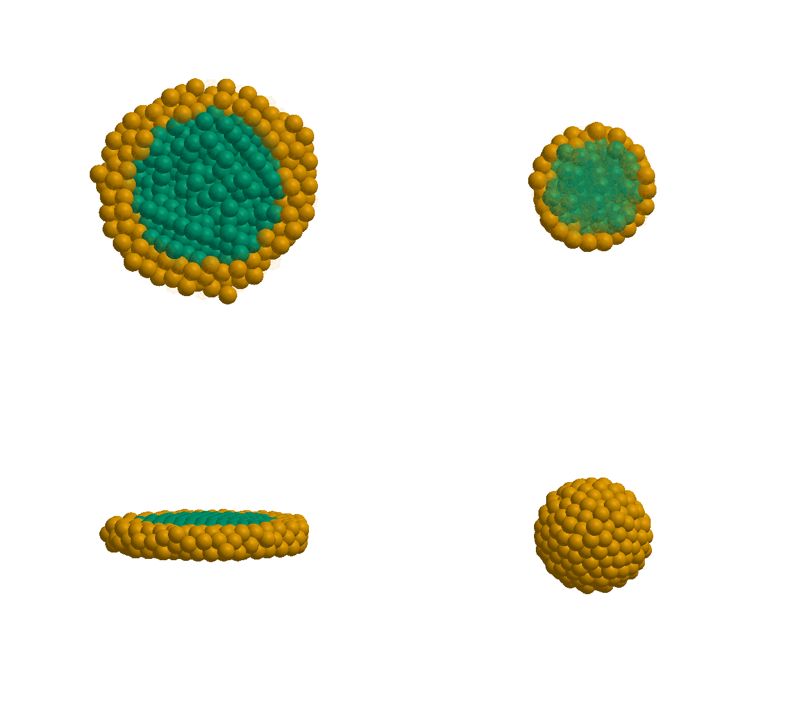
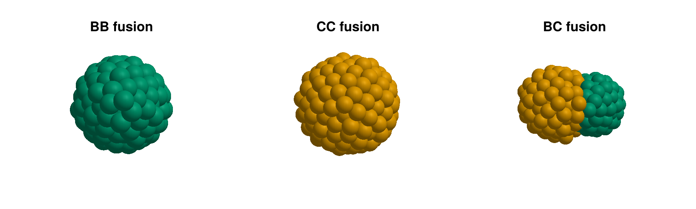
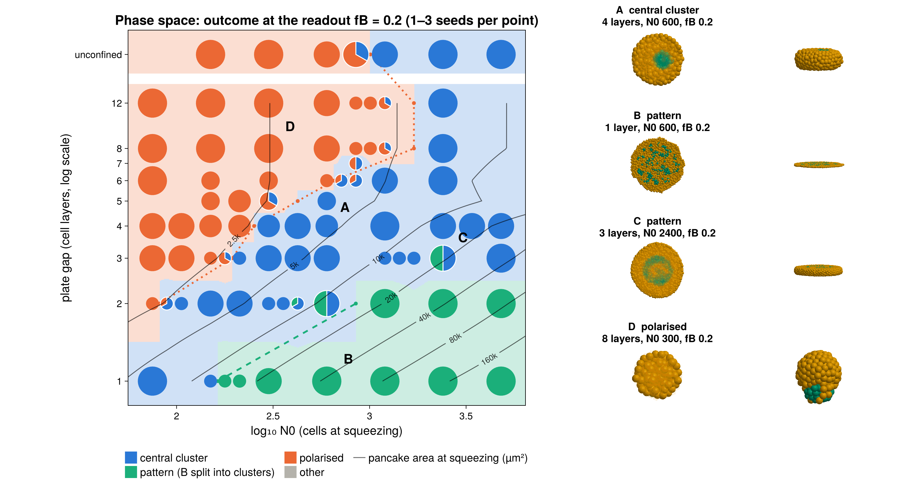
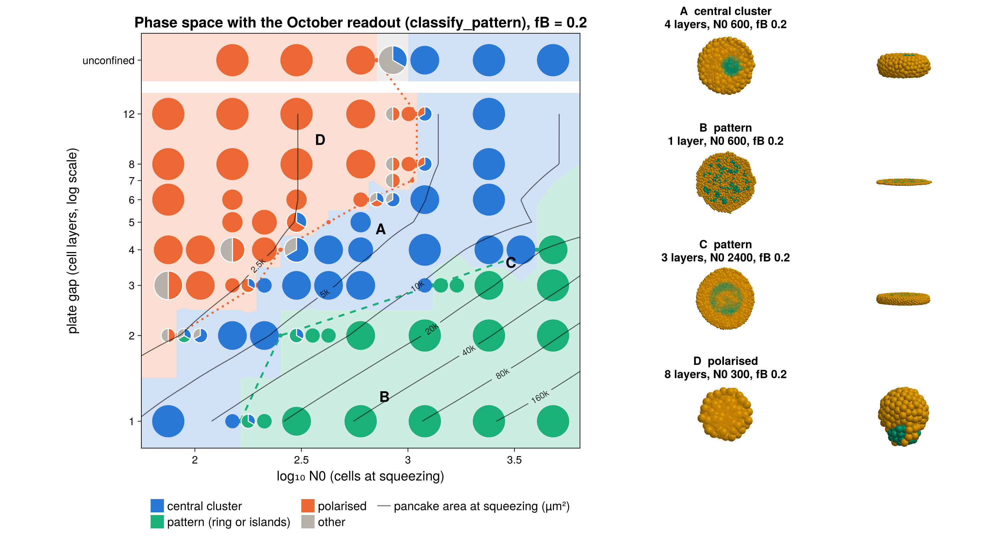
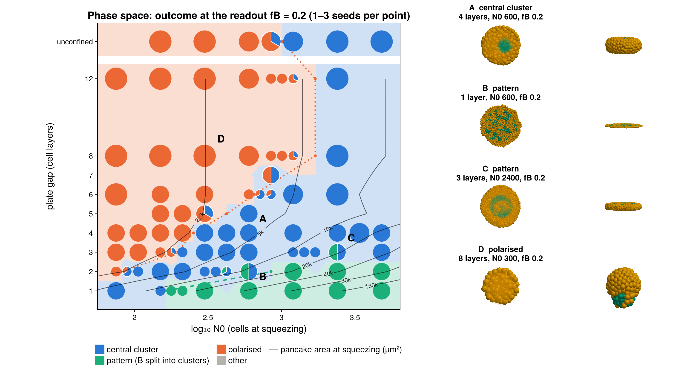
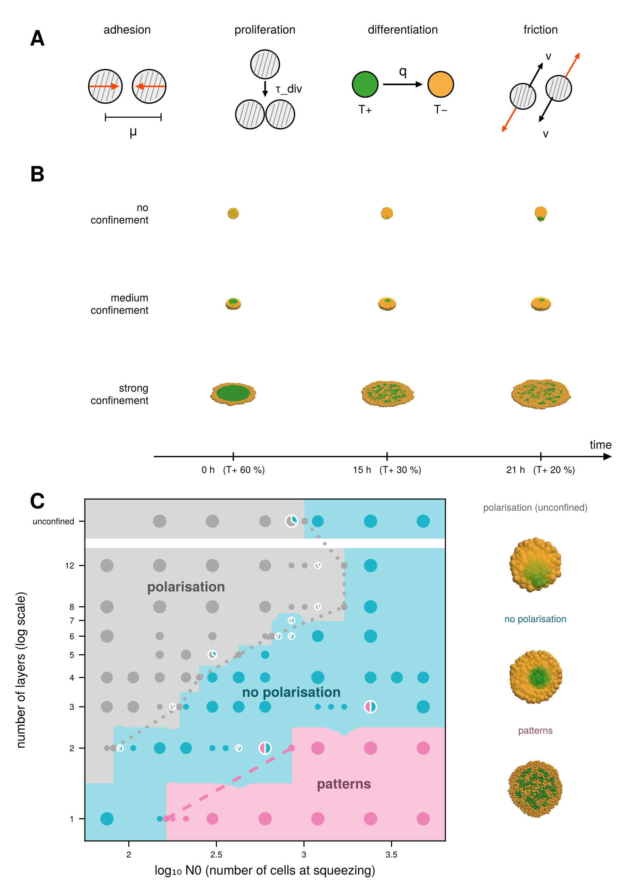
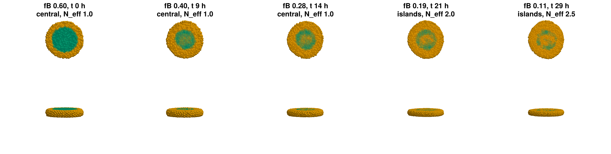
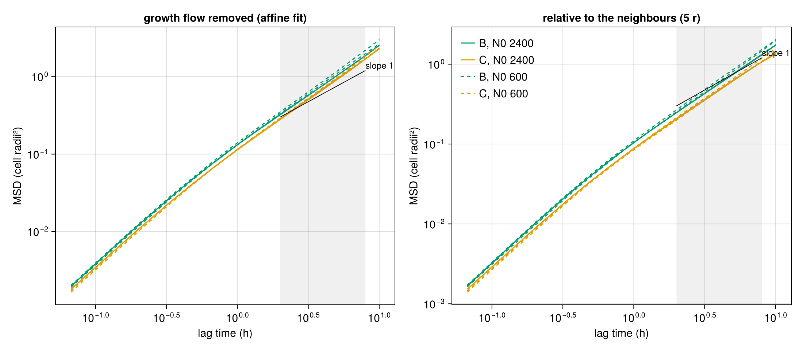
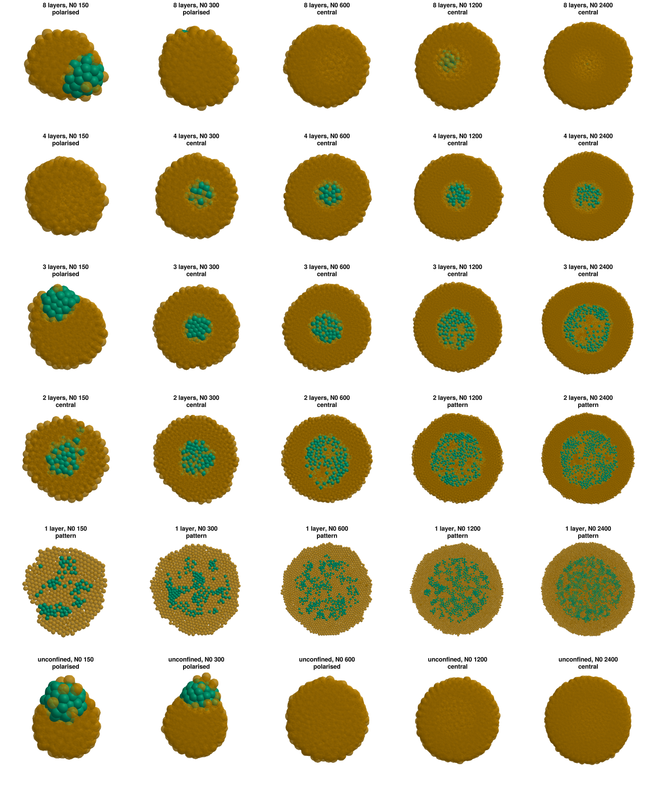

# November round: code tidy-up, November figures, readout like the experiments, pancake area, Damköhler number, 13 h division

Everything below was done overnight (Nov 1–2). Nothing is committed. The October report folder is untouched.
In the November report I changed only the figures, the parameter table (DO column) and the caption of the
initial-condition figure.

---

## 1. Code structure

### Too many scripts?

Yes. Most of them were only for the parameter sweeps. `code-claude/scripts/README.md` now lists every
script with a tag:

- **core** (13): the two libraries and the notebook tooling, the batch runner, the phase-space and figure
  scripts, and the new `msd_monolayer.jl`
- **sweep** (9): October stages 2, 4 and 5a, plus the 13 h test of tonight
- **july** (4): `make_figures.jl`, `run_phase_map.jl`, `run_checks.jl`, `probe_stability.jl`. Nothing current
  uses them.

The README ends with a proposed layout for the final cleanup: `lib/`, one `run.jl`, `phase_space.jl`,
`figures.jl`, `diffusion.jl`, and `archive/` for the sweeps. I moved nothing tonight, since you want to clean
up once the results are definitive.

### Do we need `code-claude/july-2026`?

Not for the current code. It holds:

- **Tracked (30 files):**
  - `claude_changes.jl`
  - two July notebooks: mine, and the copy you edited on the laptop for the July report
  - the July scripts
  - 15 July figures
- **Untracked (285 MB):** the July runs (`results/`, `coms/`)

Worth keeping elsewhere:

- **The July markdown reports link into it.** `reports/2026-07 july/REPORT.md` and `CATCH-UP.md` link 13
  images in `code-claude/july-2026/figures/`. The LaTeX July report has its own copies in
  `reports/2026-07 july/report/figures/`, but the markdown does not. Copy those 13 images next to the
  markdown before removing the folder.
- **Your laptop notebook is also in `code-original/july-laptop/`.**
- **The July runs** are only needed to redraw July figures.

Safe removal later:

```
git tag july-2026-code
# copy the linked figures to reports/2026-07 july/figures/ and fix the links
git rm -r code-claude/july-2026
```

Then delete or move the 285 MB of runs. Kept for now, as you chose.

### Why two figure folders?

- `figures/` is the current set: μ_BB 1.9, now with tonight's changes.
- `figures-oct7/` is the Oct 7 set: μ_BB 2, no patterns at 3+ layers. I kept it on Oct 8 because you asked
  me not to delete earlier work. Only `claude-answers/04` and REPORT.md (stage 7) refer to it, for the
  before/after comparison. The October report has its own copies.

It can go in the cleanup (28 MB in git).

### APPENDIX.md

New: `reports/APPENDIX.md`, 11 short entries. Each gives the question, the finding that settled it, and one
figure:

- plates
- sharp core
- plate friction
- stiffness vs looseness
- μ_BB 1.9
- glue vs sphere
- readout at 20 % B
- time unit
- polarisation definitions
- the new readout
- diffusion / Damköhler

The old answers are untouched.

---

## 2. November report

| request | done |
|---|---|
| fig1: no diluted core, same N0, same scale, no titles | 2 layers and unconfined, both N0 600 (as in fig2 and the overview), one box size for both, no figure title or panel titles. The caption is updated (it described the removed panel). |
| fig5: only the second row, titles "BB fusion" … | side view only, titles `BB fusion`, `CC fusion`, `BC fusion`, no figure title |
| DO column before Sotiris | Oriola et al. 2026, Tables S4–S5 and Note S2. New row `N_rel` (150; neither our model nor yours has it). DO's F0 is 100 pN (the table had 20 pN, the value in the code's reference dict). DO also gives T0 = 4 min, so 15 units/h. |





I also rebuilt all the other November figures with the transparency (§3), and redrew `ring-3layers.png` and
`dissolves-muBB1.8.png` the same way. Their data are now saved like every other final figure (`fig6`,
`fig7` in `code-claude/figures/data`).

**Text you may want to change** (I left it to you):

- "a top view leaves out the cells above the mid-plane" (start of "The simulations")
- "Top: cut at the mid-plane" in the captions of `polarisation` and `ring`
- the phase-space paragraphs and thresholds table, which change with the new readout (§3)
- the closing note on T0 = 2 h. The table now says 4 min, and the Oriola paper confirms it.

`main.pdf` is rebuilt.

---

## 3. Modelling

### The phase-space y axis

It is the number of layers on a **log scale** (log₂: each doubling of the gap is one step). That is why 1→2
is as far apart as 6→12. The axis now says so ("plate gap (cell layers, log scale)", also in the overview).
There is a **linear** version of every chart: `phase_space_lin.png`, `phase_space_lin_N0.png`, and the same for
the other readouts.

### Equal division times for B and C

Expected effects (the 13 h test is in §5):

- **Readout earlier.** With q fixed and τ_B = τ_C, the B fraction falls only by differentiation:
  f_B = 0.6 e^(−qt). So 60 → 20 % takes ln3/q = 235 units = 15.7 h. Now it takes 19.4 h, and 24 h in the
  experiments. Equal division times move the model further from 24 h. Matching 24 h would need
  q ≈ 0.0031/unit with equal division times, or 0.0039/unit with the current ones.
- **C cells born inside the B core proliferate as fast as B.** Now they are 2.5× slower. That favours splitting
  the core, so more patterns.
- **More divisions mean more pushing.** Cells only move because of divisions (§4), so faster division means
  more mixing and more sorting. That favours central clusters.
- **Faster growth.** At 13 h for every cell, the aggregate grows ×4–5 by the end of the run instead of ×2.3,
  so the pancake spreads much more during the window.

I expected the thresholds to move but the three regimes to survive. See §5 for what happened.

### More seeds

Noted. Not tonight.

### Readout like the experiments

New functions in the notebook (readout cell): `exp_clusters`, `exp_polarisation`, `exp_stats`, `classify_exp`.
They follow your description of the experiments:

- 13 µm = 2.6 r (r = R0 = 5 µm). This is the same link distance our readout already used.
- A T+ cell is a core cell if at least 40 % of its neighbours within 13 µm are T+.
- Core cells within 13 µm are linked.
- Other T+ cells join the cluster of their nearest core cell within 13 µm.
- Clusters of at least 20 cells are kept.
- N_eff = 1/Σp².
- Polarisation: P = |r − r_B| / (half the extent along PC1), polarised if ≥ 0.3.

The classes are:

- **polarised:** P ≥ 0.3
- **pattern:** N_eff ≥ 1.5, i.e. B split into clusters of comparable size
- **central:** otherwise. An **unbroken ring is central**, as in the experiments' medium confinement.

One change from the experiments: **clusters of 10 cells instead of 20**. Our aggregates are 10–100× smaller,
and with 20, monolayers of N0 ≤ 300 have no cluster at all (the "in between" you allowed).

All 178 phase-space runs and the tuning runs were re-scored. No new runs were needed. The class changes in
34 of 178 runs at fB 0.2.

Polarisation hardly changes. P and our offset rank the runs the same way: they are within a few hundredths
in slabs, and P is up to 0.2 lower for small balls. The lower cutoff (0.3) turns most former "other" points
into polarised ones. What changes is the rings:

| layers | patterns from N0 (October readout) | patterns from N0 (experiment-like) | at fB 0.12 (experiment-like) |
|---|---|---|---|
| 1 | ≈ 160 | ≈ 165 (178: 3 of 3) | 600 (178–300 mixed: some have no cluster left) |
| 2 | ≈ 250 (rings) | ≈ 850 (600: 1 of 2; 1200: 2 of 2) | 600 |
| 3 | ≈ 1300 (rings) | 2400 in 1 of 2 seeds | ≈ 1600 |
| 4 | 4800 (one ring) | none up to 4800 | none up to 4800 |

So at the readout, thick slabs show rings that have not broken yet. The experiments would call these central.
By fB 0.12 they have broken into islands. Figures:

- `phase_space.png`: the figures' readout
- `phase_space_classic.png`: the October readout
- `phase_space_exp20.png`: the strict 20-cell version



The same runs with the October readout, where rings count as patterns:



And with a linear y axis:



### Overview panel B: one scale

Done. All nine panels share one box, so the unconfined ball is now visibly smaller than the spread
monolayer. Panel C uses the new readout and says "log scale".



### Time unit

The Oriola paper itself gives T0 = R0/V0 = 4 min (V0 ≈ 1.25 µm/min, R0 = 5 µm). So 15 units/h stands, and
q = 0.070/h.

One thing the MSD revealed (§4): **model cells move about 0.05 µm/min**, measured over one 4-min frame. That
is ~25× slower than V0. If T0 is meant to match the cell speed, the model's cells are far less motile than the
speed that sets it.

### Overlap

Not touched. It wasn't needed: the 13 h runs ran without any numerical trouble.

### Transparency instead of the cutaway

The top views now draw the cells above the mid-plane (the outer layer that used to be left out)
**translucent**. The cells up to the mid-plane stay opaque, so the pattern still shows on the cut face.

The transparency has to be faint (opacity 0.03, coarse unshaded spheres). I tried three ways:

1. **All C translucent, in depth order.** In CairoMakie each sphere is many small triangles whose edges add
   up. A B core under five or more translucent C cells (a thick slab, a big ball) disappears even at
   opacity 0.03.
2. **C translucent, B drawn on top of everything.** B always shows, but B cells at all heights fill the
   hollow of a ring, so the 3-layer ring vanishes.
3. **Kept: the cut face opaque, the outer half faint on top.** Rings show at 3 layers, and the central
   core at 4 and even at 12 layers.

The side views stay opaque. This applies to all final figures, the phase-space insets, the overview, the
movies and the galleries (`GHOST`, `cells_mesh!`). `ghost = nothing` brings the plain cutaway back.

The text "a top view leaves out the cells above the mid-plane" could become: "in top views, the cells above
the mid-plane are drawn translucent, since the outer C cells would otherwise hide the B pattern".



---

## 4. Tasks

### 2 — pancake area on the phase space

Every phase-space chart with layers on y now has **labelled iso-area lines**: the area of the pancake at
squeezing, in µm² (2.5k … 160k). They are interpolated from the measured areas: A = π(D r)², D from the
seeding frame, r = 5 µm. The areas are a column of `phase_space.csv` (`A_um2`), so the chart redraws from the
data.

**Finding.** With the experiment-like readout, the pattern threshold roughly follows an iso-area line.
Patterns appear once the pancake at squeezing exceeds about **1–2 × 10⁴ µm²**, i.e. 11–16 cell diameters, or
~110–160 µm across:

| layers | last N0 without (area) | first N0 with patterns (area) |
|---|---|---|
| 1, fB 0.2 | 150 (1.2 × 10⁴) | 178 (1.4 × 10⁴) |
| 2, fB 0.2 | 424 (0.8 × 10⁴) | 600–1200 (1.1–2.1 × 10⁴) |
| 2, fB 0.12 | 424 (0.8 × 10⁴) | 600 (1.1 × 10⁴) |
| 3, fB 0.12 | 1427 (1.2 × 10⁴, 1 of 3) | 1697 (1.4 × 10⁴) |

Exceptions:

- **3 layers at fB 0.2:** only half of N0 2400 (1.9 × 10⁴) has broken, and the single N0 4800 run
  (3.5 × 10⁴) is still a ring. It breaks by fB 0.12.
- **4 layers:** even N0 4800 (2.2 × 10⁴) stays central.

So, up to 3 layers, "a thicker gap needs more cells" is mostly "a thicker gap needs more cells for the same
area". Thicker slabs need a bit more than that. With the October readout the rings blurred this, and the
diameter rule was 8–17.

### 3 — Damköhler number from a 2D MSD

**Method** (`msd_monolayer.jl`):

- **Runs:** 4 new monolayer runs (final set, rigid plates, friction 1.5), N0 600 and 2400, 2 seeds each, with
  one frame per 4 min and cell ids.
- **Tracking:** cells are followed by id between divisions. `save_frames` now saves the ids. CellBasedModels
  restarts its id counter at every run phase, so I renumber the ids at seeding.
- **Growth flow removed:** by an affine fit per lag, or relative to the neighbours within 5 r as a check.
- **Rim excluded:** cells in the outer 20 % are left out.
- **Fit:** MSD = 4Dτ + c between 2 and 8 h.

There is no noise in the model, so the only motion comes from divisions and differentiation. The diffusion is
therefore measured in growing monolayers.

| | D (r²/unit) | D (µm²/h) | log-log slope (2–8 h) |
|---|---|---|---|
| B, affine | 0.0042–0.0050 | 1.6–1.9 | 1.26–1.33 |
| C, affine | 0.0038–0.0041 | 1.4–1.5 | 1.29–1.31 |
| B, relative | 0.0029–0.0034 | 1.1–1.3 | 1.20–1.27 |
| C, relative | 0.0024–0.0026 | 0.9–1.0 | 1.19–1.23 |

The two sizes and the two seeds agree within 20 %. The MSD is nearly linear from 4 min to 10 h. The slope above 1
at long lags means some directed motion is left: flows that a single affine fit cannot remove, such as B
growing faster than C, and sorting.

**Damköhler number**, Da = q ℓ²/D, with q = 0.004667/unit and D ≈ 0.004:

- ℓ = one cell diameter: Da ≈ **4–8**. A cell needs ~17 h to move by its own diameter, longer than a B cell
  lives (14 h).
- ℓ = pancake radius at squeezing: Da ≈ **500–1000 at N0 600** and **2100–3800 at N0 2400**. The range
  covers the two drift corrections.

For a fixed D, Da ∝ area, so the iso-area lines are also iso-Da lines: Da ≈ 0.015 × A[µm²] with the
monolayer D. The pattern threshold (A ≈ 1.5 × 10⁴ µm²) then sits at Da ≈ 200.

Differentiation is much faster than single-cell mixing at every size. B patterns are set where the cells
already are, and polarisation of a whole B domain has to come from collective flows, not cell diffusion.



Data: `code-claude/results/msd/` (`msd_fit.csv`, `msd.csv`, `msd.png`).

---

## 5. Optional: division time 13 h for B and C

**Setup.** τ_div = 195 units (13 h) for every cell instead of 300 and 750 (20 h for B, 50 h for C). This is
a coarse map with seed 1: layers 1, 2, 3, 4, 8 and unconfined, × N0 150–2400 (30 runs,
`results/stage5/tdiv`, `scripts/tdiv_report.jl`). Everything else is the final set. It ran without trouble
(no failures, thickness held) and needed no change to the overlap.

**Result: it changes much less than expected.**

- **Classes.** Comparing the same points (seed 1) with the figures' readout:
  - **Same at fB 0.2 in 26 of 30 points.** The four that change:
    - 1 layer N0 150: central → pattern. The monolayer threshold moves a little lower.
    - 3 layers N0 2400: pattern → central. It still breaks by fB 0.12.
    - 8 layers N0 600 and 1200: polarised → central. Both polarise by fB 0.12: polarisation is a bit
      slower relative to differentiation.
  - **Same at fB 0.12 in 26 of 30 points.** The four that change:
    - 1 layer N0 150, as above
    - 3 layers N0 300 and 4 layers N0 300 and 600: now these polarise late (between fB 0.2 and 0.12);
      with 13 h they stay central.
  - The three regions stay. At fB 0.2 the boundaries move by one grid step (the monolayer pattern edge, 3
    layers at 2400), except the polarised edge at 8 layers, which moves from N0 1200 to 300.
- **Readout earlier.** fB 0.2 comes at 16–19 h after seeding instead of 18–21 h. The prediction was
  15.7 h + the 1.7 h relaxation before differentiation = 17.4 h. These "hours from seeding" include that
  relaxation, which is why the report's 21 h is 19.4 h + 1.7 h.
- **Much more growth.** By the end of the run (fB 0.10) the aggregate has grown ×4.1–5.3 instead of
  ×2.2–2.5, i.e. about twice as many cells.

Why so little change: the outcome is decided by where B cells differentiate and by B–C cohesion. Faster
division adds cells and some mixing, but these act on all cells alike: C cells now also divide inside the B
core, and the whole tissue is pushed more. So the balance between splitting and sorting barely moves. To
match the experiments' 24 h for 60 → 20 % with equal division times, q would have to drop to
≈ 0.0031/unit (0.046/h).



Table: `code-claude/results/stage5/tdiv/compare.txt`.
