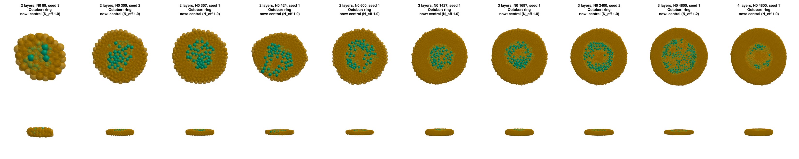
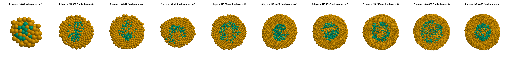
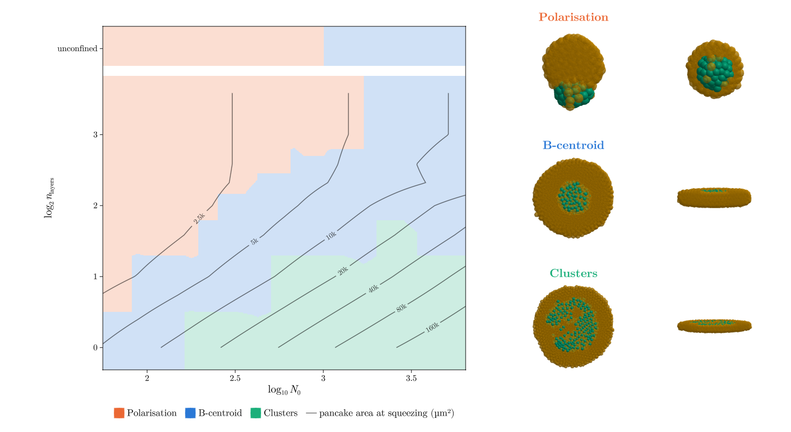
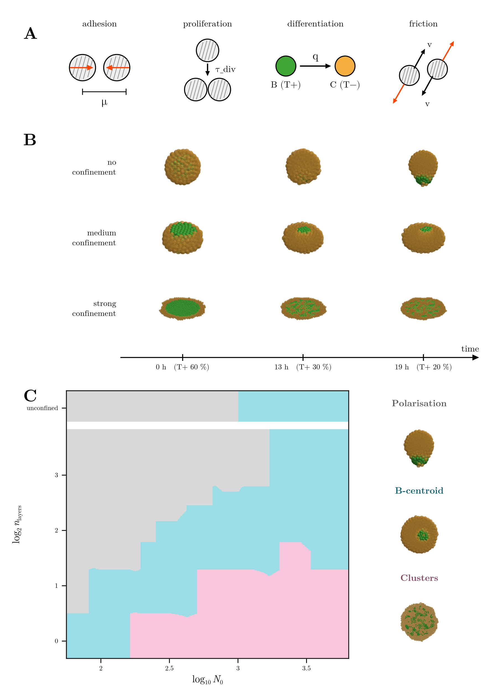

# Replies to your comments on 05 (November round)

Your comments on `05-november-round.md`, each followed by what I did or found. Nothing is committed.

---

## 1. Transparency in the 3D views

> the transparency looks bad and is only applied to all cells. what i'd like is: take the normal spherical
> aggregate where you see only yellow bc green is in the middle, then for all yellow cells set alpha=0.6 …
> using glmakie. this should also be applied to the overview

**Done as you describe.**

- **What changed.** Every 3D view (top, side, front and oblique) now shows the whole aggregate. The B cells are
  opaque and every C cell is drawn at alpha 0.6, so the B core shows through the C cells around it. The
  mid-plane cutaway is gone. In the code it is `GHOST = 0.6`, used by `cells_mesh!` and `draw_cells!`.
  `ghost = nothing` gives the old opaque cutaway back.
- **Why GLMakie.** CairoMakie draws each sphere as many small triangles and fakes transparency by drawing them
  back to front. The triangle edges add up, so a B core under a few translucent C cells disappeared even at
  alpha 0.03, which is why the earlier version looked bad. GLMakie blends transparency properly
  (`transparency = true`).
- **Where it applies:**
  - all report figures and the phase-space insets: `stage6_figures.jl` now renders with GLMakie
  - the overview: each 3D panel is rendered with GLMakie and placed in the page as an image, while the rest of
    the PDF (text, arrows, phase space) stays vector and editable in Inkscape (`stage7_presentation.jl`)
  - the movies
- **A GLMakie detail.** GLMakie renders through a window, and the window cannot be larger than the screen.
  Wide figures came out squeezed into part of the image. The scripts now render in a small hidden window at
  full output resolution: `GLMakie.activate!(visible = false, scalefactor = 0.3, px_per_unit = 1)`.
- **What still hides.** A B core buried under about ten C layers (12 layers, N0 2400) does not show through
  at alpha 0.6. The 3-layer rings, the 4-layer cores and the polarised balls all show.

---

## 2. Cluster-size threshold

> "Only clusters containing at least 20 cells, including core and border cells, were retained for further
> analysis." i agree that their aggregates are much bigger and we're right to reduce the threshold

Kept at 10 cells.

---

## 3. Rings: patterns in October, central now

> can you show me some of the plots that are rings counting as patterns in october but not patterns in the
> new readout?

These are every point where the October readout said *pattern* and the new one says *central*, at the
readout fB = 0.2 (seed 1, or the first seed that changed). **Every one was a RING in October.** B has spread
out and is hollow in the middle, but it is still one connected network, so N_eff = 1.0 (1.2 for 3 layers at
N0 4800).

The same frames with the old mid-plane cut, where the layout of B is easier to see:

What they look like:

- **2 layers, N0 89–600:** loose B networks and open arcs, not separate islands.
- **3 layers, N0 1427–2400:** a hollow core, i.e. a ring, still connected all round.
- **3 and 4 layers, N0 4800:** a wide ring starting to tear (N_eff 1.2 at 3 layers), but not yet into pieces
  of comparable size.

By the experiments' rule ("may form a ring-like pattern but without breaking" is medium confinement), these
are central. By fB 0.12 most of the 3-layer ones have broken into islands.

All points that changed, with every seed:

| layers | N0 | seeds that went ring → central |
|---|---|---|
| 2 | 89 | 3 |
| 2 | 300 | 2, 3 |
| 2 | 357 | 1, 2, 3 |
| 2 | 424 | 1, 3 |
| 2 | 600 | 1 |
| 3 | 1427 | 1, 2, 3 |
| 3 | 1697 | 1, 2, 3 |
| 3 | 2400 | 2 |
| 3 | 4800 | 1 |
| 4 | 4800 | 1 |

---

## 4. Patterns in thicker slabs

> now we only have patterns for two layers? this is not good. we should have patterns for more layers too.
> if we need a little more time it's okay!

Agreed. With the experiment-like readout, at fB 0.2 the 3+ layer rings have not broken yet, so they count as
central. There are two ways out:

1. **Make the rings break sooner** with a parameter change (BC entries frozen, as always). This is the real
   fix, and a screen is running.
2. **Read the outcome later** (fB 0.12 instead of 0.2). Then 3 layers pattern from N0 ≈ 1600, but 4 layers
   still do not, so this alone is not enough.

**The screen** (`results/stage5/thick_nov/`, 40 runs) makes one change at a time to the final set:

| candidate | change | idea |
|---|---|---|
| `muB1.875` | `mu` BB 1.9 → 1.875 | a bit less B–B cohesion (1.85 dissolves B into C) |
| `faB5.8` | `f_att` BB 6.4 → 5.8 | the same, through the strength instead of the range (W_BB 0.79 → 0.72) |
| `frB5.5` | `f_rep` BB 4.5 → 5.5 | stiffer B: the core cannot close up again around new C cells |
| `faC3.3` | `f_att` CC 3 → 3.3 | C as cohesive as B is now (W_CC 0.65 → 0.72): C keeps its place inside the core |

Each is run at:

- **the target points:** 3 layers, N0 1200 and 2400; 4 layers, N0 2400; 2 seeds each
- **the checks that must not break:**
  - 1 layer, N0 1200, still patterns
  - 2 layers, N0 150, stays central
  - unconfined N0 600 still polarises
  - the BC doublet still glues

The results follow in §7 when the runs finish.

---

## 5. Phase-space charts

> the iso-area lines are great … leave the numbers in the area level curves …
> do not do three regions ABCD in the phase space, just use colors. in the right for the green section put a
> plot in between patterns and islands. for the example central cluster find a more central example. remove
> the dots over the phase space, just leave the background color and if its a half ball choose one you can
> infer which one would it be if we let it run for longer. remove the dashed lines.
> … titles should be "Polarisation", "B-centroid", "Clusters" … colour the title … Remove the subtitle …
> y-axis should be named n_layers or log(n_layers) and the x axis just log10(N0) or N0 if linear. … latex
> rendering … the legend should be with the aforementioned titles

Done, in every phase-space chart (`phase_space*.png`, all readouts and axis versions):

- **Background only.** No pies, no threshold lines and no A–D letters (`pies`, `thresholds` and `letters` are
  now off). Each region is coloured by the majority outcome of its point.
- **Ties use the later readout.** Where the seeds split evenly (the "half balls"), the point takes the outcome
  that wins at the later readout (fB 0.12), i.e. what it becomes if left to run. The column used is the same
  readout at fB 0.12 (`class_exp10_012`); for the October readout it is `class_012`.
- **Area lines keep their numbers** (µm², 2.5k … 160k). The legend calls them "pancake area at squeezing (µm²)".
- **Examples on the right**, in this order, each titled in its region's colour, with no subtitle:
  - **Polarisation**: 8 layers, N0 300. It is now rotated so that B faces the side view.
  - **B-centroid**: 3 layers, N0 1200, where B sits right in the middle (P = 0.01). It used to be 4 layers,
    N0 600, slightly off-centre.
  - **Clusters**: 2 layers, N0 1200, a ring that has broken into a few large clusters. This is between the
    3-layer ring and the fine monolayer islands.
- **Axes:**
  - x: $\log_{10} N_0$, or $N_0$ in the linear version
  - y: $\log_2 n_\mathrm{layers}$, with ticks at 0, 1, 2, 3, or $n_\mathrm{layers}$ in the linear version
  - The unconfined row stays at the top.
- **Text** is in LaTeX's Computer Modern (`TEX_FONTS`), with the axis labels as LaTeX.
- **Legend:** Polarisation, B-centroid, Clusters (and "other" only if a point has it), plus the area lines.
- **No chart title.** The report captions say what is shown.

## 6. Overview

> in the overview you should also use this kind of plotting. also forget about the scale thing in the figure B,
> it doesnt read well not. in figure A differentiation it should be B (T+) to C (T-)

Done:

- **Panel A:** the differentiation arrow reads "B (T+)" → "C (T−)".
- **Panel B:** back to one scale per panel. The 3D panels use the new transparency (rendered with GLMakie and
  placed as images, the rest of the page stays vector).
- **Panel C:** the same chart as the report: background colours only, the same axis labels. The three
  examples on the right are titled Polarisation, B-centroid and Clusters in the colours of their regions; they
  are now the readout frames of the three rows of panel B.
- **Fonts:** the whole page uses LaTeX's Computer Modern.

## 7. Damköhler number in the November report

> add a subsection about the damkohler number in the november report in the experiments section

Added as **§3.7 Damköhler number**, with the MSD figure. I put it in "The simulations" rather than in "The
experiment", because it is measured on the simulated cells. Move it if you meant otherwise.

It covers:

- the definition: Da = q ℓ²/D
- why D is measured in growing monolayers (there is no noise in the model)
- the method: cells followed between divisions, the growth flow removed, a linear fit at 2–8 h
- the result: D ≈ 1.5 µm²/h, Da ≈ 4–8 per cell diameter and 500–3800 over the pancake radius, the threshold at
  Da ≈ 200
- a remark that model cells are ~25× slower than V0

## 8. Division time

> " The prediction was 15.7 h + the 1.7 h relaxation before differentiation = 17.4 h." are you counting the
> relaxation before diff+prolif in the times? i dont think it should be counted

You are right. During the 25 time units (1.7 h) after seeding there is no division and no differentiation,
only mechanical relaxation, so they should not count.

**All the times now count from the start of differentiation.** This applies to the figure labels (fig2, the
ring and dissolve figures), the overview time axis and the movie titles (`T_RELAX`, `hrs`), and to the 13 h
comparison:

| | fB 0.6 → 0.2, measured (from the start of differentiation) | prediction (no noise, mean growth) |
|---|---|---|
| now (τ_B 20 h, τ_C 50 h) | 16–19 h | 19.4 h |
| 13 h for B and C | 14–17 h | 15.7 h |

The frames are one hour apart, hence the ±1 h. For the report this means the 60 → 20 % drop takes **about
19 h**, not 21 h. The overview's time axis now says 19 h; the remark in §2.2 of the report still says
21 h (your text, so I left it).

> 3 layers n0 2400 you say central but it really look as it's about to pattern

Agreed. By eye it is a ring with holes, about to break. The readout calls it central because its B is still one
connected cluster (N_eff = 1.0, 95 % of the B cells in it). By fB 0.12 it has broken into islands, in both the
13 h and the current runs. It sits right at the boundary, like the current set's 3-layer N0 2400 (1 seed of 2
broken at fB 0.2).
