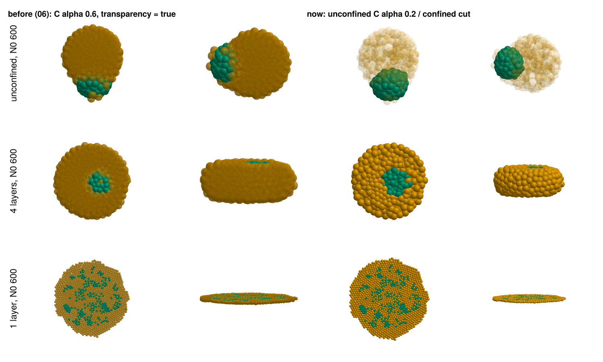
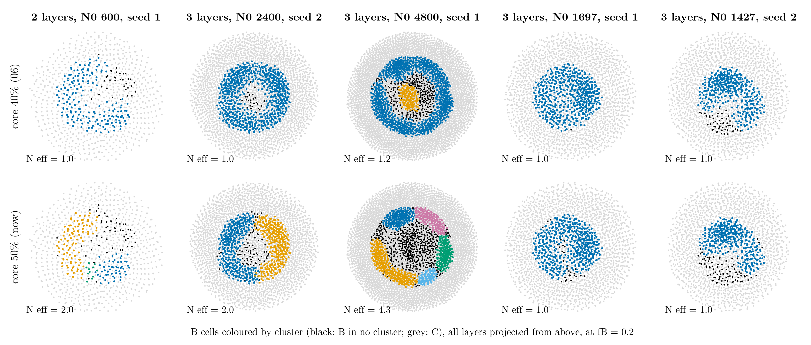
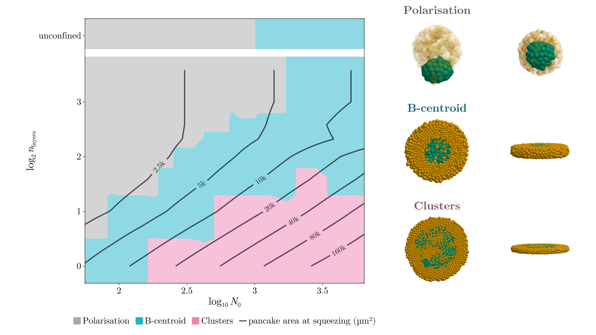
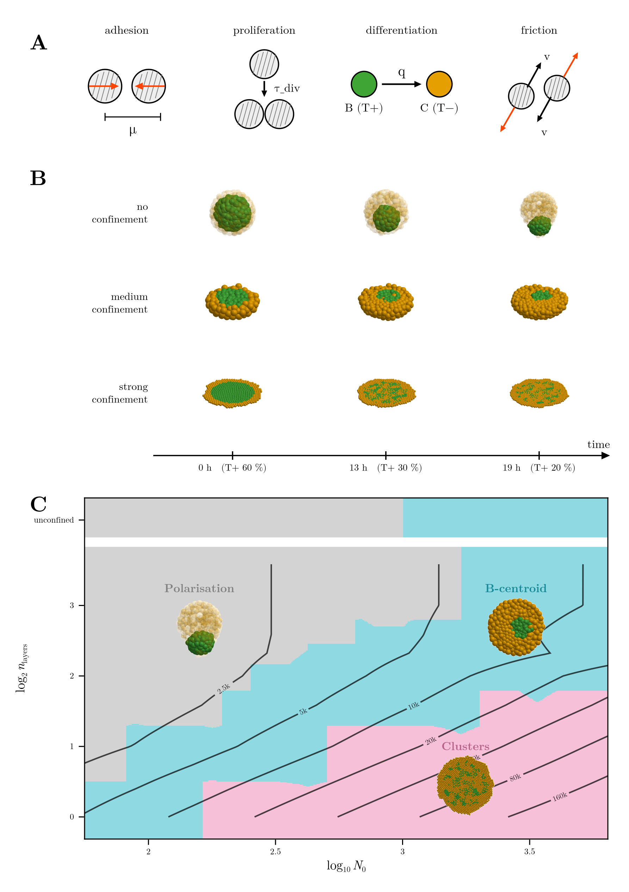
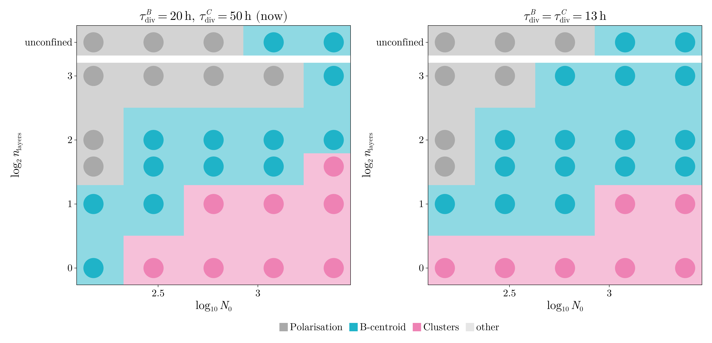
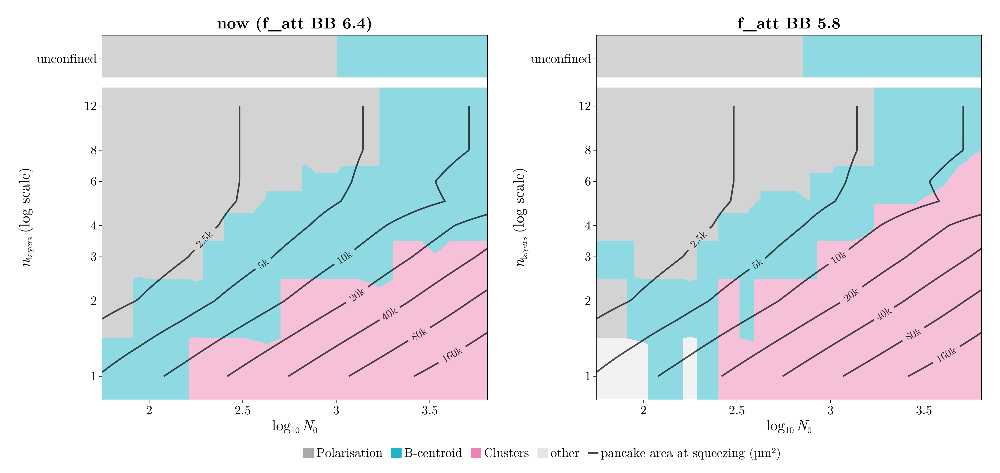
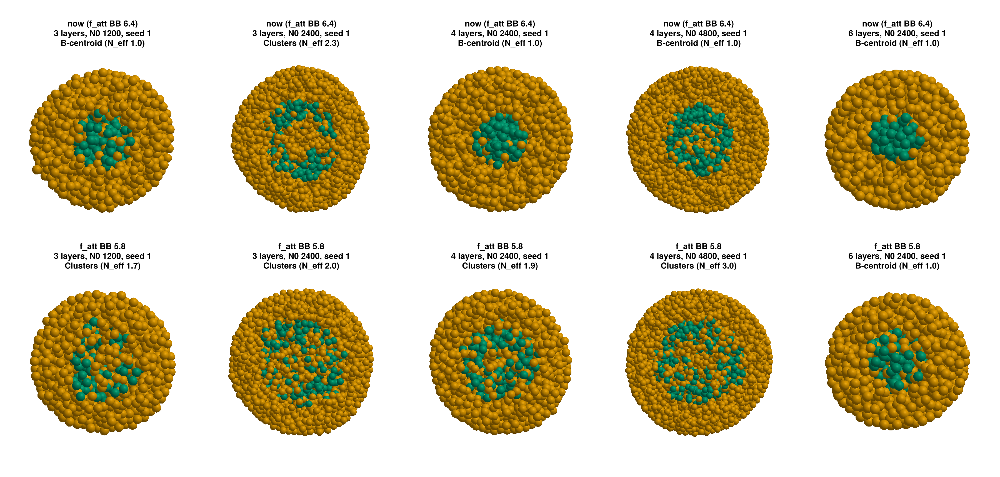

# Replies to your comments on 06

Your comments on `06-november-replies.md`, each followed by what I did or found. Nothing is committed.

The full phase space with a change that gives patterns at 3 **and** 4 layers (§3) has finished: see §8.

---

## 1. Transparency

> you should add plots showing the change … in the original code i just added alpha=0.5 or sth in the
> plot_aggregate function and got beautiful results … it looks very dark for some reason. i only want alpha
> changes in the cases where there is polarisation, in the others do not do it. maybe we only need to make
> yellow even more transparent.

**Why it was dark.** In 06 I drew C with `transparency = true`, GLMakie's order-independent blending. With
many translucent layers on top of each other it turns the yellow into dark brown. Your original
`plot_pancake` did something simpler:

- one `meshscatter` with RGBA colours
- C at alpha 0.2 (`color_map_alpha`)
- no transparency flag

Now the code does exactly that, with one change: B is drawn first. In your version the cells were drawn in
their stored order, so a C cell drawn before a B cell behind it cut a white hole into the B core.

**Where it applies.** Only to unconfined aggregates (where B polarises):

- fig1 right
- the top row of fig2
- fig4
- the Polarisation inset of the phase space
- the top row of the overview
- the unconfined and polarised movies

Everything confined is back to the October look: opaque, with the top view cut at the mid-plane. The
fusion doublets (fig5) are opaque too.

Before and after, on the three rows of fig2 at the readout:

In the code: `GHOST = 0.2`, `cells_mesh!`. `draw_cells!` now defaults to `ghost = nothing` (opaque + cut),
and `plot_panels` uses `GHOST` for panels drawn top+front, i.e. the unconfined ones.

> c cells are color yellow, not orange. change it if its like that anywhere

The 3D figures always used your C colour (`color_map[3]`). Three places called it, or drew it, orange:

- **The overview** drew C with its own light orange (`#f5b041`). It now uses `color_map[3]`, the same as
  every other figure.
- **The MSD caption** in the report said "C (orange)". It now says yellow.
- **FIGURES.md** said "T− (C) orange". Fixed.

Separately, the *region* colour of Polarisation in the phase space was orange. It is grey now (§4).

> i cannot run main.tex using latex workshop … main.pdf … might be outdated?

**The PDF was not outdated.** `main.pdf` was built at 11:54, after the last edit of `main.tex` (11:53). I
rebuilt it now with all the changes below: 17 pages, no errors and no undefined references.

**TeX itself works.** From a shell, LaTeX Workshop's default recipe (`latexmk -pdf` with biber) builds the
report without errors, even with an almost empty PATH.

**What I added.** VS Code had no LaTeX Workshop log for today's session, so I could not see why it failed.
I added `.vscode/settings.json` at the repo root. It makes LaTeX Workshop:

- call latexmk by its full path, `C:/texlive/2026/bin/windows/latexmk.exe`, so the build no longer depends
  on VS Code seeing TeX Live's PATH (a VS Code started before TeX Live was installed does not see it)
- build on save

If it still fails:

1. Close every VS Code window and reopen it.
2. Look at View → Output → "LaTeX Workshop" (or "LaTeX Compiler"), which says what went wrong.

**One warning.** While I was building, a second build ran on the same file at the same time, probably
yours from VS Code. Two builds at once corrupt `main.aux`. The symptom is
`File ended while scanning use of \@newl@bel`. The fix: delete `main.aux` and build again.

---

## 2. Clusters: a little more in between

> Maybe we should be just a little more inbetween, some do not look clustery enough to me. Write the method
> we use mathematically in the report in the Simulations section in a subsection.

I read this as being about §3 of 06, the October rings that the new readout calls central. Some of them do
look like clusters and some do not.

**What I changed.** A B cell is a *core* cell if at least a fraction φ of its neighbours within 13 µm are B.
The experiments use φ = 40 %; we now use **φ = 50 %**.

Why it matters: with 40 %, a ring whose pieces still touch through threads of one or two B cells is one
cluster. With 50 %, the cells of those threads are border cells, and the pieces become separate clusters.
Where the ring is really continuous, nothing changes.

Cluster colours with both rules, at the readout (fB 0.2):

- **Left three: now Clusters.**
  - 2 layers, N0 600: a broken ring
  - 3 layers, N0 2400: two half rings
  - 3 layers, N0 4800: a ring of five pieces
- **Right two: still B-centroid.** The 3-layer rings at N0 1427–1697 are hollow but continuous.

**What else I tried:**

- **φ = 60 %** is too strict. Loose but genuine clusters lose their core cells: monolayers at N0 75,
  2 layers at N0 89 and 300, and 2 layers at N0 4800 end up with no cluster at all.
- **A shorter link radius** (2.3 r instead of 2.6 r) changes almost nothing.

**On the whole phase space**, only three points change, all from B-centroid to Clusters:

- 2 layers, N0 600
- 3 layers, N0 2400
- 3 layers, N0 4800

Polarisation does not depend on the clusters, so it is unchanged.

New thresholds (also in the report's Table 2):

| layers | polarised up to N0 | B-centroid | clusters from N0 |
|---|---|---|---|
| 1 | – | 75–150 | ≈ 160 |
| 2 | 75 | 89–424 | ≈ 500 |
| 3 | 150–178 | 212–1697 | ≈ 2000 |
| 4 | 212 | 300–4800 | none up to 4800 |
| 6–12 | 600–1200 | up to 2400 | none |
| unconfined | 600–849 | 1200–4800 | none |

The chart with the experiments' 40 %, for comparison, is `code-claude/figures/phase_space_core40.png`:

**In the report:**

- **New subsection §3.6 "Reading the outcome"**, in The simulations, just before the phase space. It
  covers:
  - the neighbourhoods, core cells, links and border cells, as formulas
  - N_eff
  - P with the PC1 axis
  - the order of the four outcomes
  - a paragraph on what differs from the experiments (10-cell minimum, φ = 0.5) and why
- **The Damköhler subsection** was already in The simulations (it is §3.8 now), so it did not need to move.

**Text of yours that no longer matches.** I did not edit these:

- After Table 2: "from N0 ≈ 160 cells at one layer to about 4000 at four layers" and "8 to 17 cell
  diameters". With the new readout, 3 layers start at about 2000 and 4 layers have none up to 4800.
- The phase-space paragraph still names the classes "central cluster, pattern (a ring or islands),
  polarised, or other".

---

## 3. Patterns in thicker slabs: the screen

> update me on the outcome of that

All 40 screen runs are done. Each candidate changes one entry of the final set (BC entries untouched),
read with the new readout at fB 0.2.

**Reference: the final set** (from the phase space, same readout):

- 3 layers N0 2400: Clusters, 2 seeds of 2
- 4 layers N0 2400: B-centroid, 2 of 2

**The four candidates:**

| | `mu` BB 1.875 | **`f_att` BB 5.8** | `f_rep` BB 5.5 | `f_att` CC 3.3 |
|---|---|---|---|---|
| 3 layers, N0 1200 (2 seeds) | 1 of 2 Clusters | 1 of 2 Clusters | 1 of 2 Clusters | central |
| 3 layers, N0 2400 (2 seeds) | Clusters (N_eff 3.4, 3.1) | **Clusters (2.0, 2.3)** | 1 of 2 Clusters | central |
| 4 layers, N0 2400 (2 seeds) | central | **Clusters (1.9, 2.0)** | Clusters (2.9, 2.0) | central |
| check: 1 layer, N0 1200 | Clusters | Clusters | Clusters | Clusters |
| check: 2 layers, N0 150 stays central | ✗ B gone (no cluster) | **✓ central** | ✗ B gone (no cluster) | ✓ central |
| check: unconfined N0 600 polarises | ✓ P 0.59 | **✓ P 0.60** | weaker, P 0.42 | ✓ P 0.52 |
| check: BC doublet glues (BC 24 h) | ✓ 0.92 | **✓ 0.94** | ✓ 0.96 | ✓ 0.96 |

**`f_att` BB 6.4 → 5.8 is the one that works.**

- **What it does.** It lowers the B–B adhesion energy from W_BB 0.79 to 0.72, still above W_CC = 0.65.
  B stays more cohesive than C, but a large core in a slab of 3 or 4 layers now opens and breaks by the
  readout.
- **What it keeps.** Small aggregates stay central (2 layers, N0 150), the unconfined ball polarises as
  strongly as before, and BC still glues.

**Why not the others:**

- **`mu` BB 1.875 and `f_rep` BB 5.5** loosen B so much that the small 2-layer aggregate loses its B
  cluster altogether, as with μ_BB 1.85 in October. `f_rep` BB 5.5 also weakens the polarisation, and by
  fB 0.12 B has dissolved in every slab.
- **`f_att` CC 3.3** makes the cores more compact (S 0.77 at 4 layers): no patterns at all.

**What I launched.** Its full phase space is running (`results/stage5/phase_E`, 178 runs), at the same
points and seeds as the current one plus the unconfined row. When it is done I will draw it with the same
readout and compare it point by point with the current chart, in §8 below.

I did not switch the report to this set. Whether it becomes the final set is your call once you see §8.

---

## 4. Phase-space charts

> increase the opacity of the background … same colors as in the overview … make the pancake area line
> thicker and all the text larger

Done, in every phase-space chart (`PHASE_COLORS`, `phase_space!`, `plot_phase_space`):

- **Colours.** The overview's: grey for Polarisation, cyan for B-centroid, pink for Clusters. The inset
  titles use a darker shade of their region's colour so they stay readable.
- **Opacity.** 0.5 instead of 0.22, the same as the overview.
- **Area lines.** 3 px instead of 1.4, slightly darker.
- **Text.**

  | | before | now |
  |---|---|---|
  | axis labels | 20 pt | 28 pt |
  | ticks | 16 pt | 24 pt |
  | legend | 18 pt | 24 pt |
  | inset titles | 22 pt | 30 pt |
  | area labels | 13 pt | 20 pt |

  The figure is a little larger (1600 × 900).

---

## 5. Overview

> add the iso-area lines. then, on top. add each example over the area it refers to, text and figure

Done:

- **Panel C** now has the area lines. It is stretched to the width of the page, without equal aspect, to
  leave room for the examples.
- **Each example sits on its own region**, with its title above it in the region's colour: Polarisation in
  the grey, B-centroid in the cyan, Clusters in the pink. They cover a few area labels, as you said. The
  positions are set by hand in `stage7_presentation.jl` (one line, in the chart's coordinates), so they are
  easy to move. In Inkscape each one is a separate object too.
- **Each 3D panel is now a transparent image**: GLMakie renders on white and the white is made transparent
  afterwards, so the region colour shows around the cells.
- **Panel B**: only the unconfined row is translucent. The confined rows are cut at the mid-plane.
- **C is yellow**, as everywhere else (§1).

---

## 6. Final times in the text

> in the text, when there are final time plots it should state the final time.

The figure captions now give the times, counted from the start of differentiation:

| figure | time in the caption |
|---|---|
| fig1, initial condition | t = 0 |
| fig2, three behaviours | from 0 h to 26–27 h, readout at 18–19 h |
| fig3, patterns | the readout, 11–24 h depending on the run, 18 h on average |
| fig4, unconfined | 17–19 h |
| ring and dissolving figures | up to 27 h and 28 h |
| phase space and its diameter version | 18 h on average |
| late phase space | about 26 h |
| fusion | 24 h (unchanged) |

**Why fig3's range is wide.** The readout is the first frame with 20 % B. B falls faster where C cells are
born inside the core, so some runs get there earlier.

**Other caption updates:**

- the phase-space caption, which still described pies and dashed lines
- fig1, fig2, fig4 and the ring figure, which now say which panels are cut and which are translucent
- the overview, which now mentions the area lines and the examples on their regions

---

## 7. Equal division times: a sketch

> add a final section in the text considering the option of equal t_div and sketching a phase space if we
> have time (30 mins max)

It fit easily. The 30 runs with τ_div = 13 h for both B and C already existed from the November round
(`results/stage5/tdiv`):

- layers 1, 2, 3, 4, 8 and unconfined
- N0 150–2400
- seed 1

I read them with the new readout and drew them next to the same points of the current set
(`code-claude/scripts/tdiv_phase.jl`). This took about 10 minutes.

What changes with equal, faster division (13 h instead of 20 h for B and 50 h for C):

- **The three regimes survive.** Polarisation at the top left, B-centroid in the middle, Clusters at the
  bottom right.
- **Polarisation shrinks.** Unconfined, it is the same (polarised up to N0 600). Confined, 8 layers at
  N0 600 and 1200 now stay central.
- **Clusters move:**
  - Monolayers pattern from N0 150 instead of 300.
  - 2 layers pattern only from N0 1200 (now 600).
  - 3 layers at N0 2400 stays central (now Clusters).
- **The readout comes earlier.** With q fixed, B falls only by differentiation, so 60 → 20 % takes about
  14–17 h instead of 16–19 h (see 06, §8).

A reading of why: when C divides as fast as B, the C cells born inside the core push it apart sooner in a
monolayer. In thicker slabs, though, more divisions also mean more rearrangement, so the core heals
instead of breaking.

**Caveat.** This is one seed per point on a coarse grid. Single points near a boundary, such as 3 layers at
N0 2400 or 2 layers at N0 600, can flip between seeds. A full phase space at 13 h is about 180 runs, a few
hours on the machine; tell me if you want it after the `f_att` BB 5.8 one.

---

## Files

- **Code:** the notebook (cells a7f3c2d1, 6b8e0c35, 4cd7bbef) → `gastruloids_lib.jl` and
  `gastruloids_analysis.jl`, plus:
  - `stage5_common.jl` (`CORE_FRAC`, the `class_exp50_*` columns, the readout computed in parallel)
  - `stage6_figures.jl`
  - `stage7_presentation.jl`
  - new: `tdiv_phase.jl`
- **Figures:** `code-claude/figures/*` (all redrawn, the movies too), copied into
  `reports/2026-11 november/figures/`. `main.pdf` rebuilt.
- **Report text:** in `main.tex` I changed only:
  - captions
  - Table 2
  - the new subsection "Reading the outcome"

  Your new experiment figures and text were already in the file and are untouched.
- **Docs:** `reports/FIGURES.md` and `reports/REPORT.md` (decisions log); `.vscode/settings.json` (LaTeX
  Workshop).

---

## 8. The phase space with `f_att` BB 5.8

**Done** (`results/stage5/phase_E`, 178 runs, none failed). Same points and seeds as the current phase space,
plus the unconfined row, read with the same readout (fB 0.2, 10-cell clusters, 50 % core fraction). Drawn by
`code-claude/scripts/phaseE_compare.jl`. The point-by-point table, with every seed, is in
`results/stage5/phase_E/compare.txt`.

### Where the clusters start

| layers | now (`f_att` BB 6.4) | `f_att` BB 5.8 |
|---|---|---|
| 1 | N0 ≈ 160 | N0 ≈ 250 (below it, see "small monolayers" below) |
| 2 | ≈ 500 | ≈ 400 (also N0 300, 3 of 3 seeds; N0 357 central) |
| 3 | ≈ 2000 | **≈ 1100** (N0 1200 and 1427: 2 of 3 seeds; 1697: 3 of 3) |
| 4 | none up to 4800 | **≈ 2400** (2400: 2 of 2; 3394: 1 of 2; 4800: yes) |
| 6–12 | none up to 2400 | none up to 2400 |

### What stays the same

- **Polarisation.** The polarised region is nearly unchanged: up to N0 600 unconfined, and the same
  staircase in the slabs. Only single seeds near the edge flip.
- **Readout time and slab thickness.** 18 h on average, and the slabs keep their thickness.
- **Fusion.** BC still glues (0.94, from the screen).

### The pancake width

With this set the threshold in pancake diameter is nearly the same for 2, 3 and 4 layers: patterns start
at about **10 to 12 cell diameters (100–125 µm)**. With the current set, 4 layers never reach it. So the
statement "the width of the pancake sets the threshold" (08, §4) holds again, from 2 to 4 layers.

The monolayer is the exception, at about 15–17 diameters: its small aggregates lose their B cluster (next
point).

### The costs

- **Small monolayers lose their B cluster** (light grey, "other", at the bottom left of the chart). At
  1 layer and N0 75–212, B is so loose by fB 0.2 that no group of 10 B cells has half its neighbours B:
  "other" in 3 of 10 runs, central in 4, clusters in 3. With the current set these are central.
- **The thick-slab clusters are loose.** The readout frames, seed 1, current set on top and `f_att` BB 5.8
  below:

  

  The current set gives either a compact core or, at 3 layers and N0 2400, a ring broken into a few large
  arcs. With `f_att` BB 5.8 the B cells at 3–4 layers form a loose, porous network with C cells in
  between. The readout splits it into 2–3 clusters (N_eff 1.7–3.0), but it does not look like the separate
  islands of the monolayers or of the experiments' strong confinement.
- **2 layers is noisy.** Along that row the outcome goes clusters (N0 300), central (357), clusters (424, 2
  of 3).

### My reading

`f_att` BB 5.8 gives what you asked for: clusters at 3 and 4 layers, with the same polarisation and fusion,
and a threshold that follows the pancake width from 2 to 4 layers. But what it calls clusters in thick
slabs is mostly a B tissue that has become loose rather than one that has broken into islands. B is less
cohesive overall (W_BB 0.72 against W_CC 0.65), which also costs the smallest monolayers their cluster.

**Options:**

1. **Adopt `f_att` BB 5.8** as the final set. Then redraw every figure and the report from `phase_E`
   (about 15 minutes; the data and figure scripts take the set as an argument). The fusion figure needs its
   assay run once for this set (a few minutes).
2. **Keep the current set** and say in the report that 4 layers pattern only above N0 4800 or later than
   fB 0.2.
3. **Something in between:** `f_att` BB 6.1 (W_BB ≈ 0.75). It may keep the small monolayers and give
   tighter thick-slab clusters, at the cost of a higher 4-layer threshold. That means a screen (≈ 1 h) and
   then a phase space (≈ 4 h).

Tell me which one. The report and figures still use the current set.
