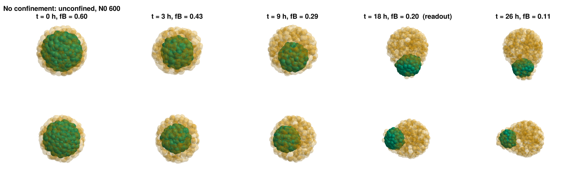
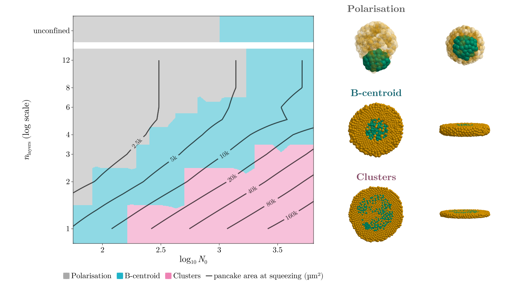

# Replies to your comments on 07

Your comments on `07-november-replies.md`, each followed by what I did, plus my review of the new
presentation. Nothing is committed.

**Update, 17:00:** the `f_att` BB 5.8 phase space (07, §3) has finished. Its results, with a decision for
you, are in 07 §8.

**Update, 13:50:** your session came back, so the overview and the movies are re-rendered (C at alpha 0.3,
the new y axis). The overview is copied into the report and `main.pdf` is rebuilt.

---

## 1. Transparency

> looks great now. maybe just a little less transparent for yellow cells.

C now has alpha **0.3** instead of 0.2 (`GHOST`). The unconfined row of fig2, at the new value:

**Already updated:**

- every report figure that has unconfined aggregates: fig1, fig2, fig4
- the Polarisation inset of the phase space
- the November report (figures copied, PDF rebuilt)

**Not yet updated (§3):**

- the overview's top row
- the unconfined and polarised movies

---

## 2. Phase-space y axis

> y axis is better to have n_layers (log scale) or something and show the actual numbers instead of log
> numbers

**Done**, in every phase-space chart and therefore also in the overview:

- The label is now "$n_\mathrm{layers}$ (log scale)".
- The ticks show the number of layers: 1, 2, 3, 4, 6, 8, 12.
- The positions are unchanged, still on a log scale.
- The linear versions (`*_lin.png`) keep "$n_\mathrm{layers}$".

**The x axis is unchanged** ($\log_{10} N_0$, as you asked in 06). If you prefer, it can work the same way:
"$N_0$ (log scale)" with ticks at 100, 300, 1000, 3000.

---

## 3. Overview and movies: waiting for your session

Shortly after you left, GLMakie stopped working: even a minimal script crashes with an access violation.
GLMakie needs OpenGL, and Windows takes the OpenGL context away when the remote-desktop session
disconnects (`query session`: yours is "Disc").

- **What got through.** All report figures and phase-space charts were redrawn just before that (12:51–12:52).
- **What did not.** The overview (`presentation.pdf`) and the movies. The overview in the report is
  therefore still the 07 version: C at alpha 0.2 and the old y-axis labels.
- **What happened next.** When you reconnected (13:48), I re-rendered the overview and all seven movies
  and copied the overview into the report. This section is done.
- **A fix along the way.** `stage7_presentation.jl` now also renders GLMakie in a hidden window, like the
  figure script. This is needed but does not fix the disconnected case.

---

## 4. The new presentation (`reports/2026-11 november/presentation/`)

**Verdict: it is in good shape.**

- Nineteen frames: experiment → goal → model → sanity checks → results → readout → phase space → Da →
  conclusions, with an appendix.
- It uses our figures and is consistent with the report: the readout with 10-cell clusters and the 50 % core
  fraction, readout at about 18 h, D ≈ 1.5 µm²/h, Da ≈ 200 at the threshold, C in yellow.
- The parameter slide matches the "Current" column of the report's table.

I did not edit it, since another agent may still be working on it (last change 12:46). What needs
attention:

**Stale after today's readout change: the same claim, in the slides and in your report text.**

- **Slide "The width of the pancake sets the threshold"** says "from ≈ 160 cells at one layer to ≈ 4000 at
  four" and "patterns appear at 8 to 17 cell diameters". With the current readout:

  | layers | patterns from N0 | pancake diameter at the threshold |
  |---|---|---|
  | 1 | ≈ 160 | ≈ 13 cell diameters (≈ 130 µm) |
  | 2 | ≈ 500 | ≈ 11 |
  | 3 | ≈ 2000 | ≈ 15 |
  | 4 | none up to 4800, although the pancake reaches 17 diameters | — |

- **The headline** "the threshold is set by the width, not the thickness" therefore only holds for 1–3
  layers. At 4 layers a pancake wider than the 3-layer threshold still does not pattern, unless
  `f_att` BB 5.8 (07 §3) is adopted. The same claim is in the third conclusion and in your text after
  Table 2 of the report. A safer wording: "for 1 to 3 layers the threshold sits at a pancake diameter of 11
  to 15 cells (110–150 µm); thicker slabs need more."

**Figures that need refreshing once the overview is re-rendered.** The deck uses
`presentation/figures/overview-A/B/C.pdf`, crops of the overview made at 12:46. They still show:

- C at alpha 0.2
- $\log_2 n_\mathrm{layers}$ with ticks 0–3 on the phase space

They need to be cropped again from the new `overview.pdf`. I can do that once it exists, if the other
agent is done with the deck.

**Small things:**

- **"The width of the pancake" slide:** `phase_space_diameter.png` is small next to the text and its legend
  is hard to read. Giving it about 70 % of the width would help.
- **"Patterns" slide:** fig3 carries its own title ("B patterns at the readout …") in small print above the
  panels, which repeats the caption.
- **Appendix "Phase space read later":** the caption says "rings break into islands, larger aggregates
  polarise late, and the smallest monolayer patterns shrink back". That was written for the October
  readout. With the current one it is still roughly right, but check it against the chart.

---

## Files

- **Code:** notebook cell a7f3c2d1 (`GHOST = 0.3`, y-axis ticks and label) → `gastruloids_lib.jl` and
  `gastruloids_analysis.jl`; `stage7_presentation.jl` (hidden GLMakie window).
- **Figures:** `code-claude/figures/*.png` redrawn and copied into `reports/2026-11 november/figures/`;
  `main.pdf` rebuilt (17 pages, no errors).
- **Docs:** `reports/FIGURES.md`.
