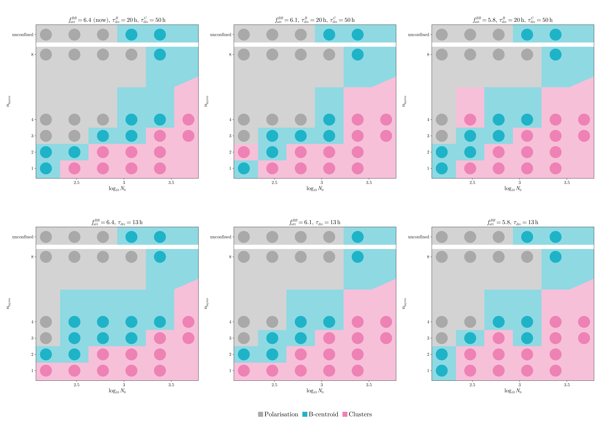
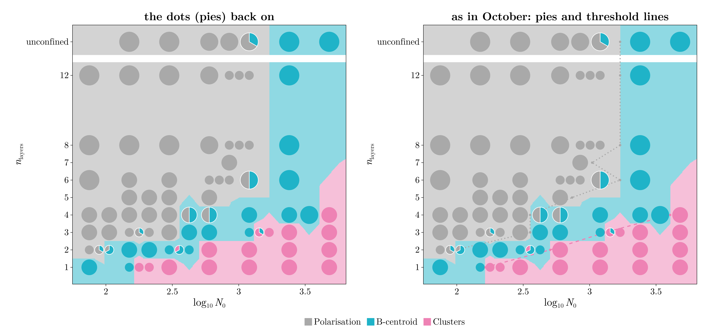
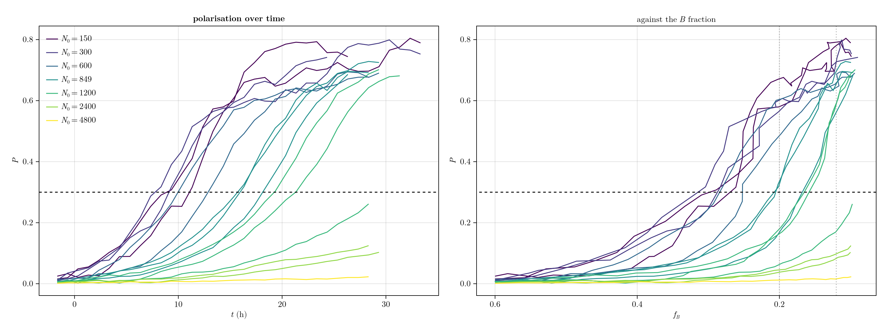

# Cleaning up: replies to your comments on 07 and 08

Grouped by topic, not in the order of your comments. Nothing is committed.

**Status (Nov 3, 18:30):** everything below is done.

- The grid results are in §2.
- All figures, the overview and the movies were rendered with GLMakie when your session was briefly active
  at 17:45.
- Your comments on the November report (the figures, the table, polarisation) are answered in §10.
- The study of why large aggregates do not polarise has started; it continues tonight in
  `10-autonomous-work.md`.

---

## 1. The readout moves to fB 12 %, with three outcomes

> Experiments readout at 24h and have around 12%, so we can allow for more time to see if we have patterns
>
> if the b centroid completely differentiates away in 24 h we should look at the fb 12% moment to determine
> space. but i dont want an other option, just those three

**The readout is now the first frame with 12 % B**: about 26 h after the start of differentiation, against
the experiments' 24 h after squeezing.

**One problem had to be solved first.** At 12 % so few B cells are left that islands shrink below the
10-cell minimum one by one. In a monolayer of N0 300, for example:

| | fB 0.2 | fB 0.12 |
|---|---|---|
| B cells | 111 | 78 |
| clusters of ≥ 10 cells | 4 (17, 16, 11, 10) | 1 (10) |

That last survivor reads as "B-centroid". It happened in every monolayer up to N0 600, and in 2 layers at
N0 600.

**The rule, written for your remark.** A moment counts only if at least half of the B cells are in clusters
there. Below that, B is differentiating away, so the run takes the outcome it had before:

1. fB 0.12, if at least half of B is clustered there;
2. else fB 0.15, under the same condition;
3. else fB 0.2.

So a central cluster that differentiates away is a B-centroid, and islands that differentiate away are
Clusters.

- **Why one half.** At 12 %, runs that were Clusters at fB 0.2 and are still clearly patterned have
  0.5–0.93 of B in clusters (the 3-layer rings breaking late, 4 layers at N0 4800). The ones that have
  dissolved have 0.07–0.32.
- **No "other" any more.** No run is left without a cluster at fB 0.2, so the rule never needs a fourth
  outcome.
- **Ties between seeds** are broken by the same rule from fB 0.10, the end of the runs.
- **Where it lives.** In the code: `read_outcome` in `stage5_common.jl` (column `class_read`). In the report:
  rewritten "Reading the outcome" subsection, which states the rule as an equation.

**What changes in the phase space**, against the readout at fB 0.2:

| layers | polarised up to N0 | B-centroid | clusters from N0 |
|---|---|---|---|
| 1 | – | 75–150 | ≈ 160 (same) |
| 2 | 75–89 | 106–424 | ≈ 500 (same) |
| 3 | **300** (was 178) | 424–1200 | **≈ 1300** (was ≈ 2000) |
| 4 | **300–600** (was 212) | 424–3394 | **≈ 4000** (was none up to 4800) |
| 6–12 | **849–1200** (was 600–1200) | 1200–2400 | none up to 2400 |
| unconfined | **1200** (was 600–849) | 1200–4800 | none |

**What the extra 8 hours bring:**

- **More patterns in thick slabs.** The 3-layer rings at N0 1427–1697 break, and 4 layers at N0 4800
  pattern.
- **More polarisation.** Medium aggregates polarise late, unconfined up to N0 1200.

**Consequences for the figures:**

- fig2's medium-confinement row is now **3 layers**, N0 600: at 4 layers one of the two seeds polarises by
  12 %.
- The panel B frames of the overview are at 60 %, 30 % and **12 %**.

**Text of yours that no longer matches.** In the report I changed the captions, Table 2 and the "Reading the
outcome" subsection. Your text still says:

- **"The outcome is read when 20 % of the cells are B (96 h in the experiments)"**, in the Phase space
  subsection. It is now 12 %; the 96 h part is unchanged.
- **The paragraph after Table 2** ("from N0 ≈ 160 … to about 4000 at four layers"). Four layers is ≈ 4000
  again by coincidence, but 3 layers is now ≈ 1300.
- **"The outcome depends on when it is read. Figure … shows the same simulations when only 12 %"**. That
  figure is now the fB 0.2 chart (`phase_space_fB20.png`, readout of Nov 2), so the sentence should say
  "earlier, at 20 %".
- **The remark in §2.2**: "60 % to 20 % in about 21 hours". The readout is now at 12 %, about 26 h.

---

## 2. Parameters: equal division times and `f_att` BB

> equal division time looks surprisingly good, but only clusters for low number of layers. maybe if we
> introduce this f_att BB change we can get better?
>
> however, the change in BB does not yield such a nice phase space. maybe we can reduce it less? or maybe
> its counterproductive

Both questions are one grid: `f_att` BB × τ_div.

|  | τ_div B 20 h, C 50 h (now) | τ_div 13 h for both |
|---|---|---|
| `f_att` BB 6.4 (now) | `phase_D` (exists) | `tdiv` (exists, + N0 4800 at 3 and 4 layers) |
| `f_att` BB 6.1 (half-way) | **new** | **new** |
| `f_att` BB 5.8 | `phase_E` (exists) | **new** |

The new runs (`results/stage5/grid_nov3`, 99 runs) use the coarse map of the 13 h test, seed 1, read with
the new readout (§1):

- layers 1, 2, 3, 4 and 8, plus unconfined
- N0 150–2400, plus 4800 at 3 and 4 layers
- the fusion assay for 6.1

### Results

Seed 1, read at fB 12 % (§1), on the same coarse map (`code-claude/scripts/grid_compare.jl`; per point:
`results/stage5/grid_nov3/compare.txt`):

Where clusters start (the first N0 from which every larger point of the map is Clusters):

| | 1 layer | 2 layers | 3 layers | 4 layers | 8 layers | unconfined polarised up to |
|---|---|---|---|---|---|---|
| 6.4, now | 300 | 600 | 2400 | 4800 | – | 600 |
| 6.1, now | 300 | 600 | 2400 | **2400** | – | 600 |
| 5.8, now | 300 | 600 | **1200** | **2400** | – | 600 |
| 6.4, 13 h | **150** | 600 | 2400 | 4800 | – | 600 |
| **6.1, 13 h** | **150** | 600 | **1200** | **2400** | – | **1200** |
| 5.8, 13 h | 300 | 300 | 2400 (600 too) | **2400** | – | 600 |

### My reading

- **Yes, the two changes add up.** The `f_att` BB change moves the thick slabs (3–4 layers) and the equal
  division time moves the monolayers. Together, at 6.1 and 13 h, the chart is the cleanest of the six: a
  regular staircase from N0 150 (1 layer) to 600 (2), 1200 (3) and 2400 (4 layers), with no isolated points.
  Its unconfined row also polarises one step further, up to 1200.
- **Reducing B–B cohesion less works.** 6.1 gives the same 4-layer threshold as 5.8. 5.8 has isolated
  cluster points among central or polarised ones: 4 layers at N0 300 (now), and with 13 h 2 layers at
  N0 300 and 3 layers at N0 600. That is the "not such a nice phase space" you saw, and 6.1 with 13 h has
  none. (6.1 with the current τ has one, 2 layers at N0 150.) So 5.8 overshoots.
- **The fusion assay of 6.1 is fine:** BB 0.54, CC 0.56, BC 0.91, the same as now.
- **Caveats:**
  - One seed on a coarse map: single points can flip.
  - None of the six makes unconfined N0 2400 polarise. That is a separate problem (your report comment,
    §10).

**Proposal:** `f_att` BB 6.1 with τ_div = 13 h for B and C is the candidate for the definitive set, if the
polarisation study (`10-autonomous-work.md`) does not change the picture. Before adopting it I would run its
full phase space (3 seeds, the refined points; about 4 h). I have not started that: it is your call, and it
should include whatever fixes large-aggregate polarisation.

---

## 3. Fusion must work

> fusion must work

Agreed: it is a hard condition for any set we adopt.

**The metric.** COM separation / (Rg₁ + Rg₂) after 24 h with no division and no differentiation: about 0.5
for one sphere, about 1.6 at first contact. BB and CC should fuse; BC should stay clearly higher (glue).

| set | BB | CC | BC |
|---|---|---|---|
| now (`f_att` BB 6.4) | 0.53 | 0.56 | 0.91 |
| `f_att` BB 5.8 | 0.53 | 0.56 | 0.94 |
| `mu` BB 1.875 | 0.54 | 0.56 | 0.92 |
| `f_rep` BB 5.5 | 0.55 | 0.56 | 0.96 |
| `f_att` CC 3.3 | 0.54 | 0.55 | 0.96 |
| `f_att` BB 6.1 | pending (in the grid) | | |

**Every set tested so far fuses and glues correctly.** The division time does not enter: the assay has no
division. Whichever set we choose, its fusion figure (fig5) will be redrawn from its own assay.

---

## 4. Transparency

> transparency to 0.5

`GHOST = 0.5`: the C cells of unconfined aggregates at alpha 0.5, everything else unchanged.

**Pending:** the figures (fig1, fig2, fig4, the Polarisation inset, the overview, the unconfined and
polarised movies) will be redrawn when your session is back.

---

## 5. Phase-space axes

> do not use log for n_layers, and for each phase space also do a completely linear plot (N_0 too)

Done in the code (`replot_figures`, the overview). Every phase space is now drawn in three versions:

| file | x | y |
|---|---|---|
| `phase_space.png` | log₁₀ N0 | number of layers, **linear** |
| `phase_space_lin.png` | **N0, linear** | number of layers, linear |
| `phase_space_diameter.png` | log₁₀ N0 | pancake diameter at squeezing (log scale) |

The old six versions (with `_N0`, `_lin_N0`, `_diameter_N0`, and n_layers on a log scale) are gone. With a
linear axis the thin slabs, where everything happens, sit close together at the bottom. The log version is
still one keyword away (`y = :layers`) if you want it back.

There are three folders of charts:

- `phase_space` (the new readout)
- `phase_space_fB20` (yesterday's readout)
- `phase_space_classic` (October's)

The section 1 picture below already uses the linear axis.

---

## 6. The old phase space with dots

> get a picture of the old phase space with dots over the space and explain me the dots, why did they have a
> size and so on

The same runs and readout as now, with the dots switched back on (`phase_space!(...; pies = true)`), and on
the right also the October threshold lines:

**What a dot is.** One dot per simulated point (number of layers, N0). It is a **pie of its seeds**: each
seed's outcome gets an equal slice in the colour of that outcome.

- **One colour:** all seeds agree.
- **Split:** the seeds disagree. For example, 4 layers at N0 424 is half grey, half cyan: one seed
  polarised, one stayed central.

White lines separate the slices.

**Why the dots have different sizes.** The size carries no information about the outcome; it only avoids
overlaps.

- **The rule.** The radius is 0.45 × the distance to the nearest other point, kept between 0.13 and 0.42
  chart units. The chart spans 10 units across and 8 up.
- **Where they are small.** Points with close neighbours get small dots:
  - the refined N0 values (89, 106, 178, 212, 357, 424, 714, 849, 1009, 1427, 1697, 3394), added between
    the grid values to locate the boundaries
  - the rows at 5 and 7 layers, added for the same reason
- **Where they are big.** Points of the regular grid, alone in their area: N0 75, 150, 300, 600, 1200,
  2400, 4800 at 1, 2, 3, 4, 6, 8, 12 layers.

**The background** is the majority outcome of the nearest point, ties broken by the later readout. That is
all the current charts keep.

**The October lines** (right):

- **Dashed pink:** where clusters start, per number of layers, half-way between the last point without
  clusters and the first with them.
- **Dotted grey:** up to where the aggregate polarises.

You asked to remove the dots and lines on Nov 2. They come back with `pies = true, thresholds = true`.

---

## 7. Figures: clean-up, beamer, half-done renders

> put beamer-specific figures in figures/beamer. then, remove the beamer.* files

Done:

- **Moved to `reports/2026-11 november/figures/beamer/`:** the deck's own figures, `overview-A.pdf`,
  `overview-B.pdf`, `overview-C.pdf` and `upc-mat-logo.pdf`.
- **Sent to the Recycle Bin:** `beamer.tex`, `beamer.pdf` and `beamer.synctex.gz`. They are also still in git,
  so both are recoverable.

> i want to go over all figures so clean up the ones that we definitely do not need anymore

**Sent to the Recycle Bin** (all of them can be regenerated):

- **`code-claude/figures/`:** 24 phase-space charts that the code no longer makes:
  - every `*_N0.png`
  - the `phase_space_late*`, `phase_space_exp20*` and `phase_space_core40*` sets (the fB 0.12 readout is
    now the main one; the 20-cell and 40 % readouts were one-off comparisons in 07)
- **`reports/2026-11 november/figures/`:** `phase_space_classic.png` and `phase_space_lin.png`, which
  `main.tex` does not use.

What remains, and what each one is for:

| where | figures |
|---|---|
| `code-claude/figures/` | `fig1`–`fig7`; `phase_space{,_lin,_diameter}.png` × the three folders; `presentation.pdf/.png` (the overview); `movies/` |
| `reports/2026-11 november/figures/` | yours (`exp-*`, `pol-histogram-*`, `fusions-relevant.jpeg`); the copies used by `main.tex`; `beamer/` |
| `claude-answers/img/` | kept: the answers refer to them |

Also on the list, still to decide:

- **Movies `central_inset.mp4` and `pattern_inset.mp4`.** They are movies of the phase-space insets; I
  kept them for now.
- **The October report's figures.** I have not touched those (as agreed).

> fix the things that were left half-done because of the opengl … re-render figures that need it

**Yesterday's half-done renders were all finished** when you reconnected at 13:48: the overview, the seven
movies, and the overview copied into the report. Today's changes need a new render, which will run as soon
as you reconnect (status at the top).

> fix the small things

- **fig2, fig3 and fig4 have no title any more.** The report's captions say it, and fig3's title repeated
  its caption.
- **fig3's panel titles now give the fB of each frame** (0.11–0.12, or 0.19–0.20 for runs read earlier by
  the rule of §1).
- **The other small things in 08 §4 were about the deck**, which is gone.

---

## 8. Later: bigger plots

> when we settle on some parameters and clean up the code, we will do larger plots with more realisations
> and larger N_0

Noted. A rough cost, so we can plan it:

- The current phase space is 163 confined runs plus 15 unconfined, and takes about 4 h on the 22 workers.
- The runs at N0 4800 are the longest: 2–3.5 h each.
- The cost per step grows about in proportion to the number of cells, so N0 9600 would take roughly twice
  as long per run (5–7 h).
- 5 seeds per point instead of 2–3 roughly doubles the total.

---

## 9. The adhesion energy remark in the report

The remark in "Analysis of the model" (§2.3) is mine, from the thick-slab work of Oct 8 (answer 04 and
REPORT.md, decisions log 10-08). It has three parts with different origins:

1. **W_XY:** a direct calculation from our force law.
2. **The tensions σ and γ:** a standard mapping (differential adhesion).
3. **The gluing condition:** a standard result for three-phase drops (Neumann's triangle).

Only part 1 is exact for our model. Parts 2 and 3 are an analogy that predicts which way things go, not
numbers.

### 9.1 The adhesion energy W_XY: from our force law

Between two cells at distance d, the force along the line between them is F_ij = f(d) F (report, Mechanics),
with

$$f(d) = \Big(\frac{2r}{d} - 1\Big)\Big(\frac{2\mu r}{d} - 1\Big).$$

- **Repulsion** for d < 2r.
- **Attraction** for 2r < d < 2μr: there the first factor is negative and the second positive.
- **No force** beyond 2μr.

The work needed to pull two touching cells (d = 2r) apart until they no longer interact (d = 2μr) is the
integral of the attraction over that range. With a = 2r and b = 2μr:

$$W = F_\text{att}\int_a^b \Big(1-\frac{a}{d}\Big)\Big(\frac{b}{d}-1\Big)\,\mathrm{d}d
    = F_\text{att}\int_a^b \Big(\frac{a+b}{d} - 1 - \frac{ab}{d^2}\Big)\mathrm{d}d
    = F_\text{att}\big[(a+b)\ln\tfrac{b}{a} - 2(b-a)\big],$$

which is the formula in the report:

$$W_{XY} = F_\text{att}^{(X,Y)}\, 2r\, A(\mu_{XY}), \qquad A(\mu) = (1+\mu)\ln\mu - 2(\mu-1).$$

Our energy unit is F₀ × R₀ (100 pN × 5 µm).

**A(μ) is very sensitive to μ.** It is 0 at μ = 1 and grows like (μ−1)³/6 near it, so a small change of μ
moves W a lot:

| μ | A(μ) | |
|---|---|---|
| 1.8 | 0.046 | |
| 1.85 | 0.053 | |
| 1.9 | 0.061 | μ_BB 2 → 1.9 is −23 % of W_BB |
| 2 | 0.079 | |
| 2.14 | 0.109 | |

With our parameters (r = 1):

| pair | F_att | μ | W |
|---|---|---|---|
| BB, Oct 7 | 6.4 | 2 | 1.02 |
| BB, now | 6.4 | 1.9 | **0.79** |
| BB, grid | 6.1 | 1.9 | 0.75 |
| BB, grid | 5.8 | 1.9 | 0.71 |
| CC | 3 | 2.14 | **0.65** |
| BC | 1.6 | 2 | **0.25** |

This is why I describe μ_BB and `f_att` BB as the same knob, B–B cohesion. 5.8 at μ 1.9 gives the same W as
μ ≈ 1.87 at 6.4.

**What W leaves out:**

- **Repulsion.** It enters how far cells overlap at rest, not the cost of separating them.
- **Friction and the α velocity-averaging term.** They change the dynamics, not the energy.

### 9.2 Surface and interfacial tensions: the differential adhesion picture

This is the classic mapping of Steinberg's differential adhesion hypothesis (1960s) and of the cellular Potts
models of cell sorting (Graner & Glazier, 1990s). A tissue behaves like a liquid whose tensions come from the
adhesion energies between cell types.

- **Surface tension σ_X** (tissue X against the medium). Cutting a tissue X in two and separating the halves
  breaks X–X bonds across the cut and makes two free surfaces:

  $$\sigma_X = \frac{W_{XX}}{2}.$$

- **Interfacial tension γ_BC.** Swapping a B–B bond and a C–C bond for two B–C bonds costs

  $$\gamma_{BC} = \frac{W_{BB} + W_{CC}}{2} - W_{BC}.$$

  γ > 0 means B and C prefer their own kind, so they sort; γ < 0 means they mix.

Now: σ_B = 0.39, σ_C = 0.33 and γ_BC = (0.79 + 0.65)/2 − 0.25 = **0.47** > 0, so B and C sort. B is the
more cohesive tissue (σ_B > σ_C), so B goes inside and C outside. That is the B core in a C shell, and why
the core keeps itself together.

**The simplification.** These are energies per bond, not per unit area. To turn them into real tensions you
would multiply by the number of bonds per unit area, which depends on packing and on μ, and is not the same
for B and C. So comparing σ_B with σ_C is only safe when they differ clearly. That is why I read
"W_BB ≈ W_CC at μ_BB 1.85" as "B is no longer more cohesive than C", which is what we saw (B dissolves).

### 9.3 Gluing without rounding up: Neumann's triangle

When two drops of different liquids B and C touch in a third medium, three tensions act along the line where
the three phases meet: σ_B, σ_C and γ_BC. A stable contact line exists only if the three can balance as the
sides of a triangle (**Neumann's triangle**). That needs each one to be smaller than the sum of the other two:

$$\gamma_{BC} < \sigma_B + \sigma_C, \qquad \sigma_B < \sigma_C + \gamma_{BC}, \qquad \sigma_C < \sigma_B + \gamma_{BC},$$

i.e. **|σ_B − σ_C| < γ_BC < σ_B + σ_C**, the condition in the report. This is the classic analysis of
three-phase drops: partial engulfment versus complete engulfment versus separation, e.g. Torza & Mason
(1970) for liquid drops, applied to cell aggregates in the differential-adhesion literature.

**What each case means for a BC doublet:**

- **Inside the triangle:** partial engulfment. The two aggregates stay as two lobes joined by a neck, which
  is "glue".
- **σ_B > σ_C + γ_BC:** C spreads over B (complete engulfment), and the doublet becomes one round
  aggregate with B inside.
- **γ_BC > σ_B + σ_C:** they do not stick at all.

BB and CC doublets have γ = 0 (one liquid), so they always round up into one sphere: "fuse".

With our numbers: |0.39 − 0.33| = 0.06 < 0.47 < 0.72. We are well inside the triangle, so BC glues, as the
assay shows (BC 0.91–0.96 against 0.53–0.56 for BB and CC).

**For the f_att BB sets:**

| f_att BB | σ_B | γ_BC | inside the triangle? |
|---|---|---|---|
| 6.1 | 0.37 | 0.45 | yes, by a wide margin |
| 5.8 | 0.36 | 0.43 | yes, by a wide margin |

So the analogy predicts that fusion keeps working along the whole grid. The 6.1 assay running now checks it
directly (§3).

### 9.4 How much to trust it

- **It gives directions, and they held:**
  - weaker B–B cohesion loosens the B core
  - W_BB ≈ W_CC is the edge where B dissolves
  - BC stays glued for any reasonable B–B change
- **It gives no thresholds.** Where patterns start depends on growth, differentiation, confinement and
  friction, none of which is in an energy argument.
- **Sources.** The formulas in 9.1 are derived here and checked against the numbers in REPORT.md. 9.2 and
  9.3 are textbook background, cited from memory and not looked up for this answer. If the report should
  cite them, I would look up the exact references first (Steinberg's differential adhesion papers; Torza &
  Mason 1970 on three-phase drops).

---

## 10. Your comments on the November report

### Figures (all redrawn, copied into the report)

> figures/fig1_initial_condition.png now this has 4 figures. i want just the one for the sphere and one for
> the pancake. the pancake should be the diagonal view … showing the top a little bit more

**fig1** now has one panel each. The pancake is seen obliquely at 45° (was 36°, `OBLIQUE_ELEVATION`), so the
top shows more. The sphere is drawn from the same oblique view: a sphere looks the same from any side, and
with the same view and box both are drawn at the same scale.

> all figures should use latex font

All of them now use LaTeX's Computer Modern (`TEX_FONTS`), with math in the titles ($N_0$, $f_B$, $P$,
$N_\mathrm{eff}$):

- the report figures
- the phase-space charts
- the overview
- the movies
- the MSD figure

Sizes are unchanged, so the figures may look slightly different in the report.

> fig5_fusion … two rows, one with the two aggregates placed for fusion and then a latex arrow pointing down
> and below the outcome of the fused aggregate … three figures one for each fusion

**fig5** now has three columns (BB, CC, BC). Each has the two aggregates as placed for the assay, a LaTeX ↓,
and the doublet after 24 h.

For this I made the assay also save its starting doublets and reran it for the current set. The numbers
are unchanged: BB 0.54, CC 0.56, BC 0.91.

> fig4_unconfined: drop the main title. for the figure titles, just write N_0 = ...; P = ... \\ t = 24 h.
> leave only one view in the unconfined case … the pole going to the side. two views only in the confined case

**Done.**

- **Every unconfined panel now has one view:** from the front, with the aggregate rotated so that B points
  to the side. This applies to fig4, fig1's sphere and fig2's top row.
- **Confined panels keep their two views.**
- **fig4's titles** read "$N_0 = …$; $P = …$" over "$t = …$ h".

**About "t = 24 h".** The panels are the readout frames, the first frame with 12 % B. That frame comes at
25–32 h after the start of differentiation, depending on the aggregate, so I wrote each panel's own time.
If you prefer, I can show all five at exactly t = 24 h instead. They would then not all be at the readout,
and P would differ slightly from the phase space.

> behaviours fig: the side view takes up lots of unnecessary vertical space … a little bit more tilted …
> drop the main title

**fig2:**

- **The side view is tilted 20°** (`SIDE_ELEVATION`; was 6°), so some of the top shows.
- **Its box fits the slab**, so it fills the width of the panel, and its row is about half the height of
  the top-view row.
- **No main title.** Its row titles read "No confinement, $N_0 = 600$" and so on.

The same tilt is used for every side view: the phase-space insets and the movies.

> fig3_patterns: remove big title. fig titles only be like "1 layer, $N_0$=100"

**Done.**

### Parameter table

> make sure the middle table is sotiris fusion, maybe they are july

**You were right: it was not.** The middle column held the values from the July report's table:

- μ: 1.55, 1.5, 1.525, …
- F_att: 6, 6, 2.4, …

The note below the table had a third set ("F_rep BB 3, CC 5.1"), which is our July *variant*.

Sotiris' fusion set is the "FUSION PARAMETERS" block of your laptop notebook
(`archive/code-original/july-laptop/squeezing-gastruloids.ipynb`), identical to `PSETS["fusion"]` in our
code:

$$\mu = 2\begin{pmatrix}1&0.91&1\\0.91&1&1\\1&1&1.07\end{pmatrix},\quad
F_\mathrm{att} = 4\begin{pmatrix}0.9&1&0.6\\1&1.6&0.4\\0.6&0.4&0.75\end{pmatrix},\quad
F_\mathrm{rep} = 3\begin{pmatrix}3&1&1\\1&2&1\\1&1&2\end{pmatrix}.$$

The table now shows this set.

**What changed in the table:**

- **Colours:**
  - dark green: Sotiris differs from DO; also used in Current where Current keeps Sotiris' value
  - dark blue: Current differs from Sotiris
- **The note on the old values is gone.**
- **Rows removed:** division relaxation, time units per hour, plates, readout.
- **The typical scales (T₀, R₀, F₀) are above the rows with no values.**
- **The Current column has no remarks in parentheses.**

**What the colours show.** Most of Current is Sotiris':

- F_att BB 6.4 and CC 3, μ_CC 2.14 and F_rep CC 6 are his (green).
- Our own changes (blue) are only:
  - μ_BB 1.9
  - F_rep BB 4.5 (his 6)
  - Δt 0.015
  - dropping A, p and K
  - the plates: λ_wall, L, φ_B⁰

**One thing I could not check.** In the Sotiris column, the rows other than μ, F_att, F_rep and F₀ (Δt, α,
τ_div, σ_div, λ, p, q, K, T₀) still come from the July table. The fusion assay has no division or
differentiation, so τ_div, p, q and K do not enter it at all.

### Large aggregates do not polarise

> i think it's a problem that large aggregates do not polarise since we aim to plot larger aggregates. you
> can take your time to study this

Started; the full study is in `10-autonomous-work.md`. The first finding:

Polarisation is a delayed take-off, and the delay grows steeply with size:

| N0 | P crosses 0.3 at |
|---|---|
| 150–600 | 8–13 h |
| 849 | 16–18 h |
| 1200 | 19–21 h (2 of 3 seeds) |
| 2400 | not before B runs out (P 0.1 at the end) |
| 4800 | not before B runs out (P 0.02 at the end) |

**What does not help** (all checked):

- weaker B–B cohesion (`f_att` BB 6.1, 5.8)
- equal division times
- both together

**Why, I think.** For B to break out of its C shell, the energy gained per unit of contact area is
σ_C + γ_BC − σ_B = W_CC − W_BC, which has no W_BB in it (§9). So the lever should be on the C side. A screen
of C-side changes (C–C attraction and range, and C and B stiffness) is running, at N0 600–4800. Results in
10.

### Other

- **`main.pdf` could not be rebuilt at 17:50:** the file was locked, probably open in a PDF viewer. All new
  figures are in `figures/`, so your next build picks them up.
- **Your To-Do list in the report:** I removed only item 1 (plot the pending GLMakie figures), which is done.
