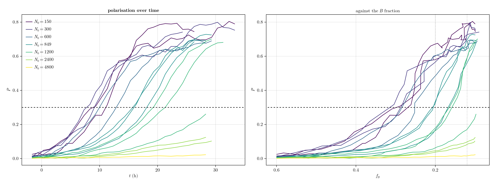
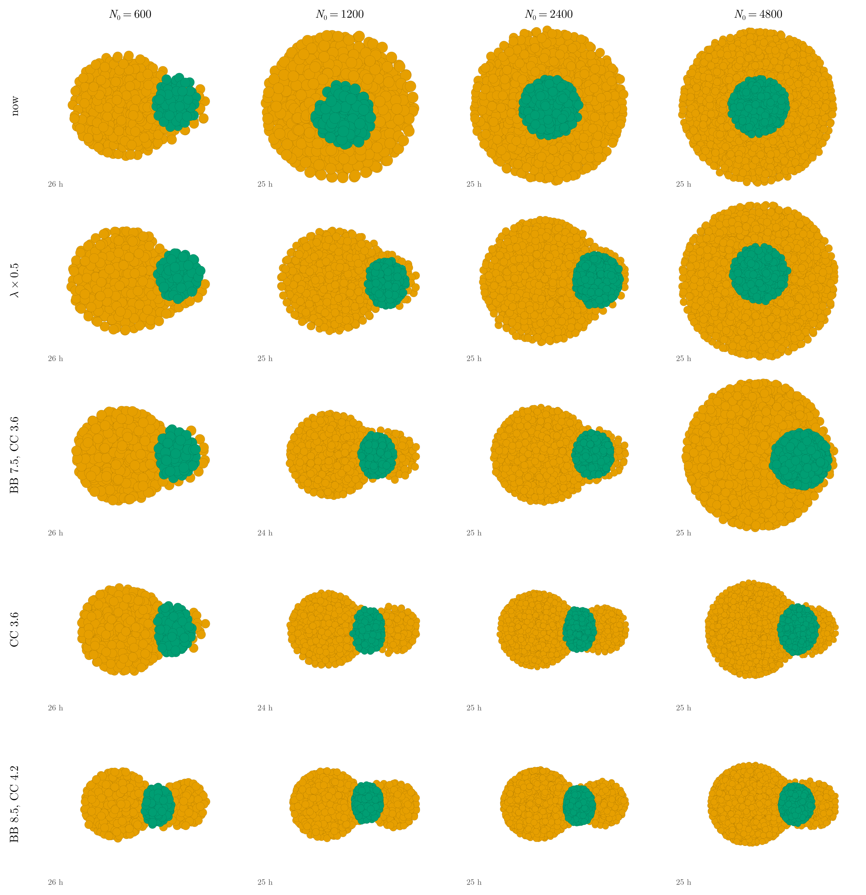
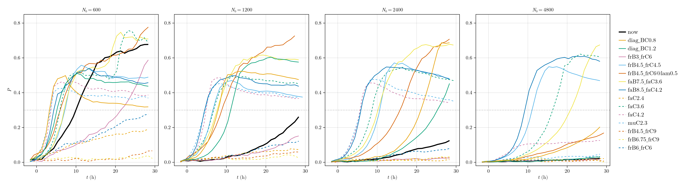
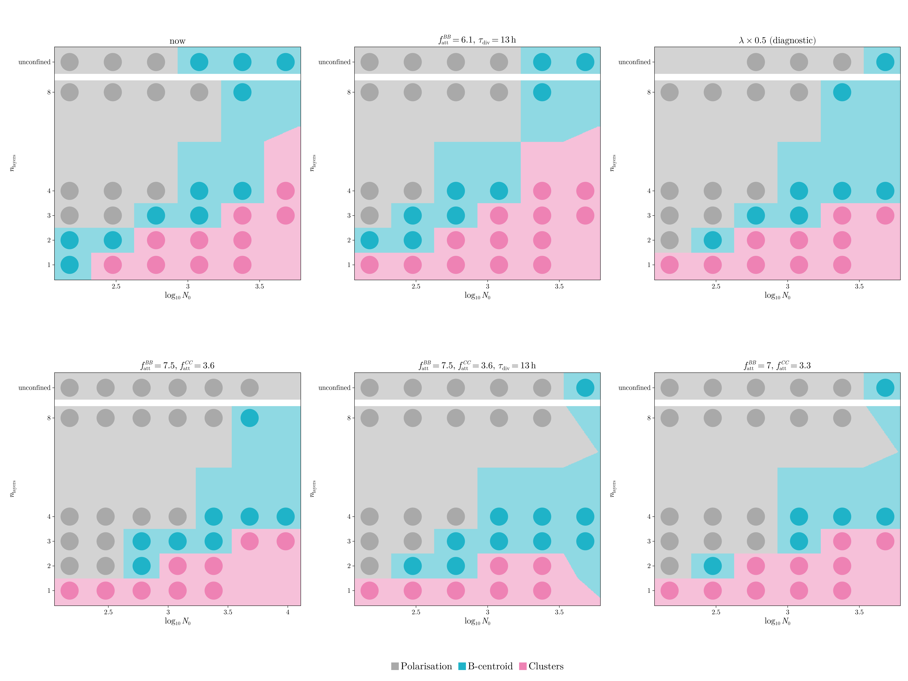
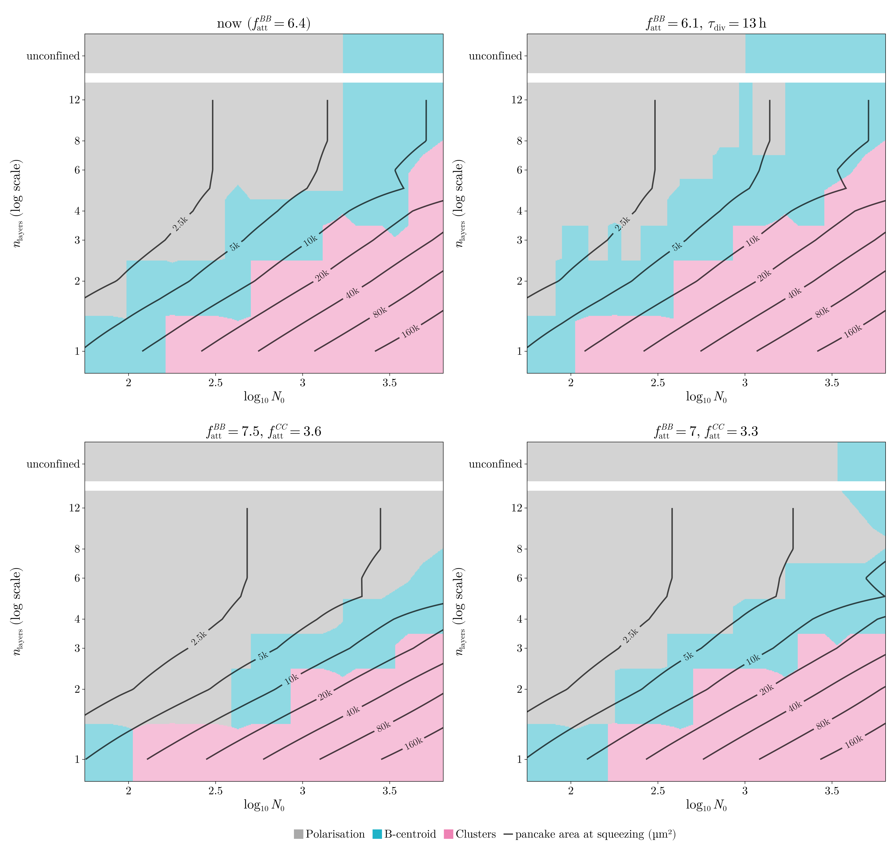
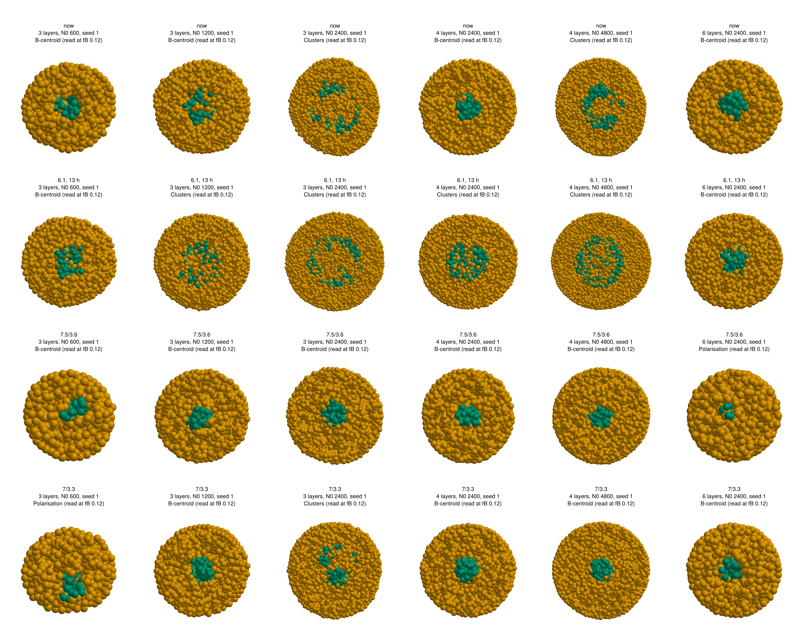
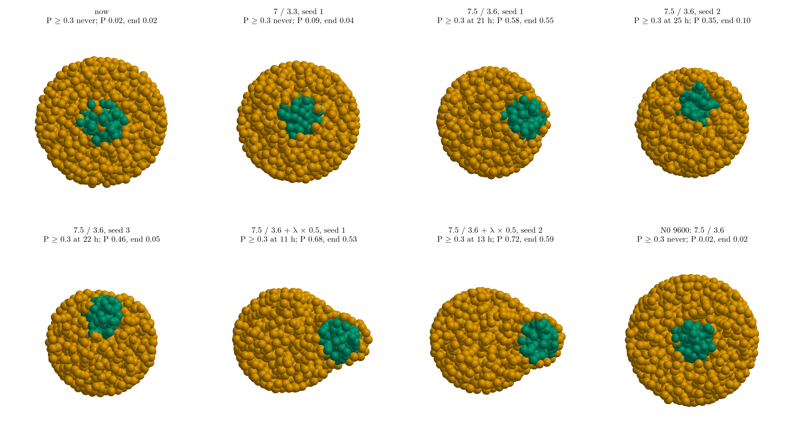
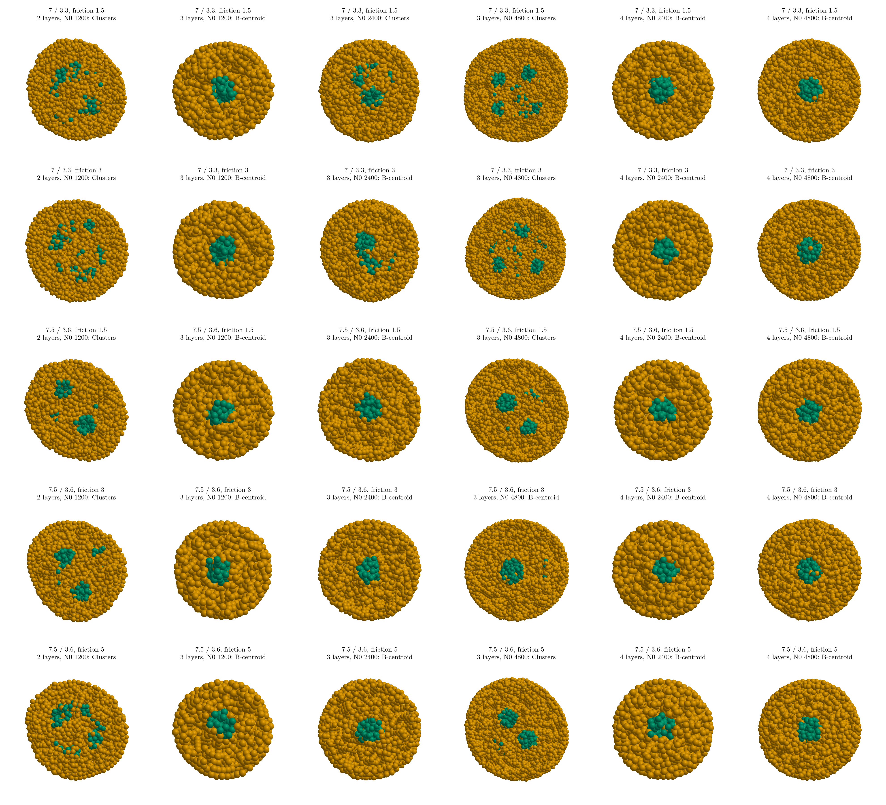

# Autonomous work, Nov 3 evening to Nov 4

What I did while you were away (17:40 on Nov 3 to about 15:00 on Nov 4), as you asked: finished what was
pending, studied why large aggregates do not polarise, cleaned up, and estimated the definitive runs.
Things that need your approval are collected in §6. Nothing is committed.

**In short:**

- **Large aggregates do not polarise because the tissue rearranges too slowly** compared with how fast B
  differentiates away (§2.4). Halving the friction λ halves the time to polarise at N0 4800 and gives clean
  poles (§2.7).
- **The sets that let larger aggregates polarise also move the 3–4-layer clusters to larger N0.** The three
  candidate sets lie on one trade-off line (§2.6), and λ × 0.5 sits on the same line (§2.7).
- **No set polarises unconfined N0 9600** by the readout. The N0 9600 run with λ × 0.5 finishes about 18:30.
- **Plate friction does not help.** It acts only on confined runs, but it changes 1–2 layers and not the
  3–4-layer clusters (§2.8). I found no parameter outside the frozen ones that moves the thick-slab
  clusters without moving the polarisation limit with them, so the choice is where to sit on that line (§6).
- **Definitive runs** up to N0 9600 take about a day on this machine (§5). Decisions are in §6.

---

## 1. Finished from the earlier rounds

- **Report figures re-rendered.** All GLMakie figures, the overview and the seven movies, with:
  - alpha 0.5
  - linear n_layers
  - the 12 % readout
  - LaTeX fonts
  - the new layouts of fig1, fig2, fig3, fig4 and fig5

  This was done while your session was briefly active at 17:45. The figures are in
  `reports/2026-11 november/figures/`.
- **`main.pdf` rebuilt** at 20:40 (it was locked at 17:50): 15 pages, no errors or undefined references.
- **A box fix.** A polarised aggregate was clipped at the edge of its panel: the box was centred on the
  centre of mass but sized from the width. Fixed in `box_halfwidth` and in the overview.
- **Grid results:** in 09 §2.
- **Answers to your comments on the November report:** in 09 §10.
- **`reports/REPORT.md`:** a "Stage 8b" summary of §2 and two rows in the decisions log.

---

## 2. Why large aggregates do not polarise

### 2.1 What happens

Polarisation P(t) of the unconfined runs of the current set (`code-claude/scripts/polarisation_time.jl`):

P rises along an S-curve whose take-off comes later and later with size:

| N0 | P crosses 0.3 at |
|---|---|
| 150–600 | 8–13 h |
| 849 | 16–18 h |
| 1200 | 19–21 h (2 of 3 seeds) |
| 2400 | not before B runs out (P ≈ 0.1 at the end) |
| 4800 | not before B runs out (P ≈ 0.02 at the end) |

So large aggregates are not stuck; they are slow, and B runs out first.

**What does not change this:**

- weaker B–B cohesion (`f_att` BB 6.1, 5.8)
- equal division times (13 h)
- both together

N0 1200 stays marginal and 2400 never gets there.

### 2.2 A finding: large aggregates are over-compressed

Measuring the aggregate sizes (for your To-Do table, §3), I found that the cells in large aggregates overlap
far more than in small ones. At the moment of squeezing, unconfined:

| N0 | median distance to the nearest neighbour (centre / whole) | neighbours closer than 2r (centre) |
|---|---|---|
| 150 | 1.22 r / 1.39 r | 15 |
| 600 | 1.09 r / 1.23 r | 24 |
| 2400 | 0.99 r / 1.10 r | 39 |
| 4800 | 0.96 r / 1.05 r | 44 |

Two non-overlapping cells of radius r touch at 2 r. Here neighbours sit about one radius apart, and a cell in
the middle of a large aggregate overlaps 40 others.

**Where it comes from.** The compression builds while the aggregate is grown from one cell (fast divisions,
daughters placed 0.3 r apart) and it never relaxes. It even increases during differentiation: in the
unconfined N0 2400 run, the B cells end only 0.78 r apart. In a monolayer it relaxes once squeezed (1.48 r),
because the cells can escape sideways.

**My reading.** In a model with friction and no noise, the pressure from new cells relaxes by flowing
outwards, and that takes longer the bigger the aggregate (roughly ∝ R²). Large aggregates therefore stay
compressed and jammed. Breaking the C shell and moving the B core to one side is a rearrangement of the
same kind, so it slows down with size too.

**This would also explain** why weakening B–B cohesion or speeding up division does not help: neither makes
the tissue relax faster.

### 2.3 The screen running tonight

`results/stage5/pol_nov3`: unconfined N0 600 (must still polarise), 1200, 2400 and 4800, seed 1, plus the
fusion assay of each set:

| set | change | idea |
|---|---|---|
| `faC3.6`, `faC4.2` | `f_att` CC 3 → 3.6 / 4.2 | the push of B out of its C shell is W_CC − W_BC (09 §9) |
| `muC2.3` | `mu` CC 2.14 → 2.3 | the same through the range |
| `faC2.4` | `f_att` CC 3 → 2.4 | the opposite direction, as a control |
| `frC4.5`, `frB3` | softer C, softer B | |
| `frB6`, `frC9`, `frB6.75_frC9` | stiffer B, C, both | less compression (§2.2) |
| `@lam0.5` | friction λ × 0.5 (= every force × 2) | **diagnostic only** (you asked to keep λ): if this polarises large aggregates, the cause is the relaxation speed |

### 2.4 Results of the screens (unconfined)

P alone is not enough: some sets give a large P without a pole. So I also measure where the B centroid sits
along the aggregate's long axis, at fB 12 %:

- **"end" ≈ 0.5–0.6:** B is a cap at one end, a real pole.
- **"end" ≈ 0.15–0.25:** B is a belt around the waist between two C lobes, a "dumbbell".

Each cell of the table: hours until P reaches 0.3 / P at fB 12 % / "end".

| set | N0 600 | 1200 | 2400 | 4800 | shape |
|---|---|---|---|---|---|
| now | 10 h / 0.67 / 0.53 | never / 0.20 | never / 0.10 | never / 0.02 | pole only up to 600 |
| friction λ × 0.5 (diagnostic) | 6 h / 0.73 / 0.61 | 9 h / 0.69 / 0.56 | 16 h / 0.66 / 0.59 | never / 0.14 | clean pole up to 2400; 4800 central |
| **`f_att` BB 7.5, CC 3.6** | 7 h / 0.72 / 0.55 | 8 h / 0.59 / 0.38 | 10 h / 0.67 / 0.50 | **21 h / 0.58 / 0.55** | **pole at every size** (a thin C cap at 1200–2400) |
| `f_att` BB 8.5, CC 4.2 | 5 h / 0.46 / 0.20 | 5 h / 0.45 / 0.20 | 6 h / 0.50 / 0.23 | 9 h / 0.60 / 0.36 | dumbbell |
| `f_att` CC 3.6 | 6 h / 0.70 / 0.48 | 7 h / 0.46 / 0.24 | 9 h / 0.49 / 0.26 | 16 h / 0.61 / 0.40 | pole at 600, dumbbell above |
| `f_att` CC 4.2, `mu` CC 2.3 | 4–5 h / 0.38 / 0.15 | 5 h / 0.38 / 0.15 | 6 h / 0.37 / 0.14 | never / 0.03–0.12 | dumbbell; 4800 central |
| softer C (`frC4.5`) | 7 h / 0.49 / 0.25 | 7 h / 0.39 / 0.17 | 11 h / 0.51 / 0.25 | 11 h / 0.48 / 0.24 | dumbbell |
| `f_att` BC 1.2 / 0.8 (diagnostic, BC is frozen) | 3–5 h, end 0.14–0.23 | 8–11 h, end 0.24–0.37 | 21–25 h, end 0.01–0.16 | never | B and C mix; no clean pole |
| softer B (`frB3`) | 22 h | never | never | never | |
| stiffer B or C (`frB6`, `frC9`, `frB6.75_frC9`) | never | never | never | never | |
| less C–C attraction (`faC2.4`) | never | never | never | never | |

Two more seeds of BB 7.5 / CC 3.6 at N0 1200 and 2400 also polarise (4 of 4). The half-way set BB 7 / CC 3.3
polarises up to 2400 and is central at 4800.

Cross-sections through the middle of each aggregate at its readout frame (fB 12 %), rotated so that the
long axis is horizontal and B lies to the right (`code-claude/scripts/pol_shapes.jl`; green B, yellow C):

P over time, every set:

Every set's fusion assay still fuses BB and CC (0.53–0.57 and 0.53–0.63; now 0.54 and 0.56) and keeps BC
apart (0.76–1.17; now 0.91). The fusion assay does not tell these sets apart.

**What this says:**

1. **Compression is not the cause.** The stiffer sets are much less compressed (neighbours 1.45 r apart
   instead of 1.16 r) and polarise worse, not better. I withdraw that reading of §2.2. The compression is
   real, but it is not what slows polarisation.
2. **Faster mechanics give a clean pole up to N0 2400, but not at 4800.** That is halving the friction, or
   equivalently doubling every force. So what limits large aggregates is how fast the tissue can rearrange
   compared with how fast B differentiates away; doubling the speed moves the limit by a factor of 2–4 in
   N0, not further.

   This fits a number already in the report: the model's cells move about 25 times slower than the
   V₀ = 1.25 µm/min that sets the time unit (MSD subsection). Model cells may simply be too slow. It touches
   λ, which you asked to keep fixed, so it is your call (§6).
3. **Without touching λ, stronger cohesion of both B and C works better, if B stays well above C.** With
   `f_att` BB 7.5 and CC 3.6 (now 6.4 and 3), N0 1200 and 2400 polarise in 8–10 h and N0 4800 in 21 h, and
   the B core sits at one end. At 1200–2400 a thin cap of C cells (one or two cells thick) still covers it,
   which "end" 0.4–0.5 reflects; at 4800 the pole is bare (seed 1; in seeds 2 and 3 the B lump is off-centre but still under C, §2.7).
4. **Once C is nearly as cohesive as B, the shape is wrong.** C gathers into two droplets and B becomes the
   glue between them: a C–B–C dumbbell, not a pole. This happens for C–C changes alone and for BB 8.5 / CC
   4.2. In adhesion energies (09 §9), a pole needs W_BC < W_CC < W_BB with a clear gap between W_CC and W_BB.
5. **Weakening B–C attraction is not the way** (diagnostic only; BC stays frozen): B and C come apart
   faster but without a pole.

### 2.5 Do the sets that polarise keep the confined patterns?

The coarse confined maps of BB 7.5 / CC 3.6 (with and without 13 h division), of the half-way set BB 7 /
CC 3.3 and of λ × 0.5, against now and the grid winner of 09 §2 (seed 1, read at fB 12 %;
`code-claude/scripts/grid_compare_b.jl`, per point: `results/stage5/grid_nov3b/compare.txt`):

Where clusters start, and how far polarisation reaches:

| set | 1 layer | 2 layers | 3 layers | 4 layers | 8 layers | unconfined polarised up to |
|---|---|---|---|---|---|---|
| now | 300 | 600 | 2400 | 4800 | – | 600 |
| 6.1, 13 h (09 §2) | 150 | 600 | 1200 | 2400 | – | 1200 |
| λ × 0.5 (diagnostic) | 150 | 600 | 2400 | > 4800 | – | 2400 |
| **7.5 / 3.6** | 150 | 1200 | 4800 (9600 too) | > 9600 | – (polarised up to 2400; 4800 B-centroid) | **4800** (9600 B-centroid) |
| 7.5 / 3.6, 13 h | 150 | 1200 | > 4800 | > 4800 | – (polarised up to 2400) | 2400 (4800 central) |
| 7 / 3.3 | 150 | 600 | 2400 | > 4800 | – (polarised up to 2400) | 2400 (4800 central) |

These are single seeds, so each threshold is uncertain by about one step of N0. For example, with three seeds
(§2.6) the current set polarises unconfined at N0 1200 in 2 of 3 runs, not only up to 600.

**My reading** (the full maps in §2.6 confirm it with three seeds):

- **The three regions survive in every set, and the sets that polarise large aggregates move the 3–4-layer
  clusters to larger N0.** BB 7.5 / CC 3.6 polarises unconfined up to N0 4800, but at 3 layers clusters
  start at 4800 (also at 9600) and at 4 layers there are none even at N0 9600. Stronger B cohesion keeps the
  squeezed core together. This is the opposite of 09 §2, where weaker B cohesion (6.1) moved the thick-slab
  clusters to smaller N0.
- **N0 9600 unconfined does not polarise with BB 7.5 / CC 3.6 either** (P 0.02 at the readout). So this set
  pushes the limit from about N0 1200 to about 4800; it does not remove it (§2.6).
- **Faster mechanics (λ × 0.5) leave the clusters where they are** (the same thresholds as now at 1–3
  layers; 4 layers at N0 4800 becomes a B-centroid) and extend polarisation to N0 2400. So they help the
  polarisation side only, and less than BB 7.5 / CC 3.6.
- **13 h division does not help BB 7.5 / CC 3.6.** It turns three polarised points into B-centroids (2
  layers at N0 300, 4 layers at 1200, unconfined at 4800) and moves no cluster threshold down. With 13 h
  the aggregates grow more during differentiation, so a fixed N0 is a bigger aggregate at the readout.

### 2.6 The full maps of the three candidate sets, three seeds

Each set run on the same points and seeds as the current set's phase space (178 runs per set; ties
between seeds broken by the later readout, as in the report):

- **now:** `f_att` BB 6.4, CC 3.
- **6.1 + 13 h:** `f_att` BB 6.1, τ_div = 13 h for B and C (the grid winner of 09 §2).
- **7.5 / 3.6:** `f_att` BB 7.5, CC 3.6.
- **7 / 3.3:** `f_att` BB 7, CC 3.3, half-way between now and 7.5 / 3.6.

The chart is drawn by `code-claude/scripts/phase_compare.jl F G H`; every seed per point is in
`results/stage5/phase_H/compare_FGH.txt`.

The readout frames of the thick-slab points, seed 1 (rows: now, 6.1 + 13 h, 7.5 / 3.6, 7 / 3.3):

Where clusters start (majority of seeds) and how far polarisation reaches before the first B-centroid:

| | now | 6.1 + 13 h | 7.5 / 3.6 | 7 / 3.3 |
|---|---|---|---|---|
| clusters from, 1 layer | 178 | **150** | **150** | 178 |
| 2 layers | 600 | **424** | 1200 | 600 |
| 3 layers | 1427 | **1200** | 4800 (and 9600) | 2400 |
| 4 layers | 4800 | **3394** | > 9600 (2 seeds) | > 4800 |
| polarised up to, 2 layers | 89 | 75 | **357** | 212 |
| 3 layers | 300 | 150 | **600** | **600** |
| 4 layers | 600 | 424 | **1200** | 600 |
| 6 layers | 1200 | 600 | **≥ 2400** | 1200 |
| 8 and 12 layers | 1200 | 849 | **≥ 2400** | **≥ 2400** |
| unconfined | 1200 (2 of 3) | 849 (2 of 3) | **4800** (3 of 3; 9600: no) | 2400 (4800: 0 of 3) |
| points that differ from now | – | 13 of 74 | 17 of 74 | 10 of 74 |
| readout (fB 20 %), mean | 18.4 h | 15.9 h | 18.3 h | 18.4 h |

**What this says:**

1. **The sets lie on one line.** More B cohesion (with C following, so that W_BC < W_CC < W_BB keeps its gap)
   pushes the polarisation region up and the cluster region to the right. Going from now to 7 / 3.3 to
   7.5 / 3.6, unconfined polarisation reaches N0 1200 → 2400 → 4800, and the 3-layer clusters start at
   N0 1427 → 2400 → 4800. 6.1 + 13 h goes the other way: clusters earlier, polarisation shorter. None of
   the three candidates improves both sides.
2. **The polarisation limit moves but does not go away.** With 7.5 / 3.6, the time until P reaches 0.3
   roughly doubles with N0: 10–13 h at N0 2400 (3 seeds), 21–25 h at 4800 (3 seeds; only seed 1 is a
   clean pole, §2.7), never at 9600. B is gone after about 20–24 h, so any set of this
   family has a largest N0 that can polarise. A real gastruloid of 200–300 µm holds 5 000–17 000 cells
   (§3), beyond that limit.
3. **The clusters look different.** With 6.1 + 13 h, the thick-slab clusters are many small groups along a
   ring. With 7 / 3.3 at 3 layers N0 2400 they are two compact islands. With 7.5 / 3.6 the B core stays
   one compact lump at 3–4 layers up to N0 2400–4800.
4. **The monolayers do not care.** At 1 layer every set has clusters from N0 150–178. Thickness holds in
   every set (layers_eff / layers 1.00–1.01).

### 2.7 Faster mechanics on top of 7.5 / 3.6 (λ × 0.5, diagnostic)

To test whether the limit in point 2 is the speed of the mechanics, I ran 7.5 / 3.6 unconfined at N0 4800
with λ × 0.5 (2 seeds, `results/stage5/lam_nov4`). Readout frames (fB 12 %), as one-cell slices through the
long axis and the B centroid, B end to the right (`code-claude/scripts/pol_large.jl`; green B, yellow C):

| unconfined, N0 4800 | P ≥ 0.3 after | P at fB 12 % | "end" | shape |
|---|---|---|---|---|
| now | never | 0.02 | 0.02 | central |
| 7 / 3.3 (3 seeds) | never | 0.09–0.11 | 0.01–0.07 | central |
| 7.5 / 3.6, seed 1 | 21 h | 0.58 | 0.55 | pole, B at the surface |
| 7.5 / 3.6, seeds 2 and 3 | 22–25 h | 0.35–0.46 | 0.05–0.10 | B lump off-centre, still under C |
| **7.5 / 3.6 + λ × 0.5** (2 seeds) | **11–13 h** | **0.68–0.72** | **0.53–0.59** | **clean pole, B bulging out at one end** |
| N0 9600: 7.5 / 3.6 | never | 0.02 | 0.02 | central |

In seeds 2 and 3 the aggregate is nearly round, so its long axis does not point at B and "end" stays small
although the lump is off-centre. The readout counts them as polarised (P ≥ 0.3), as the experiments'
criterion would.

**What this says:**

1. **Halving λ halves the time to polarise** (21–25 h → 11–13 h), and the poles are clean. This is what a
   speed limit predicts: every velocity doubles, so the same rearrangement takes half the time. Large
   aggregates are limited by how fast the tissue rearranges compared with how fast B differentiates.
2. **One knob seems to set both sides of the trade-off.** The coarse map of λ × 0.5 alone (§2.5) is the
   same as that of 7 / 3.3 at 29 of 31 points; the two differences are single seeds that swap polarised and
   B-centroid. Faster rearrangement, from lower friction or from stronger cohesion, lets large free
   aggregates polarise and also keeps the squeezed core of thick slabs in one piece. So moving along this
   line cannot give both. That needs a parameter that acts on the confined runs only (§2.8).
3. **N0 9600 with λ × 0.5** is still running (about 18:30). If the time doubles again, P would reach 0.3
   at 22–26 h, about when B runs out: a marginal case at best.

### 2.8 Plate friction on the cohesive sets: it does not bring the clusters back

Plate friction is the only parameter that acts on the confined runs alone (unconfined runs have no plates).
In October, more plate friction slowed sorting in thin aggregates: small cores stayed central, and
monolayers got looser (REPORT stage 5). If slow sorting is what lets the squeezed core break into
clusters, more plate friction should bring the 3–4-layer clusters of 7.5 / 3.6 and 7 / 3.3 back to smaller
N0, while their unconfined polarisation stays as it is.

The test: 48 runs, seed 1, in `results/stage5/wall_nov4`. 7.5 / 3.6 with plate friction 3 and 5 (now 1.5),
and 7 / 3.3 with 3, at 1, 2, 3, 4 and 8 layers, N0 150–4800. The script is
`code-claude/scripts/wall_compare.jl`, and every point is in `results/stage5/wall_nov4/compare.txt`.
Readout frames of the thick-slab points (rows: 7 / 3.3 with friction 1.5 and 3; 7.5 / 3.6 with 1.5, 3
and 5):

What changes with more friction (all other points keep their class):

| point | 7 / 3.3: friction 1.5 → 3 | 7.5 / 3.6: friction 1.5 → 3 → 5 |
|---|---|---|
| 4 layers, N0 1200 | B-centroid | Polarisation → Polarisation → B-centroid |
| 4 layers, N0 2400–4800 | B-centroid | B-centroid |
| 3 layers, N0 4800 | Clusters | Clusters → **B-centroid** → Clusters |
| 3 layers, N0 2400 | Clusters → **B-centroid** | B-centroid |
| 3 layers, N0 600 | Polarisation → B-centroid | B-centroid → Polarisation → Polarisation |
| 2 layers, N0 600 | Clusters | B-centroid → B-centroid → **Clusters** |
| 2 layers, N0 300 | B-centroid | Polarisation → B-centroid → B-centroid |
| 1 layer, S at N0 2400 (B among a B cell's neighbours) | 0.42 → 0.37 | 0.44 → 0.39 → 0.35 |

**What this says:**

1. **At 3–4 layers plate friction changes nothing systematic.** No cluster threshold moves to smaller N0.
   The changes there are single seeds at the boundary, in both directions (3 layers N0 4800 of 7.5 / 3.6:
   clusters at friction 1.5 and 5, B-centroid at 3). Only the cells touching a plate feel this friction; in
   a slab of 3–4 layers the core rearranges through the middle layers.
2. **It acts on thin slabs only.** With friction 5, 7.5 / 3.6 has clusters at 2 layers from N0 600 (1200 at
   friction 1.5), and small 2-layer aggregates stay central instead of polarising in the plane, as in
   October. Monolayers get looser (S 0.44 → 0.35 at N0 2400), towards salt-and-pepper.
3. **So it is not the knob I was looking for.** Apart from the frozen entries (BC, q, λ), I found no
   parameter that moves the thick-slab clusters without also moving the polarisation limit. λ itself
   moves both together (§2.7, point 2). The trade-off of §2.6 is a property of this model: a set has to
   choose where on that line to sit.

---

## 3. Your To-Do: number of cells against size, with the overlap

From the seeding frame of the current runs (`code-claude/scripts/size_table.jl`). Diameters are in µm, with
r = 5 µm.

- **Sphere:** 2(√(5/3) R_g + r), with R_g the radius of gyration of the cell centres.
- **Pancake:** the D column of the phase space, 2√(2⟨ρ²⟩) + 2r.

| N0 | sphere, model | sphere, cells not overlapping (φ = 0.64) | pancake 1 layer | 2 layers | 3 layers | 4 layers | 8 layers |
|---|---|---|---|---|---|---|---|
| 150 | 53 | 62 | 124 | 68 | 55 | 50 | 49 |
| 300 | 61 | 78 | 170 | 89 | 69 | 60 | 56 |
| 600 | 70 | 98 | 234 | 119 | 88 | 75 | 65 |
| 1200 | 82 | 123 | 323 | 161 | 116 | 95 | 77 |
| 2400 | 96 | 155 | 438 | 222 | 155 | 125 | 92 |
| 4800 | 114 | 196 | 572 | 307 | 212 | 168 | – |

**How to read the overlap columns.** "Not overlapping" is the diameter the same number of 10 µm cells would
give at random close packing: D = 10 µm × (N/0.64)^(1/3). The model's spheres are smaller: by 15 % at
N0 150 and by 42 % at 4800 (§2.2).

The other way round, a real aggregate of diameter D holds about 0.64 (D / 10 µm)³ cells:

| D | 150 µm | 200 µm | 250 µm | 300 µm |
|---|---|---|---|---|
| cells | 2 200 | 5 100 | 10 000 | 17 000 |

**For the experiment comparison:** if a gastruloid at 72 h is 200–300 µm across, it has 5 000–17 000 cells.
That is above our largest N0. And in the model the same N0 gives a ball 40 % too small, because of the
compression.

### Your other To-Do item: how lengths are computed in the model

Material for the text (yours to write):

- **Units.** The unit of length is the cell radius, r = 1 = R₀ = 5 µm, so a cell diameter is 10 µm.
- **Contact.** Two cells touch at a centre distance of 2r, repel closer than that, and attract up to 2μr
  (≈ 4r, two cell diameters).
- **Overlap.** Cells overlap a lot: neighbours sit at 1–1.5 r (§2.2), so "one layer" of cells is about 2r
  thick but the cells within a layer are packed tighter than spheres.
- **The plate gap.** L = 2.1 r × the number of layers (10.5 µm per layer).
- **The pancake diameter** (phase space, iso-area lines): 2√(2⟨ρ²⟩) + 2r. ρ is the in-plane distance of a
  cell centre from the centre; the formula is exact for a uniform disc; its area is π(D/2)².
- **Sphere diameter** (table above): 2(√(5/3) R_g + r). It is exact for a uniform ball.

---

## 4. Clean-up

**Scripts.** 15 scripts not used by anything current were moved to `code-claude/scripts/archive/`. Their
paths were rewritten so they still run from there, and they all parse. `scripts/README.md` is updated.

- the four July leftovers
- the October sweep scripts (stage 2, stage 4, stage 5a)
- the one-off answer scripts of this round (`tdiv_report.jl`, `tdiv_phase.jl`, `phaseE_compare.jl`)

**Report figures.** `dissolves-muBB1.8.png` and `phase_space_late.png` went to the Recycle Bin: `main.tex`
no longer uses them. These are still in the folder but not in `main.tex`; they are yours, so I left them:

- `exp-microscopy.png`
- `exp-segmented-1.png`
- `exp-segmented-2.png`

**Results** (`code-claude/results/`, 7.9 GB after this night's runs, not in git). I did not delete any runs; it is your call.
Candidates:

| folder | size | what | keep? |
|---|---|---|---|
| `stage2/` | 54 MB | October plate tests | can go |
| `stage4/` | 311 MB | October screen | can go |
| `stage5/phase_A`, `phase_A0`, `phase_B` | (part of 7.3 GB) | superseded phase spaces (Oct 7 sets) | can go once the October report is final |
| `stage5/phase_D` to `phase_H`, `tdiv`, `grid_nov3*`, `pol*_nov3`, `lam_nov*`, `seeds_nov4`, `wall_nov4`, `tune`, `thick*` | | the current set, the candidates and this week's tests | keep |
| `msd/` | 183 MB | the MSD runs | keep (msd.png is redrawn from them) |

Disk is not a problem (1.6 TB free).

---

## 5. The definitive runs: how long

Measured wall times (median over this week's maps, with up to 22 runs sharing the machine):

| per run | N0 600 | 2400 | 4800 | 9600 |
|---|---|---|---|---|
| 1 layer | 0.1 h | 0.25 h | 0.4 h | – |
| 2 layers | 0.1 h | 0.4 h | 0.8 h | – |
| 3 layers | 0.2 h | 0.6 h | 1.5 h | 4.6 h |
| 4 layers | 0.2 h | 0.8 h | 2.1 h | 7.7 h |
| 8–12 layers | 0.2 h | 1.0–1.1 h | 3.7 h | – |
| unconfined | 0.1 h | 1.0 h | 2.8 h | 9.4 h |

Above N0 2400 a run takes about **3.3 times longer for each doubling of N0** (measured from 4800 to 9600:
3.1–3.7), not 2 times as I wrote before. So the large points dominate. Equal 13 h division doubles the
cells and adds about 20 % to the time.

**A design, for example:**

- layers 1, 2, 3, 4, 5, 6, 8, 12 and unconfined
- N0 75, 150, 300, 600, 1200, 2400, 4800, 9600

| | runs | core-hours | on 22 workers |
|---|---|---|---|
| 5 seeds | 360 | ≈ 550 | **≈ 25 h** |
| 3 seeds | 216 | ≈ 330 | ≈ 15 h |
| 3 seeds, up to N0 19200 | 243 | ≈ 1000 | ≈ 2 days (the longest run ≈ 40 h) |

85 % of the time is in N0 4800 and 9600. Add about 30 % for refinement points between the grid values, so
the 5-seed design is a bit more than a day. A cheaper variant uses 5 seeds up to N0 2400 and 3 seeds at
4800 and 9600 (about 16 h), or skips N0 9600 where the outcome is clear.

- **The simulation box is big enough up to N0 9600** (I measured it; my earlier estimate was too high). The
  box is ±200 r confined and ±150 r unconfined. The monolayer is the widest case: at N0 4800 its cells reach
  87 r from the centre at the end (105 r with 13 h division), so N0 9600 reaches about 125 r (150 r). The
  unconfined aggregates stay within 18 r, because they are so compressed (§2.2). Only N0 19200 in a monolayer
  with 13 h division (about 210 r) would need a larger box (one line in `run_confined`).
- **Memory** (≈ 2.5 GB per run, 22 runs out of 128 GB) and **disk** are fine.

I have not started any definitive runs: the parameter set is not settled (§6).

---

## 6. Needs your decision

1. **The parameter set** (§2.6). All candidates keep BC, q and λ; they change `f_att` BB and CC (CC is
   Sotiris' 3 now; DO has 4.8).
   - **now** (BB 6.4, CC 3): unconfined polarised up to about N0 1200.
   - **6.1 + 13 h**: the best clusters (smaller N0 at every thickness), the shortest polarisation (≈ 850),
     loose ring-like clusters at 3–4 layers.
   - **7 / 3.3**: clusters as now at 1–2 layers, 3 layers from N0 2400, none at 4 layers up to 4800;
     polarised up to 2400 unconfined and at 8–12 layers; compact islands.
   - **7.5 / 3.6**: polarised up to 4800; clusters at 3 layers only from 4800, none at 4 layers up to 9600
     (2 seeds); one compact B lump in the thick slabs.

   **My suggestion:** 7 / 3.3 as the compromise. It keeps the clusters at 1–3 layers within the current N0
   range and polarises unconfined aggregates twice as large as now. Choose 7.5 / 3.6 if the polarisation
   of large aggregates matters more than the clusters at 3–4 layers. With either set, unconfined N0 9600
   does not polarise (§2.6, point 2). More plate friction does not change this (§2.8). Plate friction stays
   at 1.5.
2. **Faster mechanics (λ).** On top of 7.5 / 3.6, λ × 0.5 halves the time to polarise at N0 4800 and gives
   clean poles (§2.7). It is the only lever I found that moves the polarisation limit itself, and it is the
   one you asked to keep fixed. Alone it does about the same as 7 / 3.3 (§2.7, point 2). N0 9600 finishes
   about 18:30. Your call.
3. **The over-compression (§2.2)** is not what slows polarisation (§2.4, point 1). It can stay as it is,
   noted in the methods.
4. **Then the definitive runs (§5):** the N0 range (up to 9600 is feasible in about a day) and the number of
   seeds.
